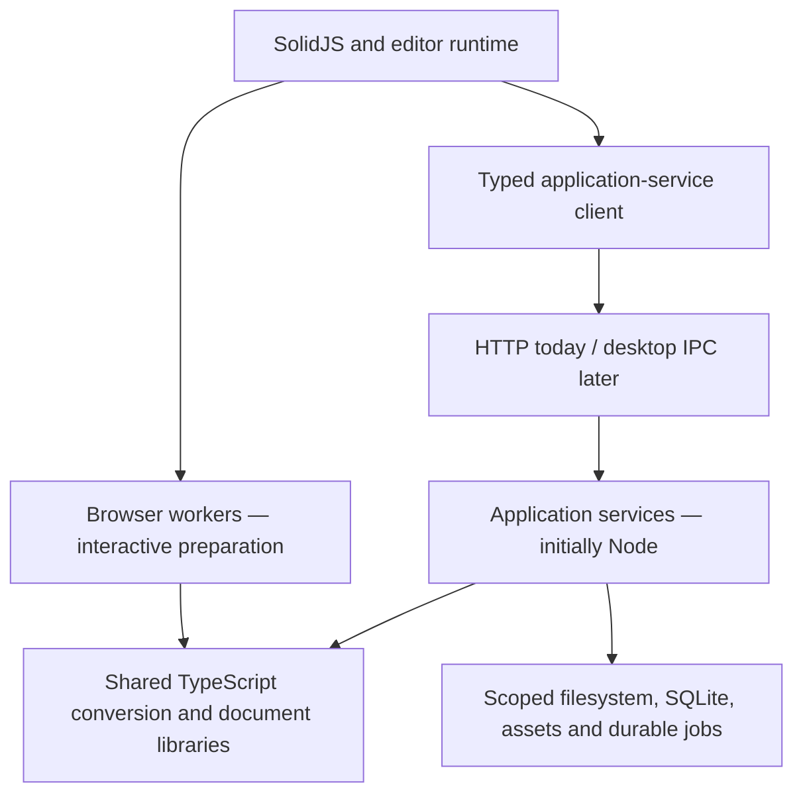

# Mutable OS Application Services and Desktop Architecture Review

Date: 2026-10-17  
Status: Architecture approved. The minimum Application Services Foundation is implemented, qualified and accepted; its qualification is recorded in [the foundation report](MUTABLE_APPLICATION_SERVICES_FOUNDATION_QUALIFICATION.md).

Mutable's existing Node backend is a suitable starting point for desktop application services. Retain SolidJS and the editor, preserve the shared TypeScript conversion libraries, and introduce a narrow service boundary around durable operations.

The main portability gap is where workflows are coordinated, rather than the conversion or storage implementations themselves. This review recommends incremental changes that support the current browser-hosted development environment, a future Electron application and a possible Tauri application.

This document records the approved architectural analysis. The minimum Application Services Foundation work in Section 7 is complete. The [Phase 3.6 plan](MUTABLE_PHASE_3_6_ARCHITECTURE_AND_IMPLEMENTATION_PLAN.md) is subsequently approved, with Stage A accepted and Stage B implementation authorized. Electron/Tauri implementation and Phase 4 advanced interchange remain outside authorization. The existing [Phase 3.5 architecture](MUTABLE_PHASE_3_5_ARCHITECTURE_AND_IMPLEMENTATION_PLAN.md) and qualified behavior remain the baseline.

## 1. Current boundaries

| Area | Current implementation | Recommendation |
| --- | --- | --- |
| Conversion and document models | Shared `src/interchange` and native-resource libraries; some entry points accept `Blob` and browser-oriented inputs | Retain the libraries. Adapt selected files into bounded byte inputs at the platform boundary. |
| Collection operations | `CollectionInterchange` combines Solid signals, editor access, HTTP, browser locks and job coordination | Separate the UI controller from the collection workflow incrementally. |
| Collection recovery | IndexedDB journal, keyed by Cavern; Web Locks coordinate browser tabs | Make the Cavern service the eventual journal and concurrency authority. |
| Native document storage | Durable generations, conflict checks, pending records and receipts already exist; some orchestration sits inside Express routes | Reuse the writer. Extract callable operations behind the existing routes. |
| Managed assets | Immutable Cavern store already separated substantially from transport | Preserve it; separate the browser image/object-URL cache from the asset-service client. |
| SQLite and PackageDataBlock | SQLite already runs in a Node worker with bounded, named operations | Retain this boundary and expose extraction through a typed service method. |
| Interchange workers | Browser workers perform explicit conversions; the fallback executes in the calling runtime | Retain browser workers for interactive preparation; use a host executor for durable jobs. |

Relevant implementation evidence:

- [Collection controller](src/runtime/collection-interchange.ts), [IndexedDB journal adapter](src/runtime/collection-journal.ts) and [collection dialog](src/rendering/collection-dialog.tsx).
- [Document interchange controller](src/runtime/document-interchange.ts), [worker executor](src/runtime/interchange-worker.ts) and [shared interchange operations](src/interchange/operations.ts).
- [Native session](src/persistence/native-session.ts), [native document routes](server/native-document-store.mjs), [managed writer](src/persistence/managed-pair.mjs) and [filesystem store](server/native-vault-store.mjs).
- [Managed asset client](src/runtime/managed-assets.ts), [immutable asset store](server/managed-assets.mjs) and [asset HTTP adapter](server/managed-assets-router.mjs).
- [Cavern lifecycle](server/cavern-lifecycle.ts), [SQLite host](server/sqlite-knowledge-host.ts), [SQLite worker client](src/knowledge-sqlite/client.mjs) and [logical package-data extraction](src/knowledge-sqlite/package-data.mjs).

The [Stage E qualification](MUTABLE_PHASE_3_5_STAGE_E_QUALIFICATION.md) documents the current browser recovery, storage, collection and typing checks. Those results do not establish cross-platform desktop durability or packaging compatibility.

## 2. Proposed ownership

Immediate typing, caret geometry, selection, IME, Undo/Redo, annotation rendering and interactive previews remain in the editor runtime. Explicit operations can capture a document snapshot or prepare an insertion plan, but services must not subscribe to keystrokes or own the live editor repository. Applying an asynchronous insertion still requires the existing destination, revision and selection checks before the editor commits it through its history infrastructure.

Document import/export, collection execution, `.inkpkg` generation and future publishing should become callable application workflows. Their contracts should contain identities, options, bounded inputs, diagnostics and operation outcomes, rather than Express requests, DOM elements, Solid signals or browser download APIs. PackageDataBlock extraction should remain a bounded, transactional knowledge-service operation that supplies the existing archival encoder.

Shared conversion and document-model code should remain TypeScript wherever practical. Browser file selection, downloads and `Blob` handling belong in adapters; the reusable transformations should accept text, bytes and document records. This does not require rewriting all existing entry points at once or introducing a second parser or document model.

A worker is an execution mechanism. It must not be the authority for whether a durable operation completed. Browser workers remain appropriate for interactive preparation and preview compilation. Durable jobs need a service-owned lifecycle and a bounded host executor so closing a view does not destroy the only record of the operation.

## 3. Narrow platform capabilities

| Capability | Intended contract |
| --- | --- |
| Filesystem | Read or enumerate within an authorized root; bounded reads; create-only publication; existing native save/conflict protocol. Use opaque grants and relative paths. |
| SQLite | Named operations such as package-data extraction and entity lookup, with transaction and cancellation boundaries. No frontend arbitrary-SQL interface. |
| Dialogs | Explicit open/import/export selections that return scoped grants and display metadata. |
| Clipboard | Read/write supported representations and report acknowledgement or fallback status, preserving the approved clipboard protocol. |
| Durable jobs | Create, inspect, checkpoint with an expected revision, claim execution, request cancellation and reconcile outcomes. |
| Managed assets | Existing lease, stage, publish, verify and original-byte retrieval operations. |
| Execution | Run bounded conversion/package tasks with cancellation and deadlines, using browser or Node workers as appropriate. |

HTTP and desktop IPC should implement the same application-operation contracts. Cancellation messages and progress subscriptions belong to transport adapters; a disconnect is not proof that a write failed. Avoid sending absolute filesystem paths or unrestricted filesystem, SQL or shell access to the renderer. Platform capability implementations must enforce grants and validate inputs independently of UI controls.

Preserve the existing operation distinctions: opening native Ink retains its identity and save destination; importing external content creates a new native document; embedding preserves authoritative external source within a Block; linking records an external relationship. Sharing adapters must not silently change ownership or overwrite an external source.

## 4. Cavern-scoped durable jobs

Use Cavern-scoped storage as the default wherever the Node service is available, including browser-hosted development.

A small, versioned filesystem journal under a proposed `.mutable/jobs/<job-id>/` is the minimum initial approach. It can reuse existing filesystem durability and locking primitives without adding job tables to the knowledge database. The path and schema are proposals, not implemented storage conventions.

Record:

- The reviewed plan, allocated identities, destination paths and source fingerprints.
- Completed, skipped, failed and pending items.
- The exact generation and immutable prepared bytes needed to reconcile an uncertain write.
- Checkpoint revisions and execution ownership.

Checkpoint updates require host-enforced concurrency control and durable publication before the corresponding external action is dispatched. Keep prepared inputs and journal sizes bounded, and avoid retaining a whole collection in memory.

The document writer's receipts remain authoritative for document publication; asset leases remain authoritative for asset publication. The job journal coordinates those systems rather than replacing them or claiming a single transaction across them.

After interruption, reconcile uncertain writes before dispatching more work. Resume remains explicit and requires source/destination revalidation. Cancellation stops future commits; it does not undo completed saves. Journal writes are operational bookkeeping and must not reintroduce document autosave. Editing continues to mark a document dirty until an explicit save.

IndexedDB can remain a web fallback, but it is origin-scoped and must not be treated as portable Cavern state. Browser-supplied source files may still require reselection after restart unless explicitly staged by the host. Desktop source access also requires reauthorization when grants expire. Durable job identity must be independent of a transient browser or Cavern session token; execution requires fresh authorization.

Existing Stage E journals must not be silently migrated or replayed. A later adapter migration should preserve their recovery semantics and receive focused qualification. Do not operate two independent journal authorities for the same job.

## 5. Initial Node application-service host

Reuse the existing Cavern lifecycle, native writers, immutable asset store and SQLite workers as the initial host. Extract application operations from route handlers only as needed; Express becomes an adapter around those operations.

Keep CPU-intensive conversion and package preparation off the service's main event loop. A host executor can call the existing TypeScript libraries in Node workers while the service owns job state, resource limits, cancellation and recovery. The browser worker fallback that runs in its caller is not sufficient isolation for long-running host jobs.

The browser development environment can continue using HTTP. A desktop adapter can invoke the same services over IPC without making HTTP part of their contracts. Packaging the entire development server unchanged is not the intended service boundary.

Retain the existing remote-acquisition consent, bounds and network security policy in the service. A desktop runtime must not bypass it through unrestricted renderer networking or filesystem APIs.

## 6. Electron and Tauri implications

Electron offers the shortest migration path for this repository; Tauri remains viable with a Node sidecar. This is an assessment of current code reuse, not a decision to select either desktop framework now.

| Consideration | Electron | Tauri |
| --- | --- | --- |
| Service reuse | Node is available in main and utility processes; an isolated utility process is a natural service host. | A Rust core can broker requests to a bundled Node sidecar. Existing Node services need not be rewritten immediately. |
| SolidJS frontend | Retained in a Chromium renderer. | Retained in the system WebView; platform-specific browser behavior requires qualification. |
| Application boundary | Narrow preload/context-bridge API and validated IPC. | Narrow commands and capabilities, with a restricted sidecar protocol. |
| Packaging work | Native Node modules need Electron-compatible builds. | Node runtime, worker files and native modules must be packaged for each supported target. |

These mechanisms are described in the official [Electron process model](https://www.electronjs.org/docs/latest/tutorial/process-model), [Electron native-module guidance](https://www.electronjs.org/docs/latest/tutorial/using-native-node-modules), [Tauri process model](https://v2.tauri.app/concept/process-model/), [Tauri Node sidecar guide](https://v2.tauri.app/learn/sidecar-nodejs/) and [Tauri sidecar packaging requirements](https://v2.tauri.app/develop/sidecar/).

For Electron, keep the renderer sandboxed and context-isolated. For Tauri, expose only the required commands and capabilities. Imported HTML previews and video frames must receive no application-service access. See [Electron security guidance](https://www.electronjs.org/docs/latest/tutorial/security) and [Tauri capabilities](https://v2.tauri.app/security/capabilities/).

Tauri does not require an immediate Rust rewrite of the document services. A Node sidecar preserves those implementations, with additional distribution and lifecycle work. A later Rust implementation could replace particular capability adapters after contract qualification; that is separate from preserving the TypeScript conversion library.

Current storage code uses `fs-ext` locking, no-follow filesystem flags and directory synchronization. Reusing Node does not establish Windows or cross-platform durability. Those guarantees need platform adapters and qualification; unavailable locking must not be replaced by a weaker in-memory lock. Native dependencies such as `better-sqlite3`, `sharp` and filesystem locking also need packaging qualification for each supported target.

## 7. Minimum preparation before Phase 3.6

After architectural approval:

1. Agree the typed service contracts and ownership boundaries above.
2. Extract only the native-read/export, asset retrieval and PackageDataBlock operations needed by publishing from their HTTP orchestration.
3. Introduce the Cavern job-store boundary for new durable workflows, including exact-outcome recovery.
4. Add a host execution adapter that invokes the existing TypeScript conversion/package libraries off the service's main event loop.
5. Qualify those boundaries against existing fixtures, conflict/recovery tests and concurrent typing behavior.

Moving all Stage E orchestration, replacing browser clipboard integrations, implementing desktop dialogs and packaging Electron/Tauri can follow separately. Phase 3.6 should not depend on rewriting already-qualified interchange behavior. Existing limits, immutable original assets, source preservation and manual-save semantics remain intact.

The qualification should establish equivalent results through the service boundary, explicit recovery after interrupted writes, safe rejection of stale destinations and bounded background work. Use the existing matched typing benchmark when implementation affects editor-triggered work; a worker boundary alone is not proof of responsiveness.

No static-site generation, themes, navigation, search or publishing implementation is included in this review. Phase 3.6 and Phase 4 require their own authorization.

## 8. Vault identity, portability and future replication

Clarification recorded 2026-10-17. A **Vault** is the complete workspace root: documents, assets, canonical knowledge and `.mutable` system data. **Cavern** is Flint's presentation of that workspace, not a second storage identity. This matches the current [lifecycle](server/cavern-lifecycle.ts), which assigns `cavernGuid` from the established `vaultGuid`. Existing names need not be renamed as part of publishing.

Keep logical Vault identity independent of its filesystem location. A filesystem root is an authorized location; a mount/context identity and session grant identify a particular activation. Neither replaces the logical Vault identity. Future replicas or read-only inspections can share provenance without sharing execution ownership, sessions or write authority.

The [application-service host](server/application-services/host.ts) already receives an explicit root, logical identity and scoped asset/knowledge capabilities. Publishing should retain that instance-bound model rather than resolve a global active Cavern during jobs. Contracts, workflows and platform adapters remain separate. The current single-active UI/HTTP lifecycle is an existing limitation, not a service-contract requirement. Future multiple hosts must retain separate authorization, storage, SQLite and preview contexts, with bounded aggregate execution resources.

### Canonical data versus local state

Storage beneath `.mutable` does not imply either portability or disposability. Classify by responsibility:

| Data | Future portability boundary |
| --- | --- |
| Native documents, stable identities, relative hierarchy, original immutable assets and portable references | Canonical Vault data; preserve across relocation and deliberate replication. |
| Authored knowledge and schema information | Canonical data, distinct from rebuildable indexes and caches. SQLite needs a consistent snapshot or logical replication protocol; copying live database/WAL files is not a synchronization design. |
| Site identities, scope/resource bindings, disclosure profiles and explicit public routes | Portable authored publication configuration. One document may belong to multiple independently configured sites. |
| Generated releases and manifests | Derived immutable artifacts, intentionally exportable; retention/replication policy is separate from authored configuration. |
| Jobs, execution leases, locks, staging, recovery receipts, caches and preview grants | Device-local operational state, even when durably stored inside the Vault. Do not synchronize or automatically replay another device's execution claims. |

Stage A's [site record](src/application-services/publication-contracts.ts) currently combines authored configuration with `active`, `releases`, `committedJobs` and a local concurrency revision. Its [storage](server/application-services/publication-storage.ts) persists these together. A future synchronization adapter must separate their meaning rather than merge or replicate the complete record blindly. `active` denotes the locally committed release, not a remotely deployed site's state; the revision is not a distributed conflict clock. Local receipts remain authoritative for local crash recovery. Preview grants are already memory-only and must never become portable authorization. No storage migration is required for current publishing.

### Future capabilities and present scope

S3-compatible storage is a future replication layer over local Vaults. It must not replace capabilities that require local locking, atomic publication, filesystem authority or SQLite transactions. A future synchronization service will exchange canonical state and immutable payloads using its own conflict/recovery protocol; local services continue operating against authorized local contexts.

Temporary archive inspection must use an isolated read-only context, never the active Vault's canonical knowledge database or asset store. Source provenance is distinct from mount authorization. Current host startup and journal facilities are writable, so they are not already an archive-mount implementation. Future inspection must withhold write capabilities and direct any necessary operational scratch work to a separate authorized local location; explicit import remains the operation that copies data into a writable Vault.

No inspected boundary prevents these future capabilities. The single-active lifecycle and mixed publication records are concrete future adaptation points, not reasons to rewrite qualified features now. Synchronization, temporary mounting, multi-Vault lifecycle changes and Electron/Tauri packaging remain outside Phase 3.6. Typing, selection, IME, previews and Undo/Redo remain editor-owned. Stage A and this amendment are accepted. Stage B — Directory Publication is now explicitly authorized; complete its qualification and stop for acceptance before Stage C. Stages C–D, Phase 4 and Electron/Tauri packaging require separate authorization.
