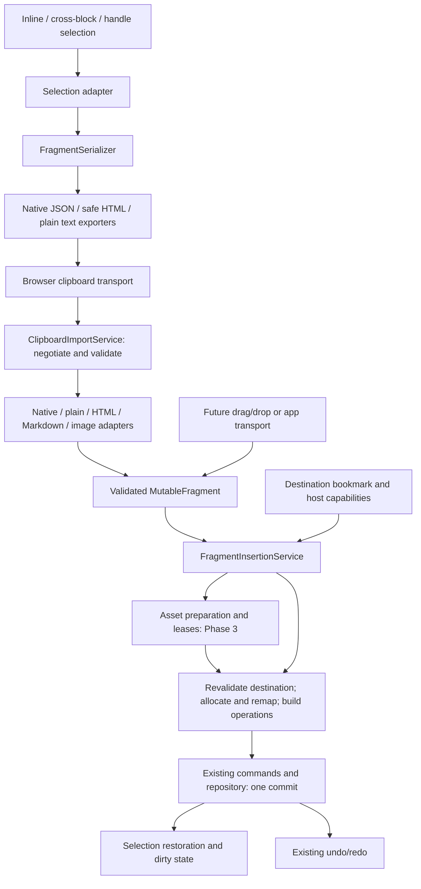

# Mutable Clipboard Architecture and Four-Phase Implementation Plan

Status: architecture and Section 8 defaults approved. Phase 1 implemented; see Section 10 for qualification and limitations. Phases 2–4 have not begun.

Prepared against the current repository on 15 October 2026. The supplied **Mutable OS — Native Clipboard & Content Interchange** brief requires approval of this document before Phase 1, and a separate design review before Phase 4.

The clipboard will exchange meaning and structure while creating new document objects. Native copy and all external importers will produce one versioned fragment, inserted through the existing Mutable command and history infrastructure. This is a shared engine feature, initially integrated into Flint, with SolidJS ownership at the application boundary. It does not introduce a UI framework, replace the editor, or change manual saving.

## 1. Current implementation inventory

### Clipboard and selection entry points

| Existing file / API | What it does now | Reuse and gap |
| --- | --- | --- |
| [`src/input/gateway.ts`](src/input/gateway.ts), `writeStandoffClipboard`, native copy/cut/paste listeners | Serializes selected inline text/image atoms to `text/plain` and an `application/json` envelope, `source: codex`, `format: standoff-inline-v1`. Rich paste inserts atoms through commands. | Keep input routing, mount identification and composition guards. The envelope does not preserve standoff properties or block metadata and is not a validated interchange format. Replace serialization/import delegation, not the input gateway. |
| [`src/input/multi-selection-editor.ts`](src/input/multi-selection-editor.ts) | Validates, sorts and replaces disjoint ranges in one inline content; uses descending edits and restores selections. | Reuse selection ordering and atomic replacement semantics. Current multi-range paste is plain text; define native grouping explicitly. |
| [`src/input/cross-block-input.ts`](src/input/cross-block-input.ts) | Routes cross-block selection input through a hidden textarea; copy/cut/paste use plain text. Cut handles a thrown clipboard write before deleting. | Preserve its focus, control exclusion and IME handling. Delegate clipboard conversion and insertion to the same services as inline selection. |
| [`src/runtime/cross-block-selection.ts`](src/runtime/cross-block-selection.ts), `resolve`, `selectedText`, `replace` | Resolves contiguous sibling text Blocks in one view. Rejects structural gaps and unsupported boundaries; joins copied text with newlines. | Reuse eligibility and occurrence identification. Do not silently extend selection across Pages, tabs or tables. Its existing feature preference defaults to **off**; this plan does not change that default. |
| [`src/runtime/block-selection.ts`](src/runtime/block-selection.ts), `actionTargets` | Resolves selected Block handles, scope and ancestor/descendant redundancy. | Reuse ordered action targets for whole-Block serialization. Handle selection is distinct from text selection. |
| [`src/runtime/block-clipboard.ts`](src/runtime/block-clipboard.ts) | Stores an in-memory `BlockFragment`; pastes after the selected Blocks or into a cut gap. A first cut/paste can retain source IDs. | Replace the private clipboard path with a transport adapter. Fresh identities are required even after a cut. Preserve current after-selection placement for handle paste. |
| [`src/rendering/block-selection.tsx`](src/rendering/block-selection.tsx), [`src/input/binding-catalog.ts`](src/input/binding-catalog.ts) | Handle/inspector UI intercepts clipboard events and invokes the internal Block clipboard; bindings describe that behavior. | Pass actual clipboard events into the shared coordinator. Route toolbar commands through a supported asynchronous clipboard path. Avoid a second competing global listener. |
| [`src/runtime/selection-snapshot.ts`](src/runtime/selection-snapshot.ts), [`src/runtime/text-ranges.ts`](src/runtime/text-ranges.ts) | Captures occurrence-aware text ranges. Text snapshots omit empty segments; validated text ranges are nonempty. | Reuse coordinate and occurrence concepts. Add a clipboard destination bookmark that can represent a caret, an empty Block and multiple selections; do not weaken the existing nonempty range contract. |

There are therefore three distinct clipboard paths today, with different fidelity and identity behavior. The new services must replace their conversion logic coherently rather than adding a fourth path.

### Model, mutations and rendering

| Existing file / API | Relevant behavior and constraint |
| --- | --- |
| [`src/block-tree/types.ts`](src/block-tree/types.ts) | Separates authored content from placements and projected occurrences. Contents have payloads, inline cells, children and owned/opaque relations. Runtime keys, projection keys and resource bindings are not portable document identities. |
| [`src/block-tree/clipboard.ts`](src/block-tree/clipboard.ts), `captureBlocks`, `cloneBlocks` | Captures an internal repository subgraph, linked annotation definitions and reference boundaries. Allocates identity maps and remaps known anchors/block references. Useful implementation machinery, but `BlockFragment` is a repository insertion representation, not the public interchange schema. It must remain behind an adapter. |
| [`src/block-tree/commands.ts`](src/block-tree/commands.ts), `replaceInlineRange`, `splitStandoff`, `replaceAcrossBlocks`, `insertFragment`, `transaction` | Supplies edit commands and transaction boundaries. The general transaction creates a repository draft; repeated commands inside it can repeat planning work. It is synchronous and must not contain awaited clipboard or asset work. Inline property mapping and splitting do not consistently distinguish point annotations from ordinary inclusive ranges. |
| [`src/block-tree/cross-text-edit.ts`](src/block-tree/cross-text-edit.ts) | Plans partial boundary replacement and newline splitting; preserves surviving cells. Currently clones the repository and rejects unsafe shared-content or attachment merges. Reuse its structural rules while avoiding a full plan per inserted atom. Do not relax its rejection rules merely to make paste succeed. |
| [`src/block-tree/repository.ts`](src/block-tree/repository.ts) | Validates and commits operation batches with inverse operations/history; offers location and reference-count bookkeeping and specialized fast paths. Use one commit for one paste, not a second undo system. |
| [`src/input/graphemes.ts`](src/input/graphemes.ts) | Inline indices count Unicode code-point cells; grapheme navigation/deletion is a separate concern. UTF-16 browser offsets need conversion. An embedded image occupies one inline position. |
| [`src/block-tree/annotation-commands.ts`](src/block-tree/annotation-commands.ts), [`src/rendering/standoff-editor-view.tsx`](src/rendering/standoff-editor-view.tsx), [`src/runtime/annotation-range-events.ts`](src/runtime/annotation-range-events.ts) | Ordinary stored standoff endpoints are inclusive. Rendering explicitly recognizes `isZeroWidth` and can represent a point at the end of a Block. Editing and rendering do not yet share a complete point-affinity policy. Phase 1 must close this gap. |
| [`src/block-tree/registry.ts`](src/block-tree/registry.ts), [`src/rendering/block-outlet.tsx`](src/rendering/block-outlet.tsx), [`src/rendering/register-core-views.ts`](src/rendering/register-core-views.ts) | Registered types select views dynamically. Some registered types load iframes/media. Registration is not evidence that an imported type is safe to instantiate. |
| [`src/rendering/unknown-block-view.tsx`](src/rendering/unknown-block-view.tsx) | Displays an unknown type and its children. This is not a security quarantine: descendants can still select registered views. Imported opaque content needs an explicitly inert fallback. |

### Relationships, resources and applications

| Existing file / API | Reuse and missing capability |
| --- | --- |
| [`src/block-tree/external-reference.ts`](src/block-tree/external-reference.ts) | Models scoped external Block, definition and asset targets, including unknown sources and version policies. It does not provide a Cavern-scoped entity target. Extend the appropriate resolution boundary rather than treating an entity GUID as globally resolvable. |
| [`src/feature-api/anchors.ts`](src/feature-api/anchors.ts), [`src/features/anchor-relationships/model.ts`](src/features/anchor-relationships/model.ts) | Anchors identify a target Block and offsets. Existing validation restricts relationships, including same-document eligibility. Remap copied targets, retain unresolved outside targets, and continue enforcing relationship constraints. |
| [`src/features/entity-references/document-entities.ts`](src/features/entity-references/document-entities.ts), [`src/knowledge/live-observer.ts`](src/knowledge/live-observer.ts), [`server/sqlite-saved-indexer.ts`](server/sqlite-saved-indexer.ts) | Entity references feed document inventory and live/saved indexing. Foreign unresolved references must not look like ordinary local entity values to these consumers. Cross-Cavern safety needs coverage beyond the clipboard importer. |
| [`src/persistence/native-resource.ts`](src/persistence/native-resource.ts) | Versioned native resource codec handles authored values, resource boundaries and definition ownership. Reuse its safe value conventions and boundary concepts, not a whole-document export as a selection fragment. |
| [`src/persistence/native-session.ts`](src/persistence/native-session.ts) | Tracks dirty documents and explicit save to the opened resource. Paste/cut should use the existing mutation notifications; copy must not dirty anything. No automatic JSON save or Markdown sidecar. |
| [`src/application/cavern-startup.tsx`](src/application/cavern-startup.tsx), [`server/cavern-lifecycle.ts`](server/cavern-lifecycle.ts) | Provide Cavern GUID and session fencing. Capture this context for asynchronous imports and reject stale results after a switch. Never put a local Cavern path or session credential in clipboard data. |
| [`server/index.ts`](server/index.ts), `/upload`, `/uploads` | Existing uploads accept selected image MIME types and use generated filenames. They do not provide the staged, deduplicated, bounded, rollback-aware asset lifecycle needed by Phase 3. A URL under `/uploads` is not a portable asset identity. |
| [`src/persistence/markdown.ts`](src/persistence/markdown.ts) | Exports a Markdown projection; this is not a Markdown importer or a managed-asset transport. Reuse supported semantic mappings where applicable, not its output as canonical clipboard data. |
| [`src/application/workspace-session.ts`](src/application/workspace-session.ts), [`src/application/document-application-capabilities.tsx`](src/application/document-application-capabilities.tsx) | Existing application/editor boundary for integration. The fragment library belongs below Flint, with application-specific capabilities supplied by adapters. |
| [`src/features/phosphor/view.tsx`](src/features/phosphor/view.tsx), [`src/features/phosphor/model.ts`](src/features/phosphor/model.ts) | Phosphor has glyph/rectangle semantics and custom clipboard formats. Preserve its current routing until a Phase 4 adapter can represent those semantics. Do not intercept opaque widgets in Phase 1. |

## 2. Architecture and responsibility boundaries

Proposed modules live in `src/interchange/` for transport-neutral data/conversion and `src/runtime/` or `src/input/` for editor/browser integration. Names are proposals, not files already implemented. Keep services small and use existing dependency injection and Solid ownership; do not introduce a general import platform.



| Boundary | Responsibility | Must not do |
| --- | --- | --- |
| `ClipboardCoordinator` / selection adapter | Choose the one active selection path; capture a versioned destination bookmark; coordinate native event or async transport and user feedback. | Hijack form fields, opaque applications or composition; derive selection from a whole-document DOM walk. |
| `FragmentSerializer` | Read only selected authored data and its owned dependency closure; clip and normalize ranges; produce native fragment and export representations. | Mutate the source, capture unrelated Blocks or resource contents, or resolve entities/network assets during copy. |
| Clipboard transport | Capture event strings/files before the event expires; write representations through the chosen browser API; report success/failure/capability. | Parse document semantics, invent synthetic OS clipboard access, or delete source text itself. |
| `ClipboardImportService` | Negotiate representations, apply limits, dispatch safe adapters, validate normalized output and return diagnostics. | Mutate the repository or silently fetch URLs. |
| Type policy adapters | Explicitly encode/decode safe authored metadata, range semantics, relationships and passive rendering capability. | Trust a registered type name as permission to execute it; perform arbitrary string replacement of IDs. |
| `FragmentInsertionService` | Resolve destination policy, prepare assets, allocate identities, remap relationships, split/merge once, and submit one validated operation batch. | Own a parallel history stack, perform asynchronous work inside a repository transaction, or invoke an edit command once per character. |
| Cavern asset service, Phase 3 | Validate/store/deduplicate binaries with session fences and rollback/recovery leases. | Save documents automatically or trust a clipboard URL as an authorized local path. |
| Application adapter | Declare supported types and destination operations; present diagnostics, loading/cancellation and selection restoration. | Implement a separate native format or insertion algorithm. |

Results use explicit outcomes: success with diagnostics, unsupported representation, invalid input, cancelled/stale destination, or storage failure. Partial fidelity must be disclosed. Imports do not silently discard a supplied annotation or image and report a lossless success.

Transient tasks and event handlers belong to the editor's Solid owner. `onCleanup` cancels work, releases asset leases and preview object URLs, and removes subscriptions. Canonical commit/history ownership remains in the repository. No Temporary Ranges, persisted annotations or renderer instances are created just to serialize or preview clipboard content.

## 3. MutableFragment schema proposal and examples

### Envelope and graph

Version 1 uses a JSON envelope plus an optional transport-side binary bundle. JSON must remain usable without that bundle; unavailable binaries become explicit unresolved assets. This is a proposal to freeze during Phase 1, not a claim of current wire compatibility.

```ts
type LocalId = string; // unique across all object tables in this fragment
type Json = null | boolean | number | string | Json[] | { [key: string]: Json };
type Affinity = "before" | "after";

type FragmentReference =
  | { kind: "local"; object: "block" | "definition" | "asset"; id: LocalId }
  | { kind: "external"; object: "block" | "definition" | "entity" | "asset";
      id: string; source: { cavernId?: string; resourceId?: string };
      revision?: string; placementId?: string }
  | { kind: "url"; url: string };

interface MutableFragment {
  kind: "mutable-fragment";
  version: 1;
  coordinates: "unicode-scalar-or-object-v1";
  roots: Array<{
    placement: LocalId;
    openStart: boolean; openEnd: boolean;
    clippedStart: boolean; clippedEnd: boolean;
    separatorAfter?: "paragraph" | "selection-gap";
  }>;
  blocks: Array<{
    localId: LocalId; type: string;
    data: { [key: string]: Json };
    inline?: {
      atoms: Array<{ kind: "text"; text: string }
        | { kind: "embed"; embed: LocalId }>;
      properties: FragmentProperty[];
    };
    blockProperties: Array<{
      localId: LocalId; type: string; attributes: { [key: string]: Json };
      target?: FragmentReference;
    }>;
    children: LocalId[]; // placement IDs, in order
    relations: { [relationName: string]: LocalId }; // owned placement IDs
  }>;
  placements: Array<{
    localId: LocalId; kind: "owned" | "reference";
    target: FragmentReference;
  }>;
  definitions: Array<{
    localId: LocalId; type: string;
    attributes: { [key: string]: Json }; target?: FragmentReference;
  }>;
  links: Array<{
    localId: LocalId; type: string;
    from: { object: "block" | "property" | "definition"; id: LocalId };
    to: FragmentReference; attributes: { [key: string]: Json };
  }>;
  embeds: Array<{
    localId: LocalId; type: string;
    asset?: FragmentReference; data: { [key: string]: Json };
  }>;
  assets: Array<{
    localId: LocalId; mediaType?: string; byteLength?: number; sha256?: string;
    source:
      | { kind: "managed"; cavernId: string; assetId: string }
      | { kind: "transfer"; transferKey: string }
      | { kind: "remote"; url: string }
      | { kind: "unresolved"; description: string };
  }>;
  provenance?: { producer?: string; cavernId?: string; resourceId?: string; sourceUrl?: string };
}

interface FragmentProperty {
  localId: LocalId; type: string;
  startIndex: number; endIndex: number; // half-open, unlike ordinary stored standoffs
  isZeroWidth: boolean; affinity?: Affinity;
  attributes: { [key: string]: Json };
  target?: FragmentReference;
}
```

`data` and `attributes` hold bounded authored values after type-policy conversion. Identity, range and graph fields are represented structurally, not duplicated inside an unchecked payload. Definitions represent copied shared annotation definitions, not an invitation to traverse an entire entity database. Source GUIDs can be kept in optional diagnostic provenance by a future extension, but are never allocation instructions.

Ownership must form an acyclic graph with valid parent constraints. Reference edges may share a local target without duplicating its content; cycles are handled as references, never recursively expanded. Terminal external references remain terminal. Root order and child order are significant. Optional unknown extension fields may be retained inertly within limits; unsupported major versions are not guessed.

`clippedStart/clippedEnd` describe source truncation. `openStart/openEnd` describe whether a text slice may join the destination boundary. They are independent: a text selection can encompass all characters without being a whole-Block handle selection. Handle roots are closed. Paragraph separators encode structural breaks, not characters inside a Block. A `selection-gap` records disjoint selections without pretending intervening text was copied. Empty selected Blocks remain represented.

### Coordinates and range normalization

Positions count Unicode scalar cells plus one position per embedded object. They do not count UTF-16 code units or grapheme clusters. For example, `A😀B` has length 3; a combining sequence may occupy multiple positions. Native serialization preserves text exactly, including Unicode normalization and literal line breaks. UTF-16 conversion is performed once per relevant content when needed by a browser selection adapter.

Ordinary fragment ranges use `[startIndex, endIndex)`. Exporting an ordinary canonical inclusive property adds one to its end; importing subtracts one. A point has equal endpoints **and** `isZeroWidth: true`; a stored ordinary property with equal inclusive endpoints is one character, not a point. Fragment points also carry affinity. Range validation checks integer bounds against the atom length, including the permitted point at `length`.

### Example A: partial text, an entity reference and a point annotation

Copy the word `Rome` from inside a longer Block. The following is a complete minimal envelope. The point type is illustrative; an unrecognized type is preserved through the inert-property policy.

```json
{
  "kind": "mutable-fragment",
  "version": 1,
  "coordinates": "unicode-scalar-or-object-v1",
  "roots": [{"placement":"e1","openStart":true,"openEnd":true,"clippedStart":true,"clippedEnd":true}],
  "blocks": [{
    "localId":"b1", "type":"standoff-editor-block", "data":{},
    "inline": {
      "atoms":[{"kind":"text","text":"Rome"}],
      "properties":[
        {"localId":"p1","type":"codex/entity-reference","startIndex":0,"endIndex":4,"isZeroWidth":false,"attributes":{},
         "target":{"kind":"external","object":"entity","id":"entity-rome","source":{"cavernId":"cavern-a"}}},
        {"localId":"p2","type":"example/bookmark","startIndex":4,"endIndex":4,"isZeroWidth":true,"affinity":"before","attributes":{"label":"end"}}
      ]
    },
    "blockProperties":[], "children":[], "relations":{}
  }],
  "placements":[{"localId":"e1","kind":"owned","target":{"kind":"local","object":"block","id":"b1"}}],
  "definitions":[], "links":[], "embeds":[], "assets":[],
  "provenance":{"producer":"Mutable","cavernId":"cavern-a","resourceId":"document-a"}
}
```

On import into the same Cavern, `p1` receives a new property GUID while its verified entity target remains shared. In another Cavern it stays a scoped unresolved reference unless an explicit resolver establishes the target. `p2` remains a point at offset 4; it does not become a one-character range or disappear at the end boundary.

### Example B: two whole Blocks with an internal anchor

This complete envelope copies a note anchored to another copied Block. No source authored Block GUID becomes a destination identity.

```json
{
  "kind":"mutable-fragment", "version":1, "coordinates":"unicode-scalar-or-object-v1",
  "roots":[
    {"placement":"e1","openStart":false,"openEnd":false,"clippedStart":false,"clippedEnd":false,"separatorAfter":"paragraph"},
    {"placement":"e2","openStart":false,"openEnd":false,"clippedStart":false,"clippedEnd":false}
  ],
  "blocks":[
    {"localId":"b1","type":"standoff-editor-block","data":{},"inline":{"atoms":[{"kind":"text","text":"A note"}],"properties":[]},"blockProperties":[],"children":[],"relations":{}},
    {"localId":"b2","type":"standoff-editor-block","data":{},"inline":{"atoms":[{"kind":"text","text":"Its target"}],"properties":[]},"blockProperties":[],"children":[],"relations":{}}
  ],
  "placements":[
    {"localId":"e1","kind":"owned","target":{"kind":"local","object":"block","id":"b1"}},
    {"localId":"e2","kind":"owned","target":{"kind":"local","object":"block","id":"b2"}}
  ],
  "links":[{"localId":"l1","type":"anchor","from":{"object":"block","id":"b1"},"to":{"kind":"local","object":"block","id":"b2"},"attributes":{"offset":{"x":12,"y":8}}}],
  "definitions":[], "embeds":[], "assets":[]
}
```

The anchor adapter converts `l1` to the current canonical anchor representation after both destination Block IDs exist. If the target was not copied, `to` would instead carry a scoped external Block reference. It must not attach to an unrelated destination Block with a matching unqualified ID.

### Example C: a managed inline image

This is a schema excerpt to combine with the envelope above, not an independently complete fragment. An image Block uses the same asset reference through its type adapter.

```json
{
  "inline": {
    "atoms":[{"kind":"text","text":"See "},{"kind":"embed","embed":"i1"}],
    "properties":[]
  },
  "embeds":[{
    "localId":"i1","type":"inline-image",
    "asset":{"kind":"local","object":"asset","id":"a1"},
    "data":{"alt":"Map of Rome","width":640,"height":480}
  }],
  "assets":[{
    "localId":"a1","mediaType":"image/png",
    "source":{"kind":"managed","cavernId":"cavern-a","assetId":"asset-map"}
  }]
}
```

The atom length is 5. `transferKey` is the alternative for an explicitly supplied binary bundle item; it is not a runtime `blob:` URL or filesystem path. Remote and unavailable images retain a descriptor and alt text without automatically loading. Phase 1 can reuse a verified available same-Cavern asset and otherwise display an unresolved placeholder. Phase 3 adds binary import, deduplication and portable storage. The fragment's fields do not change between these phases.

## 4. MIME negotiation, browser compatibility and security

### Transport and export

For native copy, produce plain text, escaped semantic HTML, and `application/x-mutable-fragment+json` when accepted. Do not continue writing a generic `application/json` payload. Read the old `standoff-inline-v1` format only through a bounded compatibility adapter. Optional `text/markdown` export is not required by Phase 1 and never becomes a document autosave format.

Native clipboard events and asynchronous clipboard calls are distinct transports. Event handlers access `clipboardData` synchronously and cancel default handling when taking ownership. Async clipboard use is subject to secure-context, focus, activation and permission constraints. Synthetic events cannot provide OS clipboard access. Choose one transport per operation; do not race an event write against a subsequent async write. [W3C Clipboard API and events](https://www.w3.org/TR/clipboard-apis/)

Async web custom formats use the spelling `web application/x-mutable-fragment+json` in `ClipboardItem`, with the underlying JSON Blob media type unprefixed. This is separate from the raw event MIME name. Chromium documents this facility, but it is not a portable prerequisite. [Chrome: web custom formats](https://developer.chrome.com/blog/web-custom-formats-for-the-async-clipboard-api)

Feature-detect methods and `ClipboardItem.supports` where available; still catch operation failures. A supported API does not promise that another application or the OS retains a custom representation. Prefer one clipboard item carrying multiple representations. UI copy/paste buttons use async APIs when available; otherwise explain the keyboard action rather than pretending a synthetic paste worked. [MDN: ClipboardItem](https://developer.mozilla.org/en-US/docs/Web/API/ClipboardItem)

Firefox, Safari and Chromium differ in activation, read prompts and clipboard permission handling. Do not make a successful `navigator.permissions.query({name: ...})` a prerequisite on every browser. Exercise actual native keyboard and button paths in the browser compatibility checks. [MDN: Clipboard API](https://developer.mozilla.org/en-US/docs/Web/API/Clipboard_API)

### HTML carrier and degraded interoperability

The safe HTML exporter includes a bounded, versioned `data-mutable-fragment` carrier on its wrapper, containing base64url-encoded native JSON. Visible content is useful semantic HTML even if the marker is removed. Include a digest binding the payload to its exported text projection to detect stale carriers after outside edits; this is a consistency check, **not** authentication. Verify the visible text projection before accepting the carrier. If it no longer agrees, use the visible representation and report that native fidelity was unavailable.

Treat a retained carrier exactly like untrusted custom MIME data. Extract it with a non-executing parser; validate size, version, graph and types before use. Sanitization or another application may strip/rewrite it. WebKit's documented sanitization and custom-data behavior illustrates why retention must not be assumed. [WebKit: Clipboard API Improvements](https://webkit.org/blog/8170/clipboard-api-improvements/)

A session cache may optimize repeat operations only when a matching unguessable copy token is actually present in the current clipboard carrier and its content agrees. Never paste an old internal fragment merely because the current plain text looks identical, or because the OS read failed. A cut recovery buffer is a separate, explicit recovery mechanism, not a hidden clipboard substitute.

### Import priority

1. An explicit **Paste as Plain Text** request selects `text/plain` and ignores rich/native representations. Missing plain text may be derived from a safely parsed supported representation, with no formatting or asset fetch.
2. An explicit **Paste as Markdown** request, introduced in Phase 3, selects a supplied Markdown representation or interprets supplied plain text intentionally.
3. Normal paste prefers a valid supported native custom representation, then a valid HTML carrier, then the bounded legacy native adapter.
4. Phase 2 adds safe semantic HTML. Before that, use supplied plain text, or a minimal safe HTML-to-text extraction when no plain representation exists. Phase 1 does not import arbitrary external formatting.
5. Phase 3 adds an explicit Markdown MIME representation when native/HTML are absent, and image-file inputs. A clipboard string that merely looks like Markdown remains ordinary text.
6. Fall back to plain text where possible. If nothing usable exists, leave the destination unchanged and explain why.

Malformed native data never bypasses validation. A safe fallback can be offered or applied with a visible fidelity notice; a fragment requiring unsafe or ambiguous structural changes is rejected without deleting the destination. Pasting an empty clipboard is a no-op, not a request to erase selected content.

When HTML and images coexist, the HTML order is authoritative. Match supplied files to explicit image descriptors where possible; do not paste both the rich representation and duplicate loose image representations. If the clipboard contains only files, preserve their supplied order. Ambiguous unmatched files require a notice or an explicit choice rather than guessed placement. This reconciliation lives in import negotiation, not in the insertion engine.

`Cmd/Ctrl+Shift+V` uses the existing binding infrastructure to record a one-use plain-paste intent for the next trusted paste in the same editor. Clear it on completion, timeout, blur or composition changes. Do not intercept the native shortcut in a way that prevents the browser from delivering clipboard data. Native controls and other applications retain their own shortcuts.

### Security and bounded work

- Parse JSON into a validated schema; reject duplicate local IDs, invalid references, ownership cycles, non-finite numbers, invalid ranges, excessive depth and prototype-polluting keys. Do not merge unchecked payload objects into editor state.
- Clipboard data is untrusted even when it claims to originate from Mutable or the current Cavern. Provenance identifies a possible source; it grants no authority to open resources or read files.
- Import passive, explicitly supported types through reviewed adapters. Quarantine unknown or active types in inert `mutable/opaque-block` or `mutable/opaque-property` representations containing the original identifier and bounded payload. Preserve range/relationship descriptors without executing them. Their renderer shows a safe label/preview; it does not recursively instantiate embedded registered types. Installing a matching type later must not automatically activate quarantined content.
- Do not transport renderer code, event handlers, component names as executable instructions, arbitrary CSS, runtime subscriptions, DOM, session credentials or absolute local paths. Unrecognized payload fields remain inert data only when they meet the bounded-data policy.
- Parse HTML using a network-inert AST parser; never mount imported HTML or use `innerHTML` as an import shortcut. Detached `DOMParser` documents can still fetch some resources, so merely calling the parse “inert” is insufficient. [MDN: DOMParser.parseFromString](https://developer.mozilla.org/en-US/docs/Web/API/DOMParser/parseFromString)
- Allow semantic tags and a small parsed style subset only: emphasis, supported decoration, super/subscript and supported highlight colors. Strip scripts, event attributes, stylesheets, layout CSS, iframes and active embeds. Links allow validated `https`, `http` and `mailto` schemes; local anchors use typed reference handling. Reject executable/file schemes and HTML data URLs. Images have a separate Phase 3 policy.
- Never fetch remote images automatically. Phase 3 requires explicit consent for the proposed source set, constrained redirects, byte/type limits and a server-side private-network/file-access policy if proxy fetching is used. Reject unsupported sources without network activity. Native same-Cavern reuse also verifies the asset belongs to that Cavern.
- Initial configurable limits: 8 MiB total textual clipboard representations; 200,000 inline positions; 10,000 Blocks; 20,000 properties; nesting depth 64; 256 KiB for one opaque payload. Phase 3 starts with 20 MiB per image, 50 MiB per operation and a decoded-pixel limit of 40 megapixels per image. Validate both before and during expansion. These are safety ceilings, not responsiveness targets; no silent truncation.

Large allowed imports must prepare outside the synchronous edit transaction, yielding or using a worker for expensive pure parsing. A threshold around 10,000 inline positions is an initial profiling point, not a promise that every smaller import is fast. Cancellation and destination revalidation are required. Ordinary typing does not run this pipeline.

## 5. Identity, references, ranges and transactions

### Two-pass identity allocation

1. Validate the fragment and determine the destination plan, including which boundary slices merge and which objects need materialization. Allocate fresh persistent IDs and runtime keys for every newly created Block, placement, standoff property, block property and copied definition. Allocate even where legacy data omitted an ID. Record maps by fragment-local identity, not source GUID string.
2. Resolve local relationships against those maps; install children, owned relations, anchors and linked definitions. Resolve semantic/external targets through their type policy and scope. Validate the resulting operation graph before a single commit.

Every paste creates fresh owned identities, including paste after cut and repeated paste of the same clipboard. Undo/redo restores the identities allocated by that particular operation; redo does not allocate again. Existing destination Blocks that receive a partial text insertion retain their identities because they are not newly pasted Blocks. Shared definitions within one fragment remain shared after remapping, with one new definition identity.

Only known typed references are rewritten. An arbitrary string equal to a GUID is not evidence of a relationship. Duplicate or ambiguous source identities cannot be repaired by global string substitution. Unknown relationships remain explicitly unresolved/inert with diagnostics.

### Scope and semantic targets

| Target | Policy |
| --- | --- |
| Entity in the same Cavern | Preserve the target entity identity when the existing resolver confirms that scope. The annotation receives a fresh ID. No entity creation and no full entity scan during paste. |
| Entity in another/unknown Cavern | Preserve a scoped unresolved target and display it as unresolved. Do not bind a coincidentally matching local GUID or duplicate/import an entity automatically. Explicit resolution/import is a later action. |
| Copied Block / definition | Use the newly allocated local target. Preserve within-fragment sharing and validate the relation's allowed topology. |
| Unselected Block in the destination's eligible resource | Retain the scoped external reference if the relationship policy permits it. An anchor still obeys existing same-document, self and cycle rules. |
| Unselected Block in another resource | Preserve unresolved reference/provenance. Do not bring along the target document, follow it recursively, or fabricate an anchor to a local Block. |
| Hyperlink | Preserve a validated URL as semantic data; creating a property does not navigate or fetch it. |
| Asset | Reuse only a verified same-Cavern managed asset. Cross-Cavern or unavailable assets remain unresolved until a Phase 3 transfer/import succeeds. |
| Comment/contextual annotation | Allocate a new instance; preserve safe authored content and original provenance. Clear runtime interaction state. Apply a type-specific policy to contextual attribution rather than inventing new authorship. |

Cross-Cavern entity handling needs an additive canonical scoped-reference representation plus adapters for rendering, entity lookup, backlinks, live indexing and saved indexing. A foreign target must **not** be left in a naked local `value` field that existing consumers will resolve incorrectly. Until a consumer understands the scoped form, use the inert unresolved representation. This is a Phase 1 safety prerequisite, not deferred polish. Ensure it round-trips through the native codec without changing the opened filename or forcing a migration of every document.

### Selection and standoff rules

For a selected text interval `[s,e)`, copy each ordinary annotation's intersection and translate endpoints by `-s`. Omit empty intersections. Preserve safe metadata and target identity under its policy; allocate a new property on paste. Crossing selections may produce independent clipped instances in separate output slices. Do not accidentally merge distinct overlapping annotations just because their types/ranges match.

Point annotations use these explicit rules:

- Include a point strictly inside `[s,e)`.
- At `s`, include an `after`-affinity point; at `e`, include a `before`-affinity point.
- For legacy points without affinity, default to `after`, except at the end of a Block where the default is `before`.
- Whole-Block handle copy includes all points, including points in an empty Block. A collapsed text selection does not implicitly copy its Block or point annotations.
- Rebase without changing `isZeroWidth`. Adjacent selected slices must not duplicate the same source point; apply inclusion once per selected occurrence.
- At an insertion boundary, `before` stays before inserted content and `after` moves after it. A point consumed by a deletion is removed; a retained boundary point maps to the surviving boundary. Cut uses the same inclusion set for serialization and deletion, so it cannot delete an excluded boundary point.

Use a shared, narrow position-mapping helper for clipboard insertion and the split/replace primitives it depends on. Update those commands' missing point behavior and test it; do not introduce an unrelated general annotation refactor. If an existing range splits into two independent destination annotations, retain its ID on one surviving piece and allocate a fresh ID for the other.

### Destination behavior

| Destination / input | Insertion rule |
| --- | --- |
| Collapsed caret + single open text slice | Insert inline into the current Block, preserving destination Block identity and metadata. |
| Selected text within one Block | Replace exactly the selected content; map surviving destination properties once and insert imported properties at the rebased offset. |
| Eligible cross-block text selection | Reuse sibling/order/ownership restrictions. Preserve the surviving prefix and suffix and their annotations; replace the selected middle in one operation. |
| Multiple text roots | Join an open first/last slice only when destination types and attachment rules allow it. Create fresh middle Blocks. Closed whole-Block roots retain their own newly allocated Block identities. |
| Boundary slice targeted by an internal Block relationship | Materialize a new Block so the relationship has a stable copied identity. Do not erase that identity by merging it into an unrelated destination Block. Report any required structural separation. |
| Whole-Block handle selection | Paste **after** the last selected Block, consistent with current UI. A prior cut gap is a valid destination. This does not implicitly replace selected handles. Text paste-over-selection is supported independently. |
| Disjoint inline selections | One input group is replicated to each destination range with fresh identities per copy. If group counts match, pair them in order. Other multi-group/multi-range combinations reject with a clear message rather than silently distributing content. Commit all replacements together. |
| Unsupported structural boundary / shared-content merge | Reject without changing content, with a reason. Do not flatten Pages, detach transclusions, or discard margins/children to force a paste. |

Text selection across unsupported structural containers is not expanded in Phase 1. Existing handle selection can copy eligible whole containers, preserving children and relations through safe adapters. Plain text fallback is explicitly less expressive.

Map existing destination properties using the editor's insertion semantics: insertion strictly inside a range extends it; insertion at its exterior edge does not unexpectedly inherit it. Deleting selected content clips/removes affected ranges and preserves independent overlaps. For boundary joins, destination formatting/metadata belongs to its surviving text; source Block metadata belongs to newly materialized Blocks. Empty structural Blocks may be omitted only if they have no retained annotations, children, relations or required identity.

### Atomic paste, async preparation and undo

Capture the destination's view, content/placement identity, selection version, relevant content revisions and Cavern session before awaiting work. Retain an occurrence-aware bookmark; do not keep a live DOM Range as authority. After parsing/asset preparation, verify that the same eligible destination still exists and is unchanged. Cancel stale work with a notice instead of inserting at a new caret or switching documents unexpectedly. Do not hold a transaction open while the user types.

Build one insertion plan from the fragment, then commit one operation batch through the current commands/repository. A narrow `insertMutableFragment` command can adapt to the internal `BlockFragment` and existing edit operations. Avoid serializing/revalidating the whole repository per atom. Some general repository validation may still occur once for a structural paste; this is not a reason to put it into ordinary typing.

One paste and one cut each produce one undo step. A cut followed later by paste is two independent user operations, not a cross-document atomic move. Copy has no commit or history entry. Failed/cancelled imports have no edit or undo entry. Selection restoration follows commit/history application; correct caret/IME behavior must not depend on a second document mutation. Dirty state follows the existing resource notification, and save remains explicit.

### Safe cut protocol and browser acknowledgement limits

Prepare and validate a complete recovery fragment and the exact deletion plan before writing. Choose one of two transport protocols:

1. **Acknowledged async write:** await successful clipboard write, then revalidate the unchanged source selection and Cavern context before one delete commit. Failure leaves source content intact. If the source changed while writing, keep it intact even though copying succeeded.
2. **Trusted native event:** synchronously set mandatory fallback representations and the supported native representation, checking for exceptions. Keep a bounded lossless recovery fragment before cancelling the event and committing deletion. Do not delete if required writes, recovery capture or validation fail. Retain recovery alongside the source editor's undo lifetime so custom-format stripping does not lose the only rich copy.

The event API does not provide a durable OS write receipt. Protocol 2 is therefore an explicitly recoverable equivalent, not a claim of guaranteed OS delivery: undo and recovery retain the cut data if an external consumer cannot retrieve it. It also does not promise crash durability. If this tradeoff is unacceptable, the strict alternative is copy-only/no deletion on platforms without an acknowledged write; this is a review decision in section 8. Never delete first and attempt to serialize afterward. Internal Block cut must adopt the same rule.

### Phase 3 asset transaction boundary

Validate MIME signatures, decoded dimensions, sizes and permitted source before storage. Deduplicate by verified content hash within the destination Cavern. Stage blobs under a scoped lease; make successfully staged blobs durable before publishing canonical references. Revalidate destination/session, then commit document operations once and finalize the lease. On failure/cancellation, release new unreferenced blobs; never delete a reused asset.

Filesystem writes and an in-memory editor commit are not a distributed atomic transaction. Use a small recovery ledger for interrupted staging/finalization and delayed collection of abandoned leases. Track live documents, undo/redo retention and persisted references before reclaiming assets. Undo removes inserted objects but must leave assets available for redo. A process interruption must not leave a committed document pointing to a missing blob. This is necessary asset work, not permission to autosave documents.

## 6. Four-phase implementation plan

### Phase 1 — Native clipboard and common insertion

Dependencies: approval of this document and the blocking policy defaults in section 8. No Phase 2/3 parser or Phase 4 UI dependency.

Tasks, in dependency order:

1. Add a default-on `mutableClipboard` feature flag using existing feature/preference conventions. Gate the complete new route, not individual handlers that can both fire. Preserve current defaults for unrelated features, including cross-block selection.
2. Add the versioned fragment types, bounded validator, type policies and safe opaque representations. Build native serializer adapters for inline, cross-block and handle selections, preserving empty Blocks and selected owned dependencies.
3. Implement shared range clipping/point-affinity helpers, a destination bookmark, two-pass identity remapping, and one insertion planner. Reuse repository operation validation and history. Cover scoped unresolved entities/anchors across lookup and indexing consumers before enabling foreign imports.
4. Add native event and async clipboard transports, safe HTML/plain exporters, carrier extraction, native/legacy/plain importers and diagnostics. Do not import external rich formatting yet. Integrate copy/cut/paste and plain-paste intent through the existing routing points.
5. Replace internal Block clipboard authority with transport/coordinator delegation. Preserve after-selection and cut-gap destinations, but remove identity retention in the new cut/paste path. Native custom-type absence must not trigger stale internal paste.
6. Add acceptance tests and browser checks; compare real Flint typing before/after integration. Complete the implementation report and a small demonstration covering native fidelity, fallback and undo.

Deliverable: native clipboard in Flint/editor, shared core contracts, bounded legacy read compatibility, concise notes and limitations. No external rich importer beyond text fallback, no asset download/upload expansion, and no advanced paste menu.

Acceptance:

- Single, multi-Block, partial and handle copies preserve supported native text, metadata, overlapping properties, points, owned structure and copied relationships.
- Every new owned object has a fresh identity; repeated paste and cut/paste cannot collide. Entity targets remain shared within the verified scope.
- Outside targets and foreign assets/entities are retained unresolved rather than misbound or silently duplicated. Unknown types have an inert visible fallback and retain safe data on save/reload.
- Paste-over-text-selection, supported boundary merges, disjoint range policy and selection restoration are deterministic. Copy leaves the source and dirty state unchanged.
- Cut follows the approved safe protocol; a failed write does not delete. Each successful paste/cut is one undo step and restores accurately through redo.
- Plain paste removes imported formatting; native-format stripping degrades predictably with a notice where fidelity is lost. Existing widgets, IME and normal keyboard input still work.

### Phase 2 — External semantic HTML and text

Dependencies: Phase 1's fragment, insertion, diagnostics and security boundaries. Add a default-on external-HTML import flag when this new feature ships; retain the native route independently.

Tasks:

1. Evaluate the existing `@atjson/source-html` / `@atjson/offset-annotations` dependencies against network-inert parsing and index-conversion requirements before selecting another parser. Do not assume an installed parser already satisfies the sanitizer policy.
2. Implement one safe HTML AST-to-fragment adapter. Map paragraphs/headings to the existing text Block/Block-property conventions, emphasis/link/highlight/super/subscript to supported properties, and lists/tables to existing container/row/cell types. Reuse registry capabilities; do not invent a second document model.
3. Specify whitespace and line-break conversion: normal HTML whitespace follows semantic flow; `<br>` is an inline break; block boundaries become structural separators; preformatted/code whitespace is retained. Normalize CRLF/CR from external plain text to native line breaks, retaining literal Unicode text otherwise. Preserve empty paragraphs intentionally rather than trimming them globally.
4. Map nested inline styles by ranges in the resulting text, not original HTML source offsets. Handle malformed nesting deterministically. Strip foreign layout and unsupported CSS; flatten unsupported passive wrappers while retaining text and reporting unsupported semantics.
5. Preserve image source/alt descriptors as inert placeholders for Phase 3, at the correct text positions. Do not load images merely because HTML includes them. Preserve a supplied safe source URL only when actually available; do not infer it from browser history.

Deliverable: browser/office HTML and plain-text import adapters using unchanged fragment insertion, with semantic fixtures and interoperability notes.

Acceptance: representative nested paragraphs, headings, lists, basic tables, links, emphasis, highlights and super/subscript produce native structures/ranges; unsafe content does not execute or fetch; unsupported semantics degrade visibly; mixed image placeholders remain ordered; one undo reverses the entire paste. Plain fallback works when rich import is unavailable.

### Phase 3 — Managed images and explicit Markdown

Dependencies: Phase 1 insertion; Phase 2 semantic conversion policies for reuse; an approved managed-asset storage/lease contract before implementation of image persistence. Add default-on flags for the new image and explicit-Markdown import capabilities.

Tasks:

1. Implement the Cavern asset service described in section 5, building on current scoped server access rather than treating `/upload` as transaction-safe. Add signature/pixel/byte checks, hashes, deduplication, relative portable references, lease rollback and interrupted-operation recovery.
2. Import clipboard image files/blobs and reconcile HTML image descriptors in source order. Preserve alt text/dimensions, create fresh image object identities, and reject unsupported/ambiguous sources safely. Reuse managed same-Cavern assets; never reuse a foreign `/uploads` URL by string equality.
3. Add explicit remote-image consent and constrained fetching, or retain unresolved placeholders when consent is declined. Validate after redirects and guard server-side network destinations if fetching is proxied. No hidden fetch on paste, preview or fallback rendering.
4. Add a Markdown AST adapter for a documented CommonMark plus basic GFM tables subset. Map headings, lists, tables, code, formatting, links and images through the same semantic and asset policies. Disable raw active HTML. Select a maintained parser after checking existing dependency capabilities; a CodeMirror language mode alone is not a conversion pipeline.
5. Offer a minimal command for **Paste as Markdown** and accept explicitly supplied Markdown MIME data. Ordinary `text/plain` containing `#`, `*` or backticks stays literal. Keep advanced interpretation UI for Phase 4.

Deliverable: persistent portable images and explicit Markdown imports, asset error/recovery handling, and concise supported-format documentation.

Acceptance: single/multiple images and HTML mixed with images preserve order and survive explicit save/reload and Cavern relocation. Deduplication never aliases unauthorized foreign assets. Failed preparation leaves the document unchanged and releases newly staged assets; interrupted leases recover. Undo/redo retains needed blobs. Markdown yields supported native structures, while identical ordinary plain text remains literal.

### Phase 4 — Paste choices and broader interchange

Dependencies: preceding phases and a **separate product/design review**. Do not implement this phase merely because Phase 3 is complete.

Proposed scope for that review:

- Contextual rich/plain/Markdown/link interpretations that call existing import modes, not post-hoc mutation chains creating extra undo steps.
- Drag/drop transport over the same fragment and destination contracts. Define copy versus true move explicitly; clipboard's fresh-identity rule must not accidentally redefine an existing move command.
- Capability adapters for Flint/Ink and, incrementally, Phosphor, Canvas, Spatial/Studio and Workbench. Preserve Phosphor glyph/rectangle and spatial placement semantics as typed extensions with a safe fallback; do not flatten them silently.
- Reusable fragment templates and narrowly justified semantic transformations. Templates use local IDs and get fresh destination identities on each insertion.
- Consumer capability reporting: show supported projections while retaining unsupported inert data, or ask before an explicitly lossy conversion. Do not create parallel clipboard schemas per application.

Deliverable: the reviewed subset of optional interactions and app adapters, with demonstrations and declared unsupported cases. Add default-on flags for approved major additions; do not pre-enable unfinished consumers.

Acceptance: supported consumers use the same schema, validation and insertion contracts; transport changes do not change range/identity/asset behavior; unsupported content has a visible safe fallback; transformations and paste choices preserve one-operation undo. Phase 1 remains usable without any Phase 4 UI.

## 7. Holistic integration matrix

### Shared architecture across phases

| Layer | Phase 1 | Phase 2 extension | Phase 3 extension | Phase 4 extension |
| --- | --- | --- | --- | --- |
| Fragment | Versioned Blocks, slices, properties, points, refs, asset descriptors | Same model from HTML semantics | Same model plus supplied asset bytes and Markdown conversion | Typed app extensions; no competing envelope |
| Selection / destination | Existing inline/cross/handle routes and bookmarks | Unchanged | Async preparation uses the same stale-destination checks | App-specific destination capability adapter |
| Negotiation | Native, carrier, bounded legacy, plain | Safe external HTML | Explicit Markdown, files and HTML/file reconciliation | User interpretation or drag/drop transport |
| Insertion / identity | One planner, two-pass remap, one repository commit | Unchanged | Asset leases complete before commit | Same contract; reviewed transformations before insertion |
| References | Local remap, scoped external/unresolved | Safe URL semantics | Managed asset resolution | Additional declared semantic target adapters |
| Rendering / lifecycle | Existing editor plus inert fallbacks | Existing supported views | Existing image views with managed sources | Consumer projection with independent ownership |
| Persistence / undo | Manual native save; one step | Unchanged | Add asset retention for undo and reload | Unchanged |

### Acceptance coverage matrix

`Caret`, `Text`, `Cross` and `Handles` identify destination kinds. Cross means an already-supported sibling text selection, not arbitrary structural selection. All successful mutating rows require one undo step, stable redo identities and correct selection restoration; rejected/cancelled rows require no mutation/history entry. Cross-Cavern cases include equal-looking IDs and unavailable source scopes.

| Source / special case | Destination coverage | Document / Cavern boundary | Property / reference coverage | Phase and expected result |
| --- | --- | --- | --- | --- |
| Native partial text | Caret, Text, Cross | Same document; other document in same Cavern | Known overlapping ranges and clipped entity refs | P1: exact selected text, clipped ranges, fresh properties, verified entity sharing |
| Native full Blocks and nested owned content | Handles, Caret | Same and different documents | Known block properties, children, owned relations | P1: fresh graph; after-handle placement; safe text splitting without lost attachments |
| Empty Blocks and points at 0/interior/end | Caret, Text, Handles | Same and different documents | Points with both affinities; legacy missing affinity | P1: precise inclusion/mapping, no one-character conversion or duplicate boundary points |
| Native anchor graph / linked definitions | Handles, Text | Same document and cross-document | Copied target, unselected target, shared definition, prohibited anchor topology | P1: local remap; eligible external retention; unresolved/rejected invalid relationship, never guessed target |
| Foreign entity IDs and managed image refs | Caret, Handles | Cross-Cavern / unknown source | Known reference types, unresolved scopes | P1: no accidental local binding or asset fetch; preserve unresolved data through manual save/reload |
| Unknown and active type payloads | Caret, Handles | All boundaries | Unknown property plus unknown Block/descendants; known unsafe embed | P1: inert fallback, safe data retained, no activation after registration changes |
| Disjoint native text groups | One or multiple Text destinations | Same/cross-document | Overlaps and point boundaries | P1: pair/replicate per policy, fresh IDs per insertion, reject ambiguous group counts |
| Missing/stripped native MIME or rewritten carrier | Caret, Text | Same session; external app round trip | Native annotations no longer recoverable | P1/P2: safe fallback and fidelity notice; no stale internal clipboard substitution |
| HTML with nested formatting, links, lists and tables | Caret, Text, Cross | External browser/office content | Known semantic properties; unsupported CSS | P2: native semantic conversion, correct Unicode offsets, safe degraded unsupported formatting |
| HTML with text and images plus file items | Caret, Cross | External; cross-Cavern asset transfer | Image descriptors mixed with nested formatting | P2 placeholders; P3 ordered imports without duplicate images or silent fetching |
| Explicit Markdown / identical plain text | Caret, Text | External or cross-app | Supported formatting/code/links; unknown syntax | P3: only explicit interpretation creates semantics; normal plain text remains literal |
| Image files, duplicate assets, invalid bytes, remote URLs | Caret, Handles | Same/cross-Cavern | Asset refs and alt text | P3: managed, deduplicated, portable output; consent or unresolved state; rollback on failure |
| Large/malformed/deep/cyclic fragment | All eligible destinations | Any | Invalid ranges, unknown types, hostile payload | P1+: bounded reject or cancellable preparation; no destination deletion or partial history |
| Clipboard failure / permission denial / stale destination | Text, Cross, Handles | Switch document, close editor, switch Cavern mid-operation | Any supported content | P1+: source retained for failed cut; stale paste cancelled; no unexpected focus jump |
| IME, toolbar focus, opaque widget, undo/redo and reload | All relevant routes | Same/cross-document | Text, points, entity/anchor refs and assets | P1+: correct ownership, composition preserved; P3 extends persisted asset checks |
| Future consumer supports only a subset | App-specific | Cross-app and cross-Cavern | Unknown/unsupported semantic extension | P4: visible projection plus retained safe data or explicit lossy conversion; no silent loss |

This is a targeted matrix, not a requirement to run every Cartesian combination. Use common schema/planner tests for invariant combinations and representative browser/application cases for routing, transport and rendering.

## 8. Open decisions and recommended defaults

The following defaults were approved together before Phase 1 implementation.

| Decision | Recommended default | When it must be settled |
| --- | --- | --- |
| Coordinate and point contract | Half-open Unicode-scalar/object fragment ranges; explicit `isZeroWidth` and the boundary affinity rules in section 5; canonical inclusive ranges remain supported through adapters. | Blocking Phase 1 schema freeze. |
| Cut acknowledgement tradeoff | Use acknowledged async write when available; trusted-event recovery protocol otherwise. Document that event mode is recoverable, not crash-durable or OS-acknowledged. Strict copy-only fallback is the alternative. | Blocking Phase 1 cut implementation. |
| Fresh identity after cut | Always fresh pasted identities, including first paste after cut. Keep true move semantics separate. | Blocking Phase 1; deliberately changes an existing test/behavior. |
| Foreign entity references | Add explicit scope and unresolved handling across resolver/index consumers; no automatic entity duplication/import. | Blocking Phase 1 cross-Cavern enablement. |
| Unknown/active imports | Persist inert wrapper representations and bounded original data; do not automatically activate on later type registration. | Blocking Phase 1 safety and persistence contract. |
| Handle paste versus replace | Preserve paste-after-selected-Blocks. Paste-over-selection applies to text; an explicit replace-Blocks action is deferred. | Blocking Phase 1 routing/acceptance agreement. |
| Disjoint selection behavior | Pair equally sized groups; replicate one group; reject other distributions. | Blocking Phase 1 selection contract. |
| Feature rollout | Default-on core flag; later new capabilities get their own default-on flags when implemented. Existing feature defaults stay unchanged. | Blocking Phase 1 integration, per project conventions. |
| Detailed parser choice | Evaluate installed HTML tooling first; choose AST-based, network-inert conversion and a maintained Markdown parser as needed. | Before the relevant phase, not a blocker for native Phase 1. |
| Size ceilings and async threshold | Begin with section 4's bounded limits, tune from real document/paste measurements. No silent truncation. | Baseline before Phase 1; tuning is deferrable. |
| Asset storage/lease design and remote consent UI | Cavern-scoped hashes, staged leases, crash recovery and explicit remote consent. Exact storage schema follows server inspection in Phase 3. | Blocking Phase 3, not Phase 1. |
| Full table styling, complex merged cells and office fidelity | Basic native tables only initially; retain text and report unsupported structure instead of reproducing layout. | Define exact supported mapping in Phase 2 fixtures. |
| Advanced menus, true drag moves and app transformations | Separate product/design review, including app-specific extension schemas. | Deferred to Phase 4 review. |

## 9. Test strategy, migration, performance and risks

### Focused tests

Add pure tests beside `src/interchange/` modules for round-trip normalization, scalar/object indexing, inclusive conversion, clipped overlaps, points, empty Blocks, graph validation, schema limits and two-pass remapping. Use small fixtures that distinguish semantic identity from runtime/placement identity. Assert preservation, not serialized implementation details.

Extend existing tests where behavior changes:

- [`src/runtime/block-clipboard.test.ts`](src/runtime/block-clipboard.test.ts): fresh IDs after cut, repeated paste, safe failure, after-selection/cut-gap behavior, flag-off compatibility. Replace the old identity-retaining expectation only for the new enabled path.
- [`src/block-tree/cross-text-edit.test.ts`](src/block-tree/cross-text-edit.test.ts) and relevant command tests: boundary merge/split, point affinity, property clipping, shared-content rejection, one commit/undo and rollback. Include a large fragment to guard against per-atom full planning.
- [`src/rendering/cross-block-selection.test.tsx`](src/rendering/cross-block-selection.test.tsx), [`src/rendering/block-selection.test.tsx`](src/rendering/block-selection.test.tsx): native routing, control exclusion, failed clipboard write, empty clipboard, plain-paste intent, focus/composition and selection restoration.
- [`src/features/anchor-relationships/anchors.test.tsx`](src/features/anchor-relationships/anchors.test.tsx): copied/unselected targets, illegal anchor topology and scoped unresolved cases.
- [`src/persistence/native-resource.test.ts`](src/persistence/native-resource.test.ts), [`src/persistence/native-session.test.ts`](src/persistence/native-session.test.ts): opaque/scoped-reference round trip, dirty state and manual save to the opened filename. Cross-Cavern entity tests must exercise both live inventory and saved index consumers.
- Phase 2: representative browser/office HTML fixtures, nested styles and Unicode, whitespace, tables/lists, stale carrier, dangerous URL/style cases; assert no network requests while parsing or displaying unresolved content.
- Phase 3: asset signature/size/dimension limits, deduplication, mixed representation reconciliation, denied remote access, failed writes, stale Cavern session, cancellation, interrupted lease recovery, undo/redo retention and reload after Cavern relocation.

Use existing browser harnesses such as `scripts/check-cross-block-selection.mjs`, `scripts/check-block-selection.mjs` and `scripts/check-stage2-selection-browser.mjs` for editor interaction. Test real OS clipboard copy/paste in Chromium, Safari and Firefox where available; cover macOS shortcuts and a Ctrl-key platform. Synthetic `ClipboardEvent` tests prove routing and conversion, not operating-system retention or permission behavior. Record unsupported/unavailable platform checks honestly.

### Performance requirements

- No copy/paste-derived subscriptions to every keystroke or document revision. Capture selection/content on the explicit operation; cheap command availability follows relevant selection state only.
- Copy cost follows selected atoms, properties and owned dependencies, not the whole vault or every open document. Do not serialize a full document to extract a selection. Avoid duplicate graph and UTF-16 conversion work across export representations.
- Build large paste operations in batches. Never run `replaceInlineRange` once per incoming character or repeat full repository snapshots/validation once per atom. Reuse location/reference-count indexes; allow only required commit-level validation.
- Import makes no geometry measurements. Restore selection with existing mount/selection infrastructure and shared geometry caches if needed; do not sweep character DOM cells to discover an insertion offset.
- Trigger backlinks/index updates from actual entity-reference creation/deletion/semantic changes in the resulting operation, not generic clipboard activity or offset rebasing. Batch the affected semantic notifications.
- Add bounded-work assertions for commit count, snapshots/planner passes, layout reads and network activity. Measure existing Flint typing before/after gateway/command changes using `scripts/benchmark-flint-typing-browser.mjs`. Include a small Michelangelo letter and the larger LOTR document for interaction checks. Report measurements, not a universal latency guarantee.
- Large async preparation remains cancellable; progress UI is editor-scoped and does not block unrelated documents. Do not make ordinary typing pay for keeping a speculative clipboard cache current.

### Migration and rollout

No bulk document migration or filename change is required. Fragment versioning is independent of native resource versioning. Add only the canonical scoped-reference/opaque representations required for safe persistence, with explicit codec compatibility tests. No new Markdown saves or autosave.

Read legacy inline clipboard envelopes through a strict adapter; stop writing them when the new flag is enabled. Reuse existing internal graph helpers behind conversion adapters. Keep the old behavior only as the complete flag-off route during rollout, then remove duplicate conversion logic after validated migration. Never run both routes for the same event. Existing Phosphor/native form controls keep their current behavior until their app integration is reviewed.

Review actual supported Block/property policies at Phase 1 delivery. Native fidelity applies to declared supported types; unknown/inactive types retain safe opaque data with visible limitations. Do not label a lossy fallback as a lossless native round trip.

### Realistic risks and mitigation

| Risk | Mitigation / explicit limitation |
| --- | --- |
| Custom MIME and HTML carrier stripped by another app | Useful HTML/plain export remains; report loss of native fidelity. No browser-independent promise of native round-trip through arbitrary software. |
| Inconsistent point behavior in existing edit primitives | Implement/test the narrow shared mapping policy before enabling point-aware clipboard; include end-of-Block and deletion boundaries. |
| Cross-Cavern ID collision or unintended asset access | Scoped targets, unresolved fallbacks, session fences and consumer/index coverage; never trust provenance as authorization. |
| Active/unknown type activation or hidden network traffic | Explicit passive import policies and persisted inert wrappers; network-inert parsing and unresolved image rendering. |
| Repository-wide work during large structural insertions | One planned batch, bounded preparation and measured commit cost. Optimize the evidenced hot path; do not promise that general repository validation is already fragment-local. |
| Cut event lacks OS acknowledgement | Approved recovery protocol and honest limitation, or strict copy-only fallback. Never delete after a known failed write. |
| Assets and document mutation cannot share a physical transaction | Durable staging, leases, compensation and crash recovery; retention for undo and unsaved documents. |
| Async paste targets a moved caret or closed/switched resource | Versioned destination bookmarks, cancellation and revalidation; do not silently retarget. |
| Unsupported structures cannot merge safely | Reject with explanation or offer explicit plain conversion; preserve source and destination. |

Review checkpoint: Phase 1 and its defaults were approved before implementation. Deliver subsequent phases sequentially with a short completion report and demonstration for each; Phase 4 retains its separate design review.

## 10. Phase 1 implementation and qualification — 16 October 2026

The default-on `mutableClipboard` flag selects the complete new clipboard route. Turning it off restores the previous handlers; both routes never handle the same event. Previously imported opaque content remains safely renderable regardless of the flag. Other feature defaults are unchanged.

### Implemented behavior

- Native copy/cut/paste and Command/Control-Shift-V use the existing inline, cross-Block and Block-handle selection infrastructure. Handle paste inserts after selected Blocks or into the cut gap. Disjoint inline groups pair with equally many selections, or one inline group is replicated. Ambiguous distributions and structural multi-caret paste are rejected without changes.
- `src/interchange/` owns the versioned fragment, scalar/object coordinates, point affinity, graph/range validation, serialization, two-pass identity allocation, transport and insertion preparation. Every pasted Block, property, placement and shared annotation definition receives a new identity. Undo/redo preserves the identities of the committed paste. Existing true-move operations are unchanged.
- `src/runtime/mutable-clipboard.ts` coordinates explicit operations without repository subscriptions. Async cut waits for clipboard-write acknowledgement and rechecks its source. Native-event fallback retains a recovery fragment before deletion. Failed writes retain the source. Recovery lasts for the editor session; event mode cannot prove OS retention or survive a crash.
- Payloads above 10,000 transport characters prepare in a worker, with cancellation and revision, selection, view and Cavern-session checks before insertion. Environments without workers yield before preparation. One prepared insertion batch produces one history entry; no command runs per character. Structural commit validation remains on the main thread.
- Same-Cavern entity references retain their meaning; copied Block references, anchors and linked definitions are remapped. Unselected Block targets require the same verified resource and an available target. Foreign or unavailable targets remain inert, without a naked local entity value. Live and saved knowledge fact tests verify that foreign references are excluded.
- Unsupported types retain their original identifiers and safe JSON-authored data in persistent inert wrappers. Opaque relationships and shared-definition data survive. Recopy does not activate them. Unsupported values such as Maps, non-finite numbers and nested `undefined`, and invalid annotation ranges, are rejected rather than silently coerced or dropped.
- Native custom MIME, an escaped HTML carrier and plain text are written together. Carrier recovery requires an exact match with its visible text projection. Bounded legacy `standoff-inline-v1` read support remains. A network-inert `parse5` AST supplies HTML-to-text fallback; external rich formatting import is deferred.
- Existing manual native JSON save, dirty state and undo infrastructure are reused. Clipboard activity introduces no autosave, Markdown sidecars, geometry measurements or per-keystroke serialization.

### Supported projections and limits

The explicit allowlists in `src/interchange/materialize.ts` are the authoritative supported-type policy. They include standoff/plain text, documents and common containers, Pages/margins, lists, tables/grids and tabs; ordinary typography and existing visual annotation styles; alignment, heading/font-size, indentation and margin Block properties; and scoped entity/Block/URL references. Unknown and active Block types use a visible inactive placeholder. Their retained children do not mount through that placeholder.

Inline images reuse only an already available matching image descriptor in the same Cavern. Other embeds/images retain an inactive descriptor and placeholder. No file acquisition, upload, remote fetch or portable asset transfer is implemented in Phase 1. HTML-only consumers receive a plain preformatted projection; Mutable formatting lives in the native MIME/carrier. This is not a claim of rich round-trip fidelity through arbitrary external applications.

Initial ceilings are 8 MiB combined transport data, 200,000 inline positions, 10,000 Blocks, 20,000 properties, depth 64 and 256 KiB per newly quarantined opaque payload. Large copy still serializes synchronously under the clipboard gesture. Large paste preparation is cancellable, but the final atomic repository commit can still take time. No arbitrary-large-paste latency guarantee is made.

### Qualification

- **104 tests passed in 9 files:** native fidelity and fresh identities, overlaps/points, rich cross-Block replacement, multi-caret behavior, inert unknown/foreign data, anchors/linked definitions, safe asset reuse, malformed input, write failures and recovery, stale/disposed operations, legacy flag-off routing, one-step undo/redo, native persistence and manual saving.
- **Typecheck passed** for reactive and server projects.
- **Client and server builds passed.** The existing combined build has an ordering issue: the client build clears `dist`, including a SQLite foundation module imported by a server test. Qualification regenerated that module with `node scripts/build-sqlite-foundation.mjs` between `npm run build:client` and `npm run build:server`. No build-system changes were made. Existing large-chunk warnings remain.
- **Chrome 155.0.8059.41 on macOS:** `scripts/check-mutable-clipboard-browser.mjs` passed real OS clipboard copy/paste, Shift-V, acknowledged cut, an 18,000-character worker paste and undo, and cancellation after an intervening edit. The OS exposed web custom Mutable MIME, HTML and plain text; no runtime exceptions occurred. Fixtures were in memory.
- **Typing:** the real Flint benchmark passed editing and undo for the Michelangelo letter and `lotr_book-2_chapter-8.ink`, without saving either fixture. The original small-letter baseline was 7.6 ms median / 10.7 ms p95 synchronous input. Subsequent enabled runs varied (6.9 / 13.8 ms and 9.9 / 16.5 ms); the same-code flag-off comparison measured 9.7 / 21.2 ms. LOTR measured 12.1 / 20.2 ms. All runs reported zero repository snapshots and unrelated status reads. A focused input test additionally asserts no synchronous layout reads. These noisy headless measurements show no clear clipboard-specific typing penalty; they are not a user-visible latency guarantee or a claim that pre-existing editor costs were eliminated.

Reproduction commands:

```sh
npx vitest run src/interchange/clipboard.test.ts src/rendering/mutable-clipboard.test.tsx src/runtime/block-clipboard.test.ts src/block-tree/cross-text-edit.test.ts src/rendering/cross-block-selection.test.tsx src/rendering/block-selection.test.tsx src/features/anchor-relationships/anchors.test.tsx src/persistence/native-resource.test.ts src/persistence/native-session.test.ts
npm run typecheck
npm run build:client
node scripts/build-sqlite-foundation.mjs
npm run build:server
node scripts/check-mutable-clipboard-browser.mjs
BENCHMARK_OUTPUT=/tmp/mutable-clipboard-letter node scripts/benchmark-flint-typing-browser.mjs
BENCHMARK_MUTABLE_CLIPBOARD=false BENCHMARK_OUTPUT=/tmp/mutable-clipboard-legacy node scripts/benchmark-flint-typing-browser.mjs
BENCHMARK_DOCUMENT_PATH=vaults/imported/documents/misc/lotr_book-2_chapter-8.ink BENCHMARK_OUTPUT=/tmp/mutable-clipboard-lotr node scripts/benchmark-flint-typing-browser.mjs
```

Safari, Firefox and a Ctrl-key operating system have not received real OS clipboard qualification. Native-event fallback, control/composition routing and failure handling have automated coverage; browser-specific retention and permissions still require those platform checks. Phase 2 external rich HTML, Phase 3 asset/Markdown import and Phase 4 interactions remain unimplemented. Phase 4 continues to require its separate design review.
