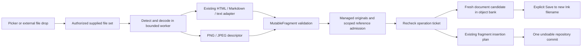
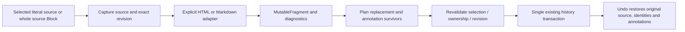
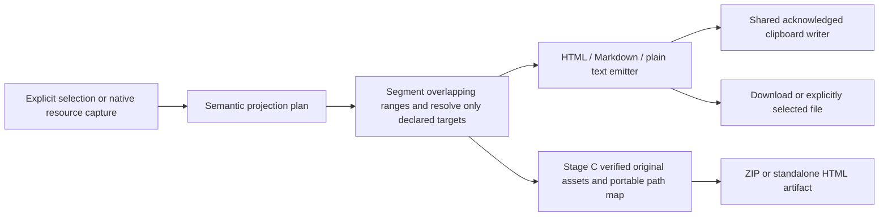
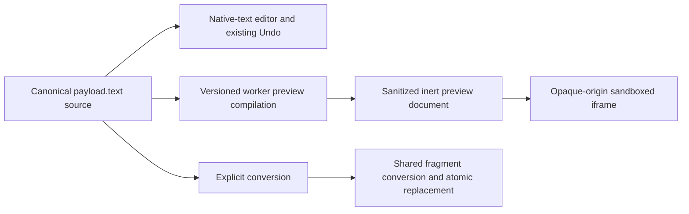
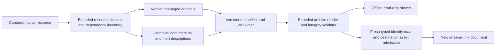
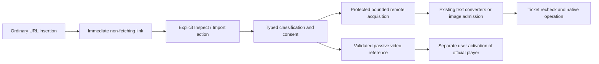

# Mutable OS Phase 3.5 — Document Import, Export and Conversion

**Status:** Architecture proposal; awaiting approval. Planning only.  
**Repository inspected:** `614232c` (`Phase 3 complete`), 16 October 2026.  
**Authorizing brief:** [MUTABLE_PHASE_3_5_FEATURE_BRIEF.md](/Users/iianneill/Downloads/MUTABLE_PHASE_3_5_FEATURE_BRIEF.md).  
**Baseline:** [Accepted clipboard architecture and Phase 3 qualification](MUTABLE_CLIPBOARD_ARCHITECTURE_AND_PHASE_PLAN.md). Phases 1–3 remain complete.

The recommended implementation extends the existing fragment, native document, command/history and immutable asset boundaries. It adds explicit operation coordinators, semantic exporters, source-preserving Blocks and a bounded native package format. It does not introduce a second document model or clipboard implementation.

Approval of this document authorizes **Stage A only**. Each subsequent stage requires acceptance of the preceding qualification and authorization to proceed. Stage E has a separate go/no-go decision. Phase 3.6 Publish to Web and Phase 4 Advanced Mutable Interchange remain excluded.

## 1. Repository findings and reuse decisions

Paths below are existing code unless explicitly marked proposed. Findings describe inspected implementation, not assumed capabilities.

| Boundary | Existing implementation | Reuse and necessary change |
| --- | --- | --- |
| Portable selections | [`fragment.ts`](src/interchange/fragment.ts), [`serializer.ts`](src/interchange/serializer.ts), [`ranges.ts`](src/interchange/ranges.ts) | Reuse `MutableFragment` v1, scalar-or-object coordinates, selection clipping, point affinity, local/external targets and linked definitions. Add an explicit document-resource adapter for packaging; selection serialization alone is not proof of complete resource fidelity. |
| Validation and trust | [`materialize.ts`](src/interchange/materialize.ts) | Reuse two-pass identity allocation, passive type allowlists, bounded opaque preservation and verified asset admission. Extract the existing policy tables into a narrow shared policy module when needed; registration in `BlockRegistry` must never imply import permission. |
| External HTML | [`html-ast.ts`](src/interchange/html-ast.ts), [`html-import.ts`](src/interchange/html-import.ts) | Reuse parse5 data-only parsing and semantic conversion. Current parser is fragment-oriented; add a bounded full-document entry for file metadata/body, without trusting `<base>`, charset directives or carrier attributes. Existing warnings are strings, not structured diagnostic records. |
| Markdown | [`markdown-import.ts`](src/interchange/markdown-import.ts) | Reuse CommonMark plus GFM tables and the bridge to the HTML semantic converter. Raw HTML stays literal. Code metadata survives but code presentation, H5/H6, blockquotes, rules and complex tables have documented degradations. Do not add another Markdown parser. |
| Clipboard transport | [`transport.ts`](src/interchange/transport.ts), [`mutable-clipboard.ts`](src/runtime/mutable-clipboard.ts) | Preserve existing negotiation, acknowledged async writes and recoverable event fallback. Its HTML output is an escaped projection carrying native data, **not a rich semantic exporter**. New Copy-as actions reuse transport ownership rather than adding listeners. |
| Preparation and insertion | [`prepare.ts`](src/interchange/prepare.ts), [`prepare.worker.ts`](src/interchange/prepare.worker.ts), [`insertion.ts`](src/interchange/insertion.ts), [`commands.ts`](src/block-tree/commands.ts) | Reuse validation, materialization, `planFragmentInsertion`, `insertMutableText`, `insertFragment` and `transaction`. Add conversion-specific replacement policy; ordinary paste rebasing must not blindly carry annotations over transformed markup. Keep asynchronous work outside transactions. |
| Existing Markdown projection | [`markdown.ts`](src/persistence/markdown.ts) | `mutable-markdown-subset-v1` supports a narrow projection: principally bold, H1, qualified wiki links and simple plain header tables. Overlaps degrade to text; images are not packaged. It is not the Phase 3.5 rich exporter. Keep persistence compatibility behavior; add an explicitly named interchange export profile instead of silently changing old projection semantics. |
| Canonical resource/open/save | [`native-resource.ts`](src/persistence/native-resource.ts), [`native-session.ts`](src/persistence/native-session.ts), [`native-document-store.mjs`](server/native-document-store.mjs) | Reuse `captureNative`, native envelope validation, resource boundaries, candidates, conflict checks and manual save. `admitNative` retains identity for an opened resource; it must not be used unmodified for package **copy import**. New import candidates use fresh identity and `trackCandidate`. |
| Flint integration | [`document-application-capabilities.tsx`](src/application/document-application-capabilities.tsx), [`document-application.ts`](src/feature-api/document-application.ts), [`shell.tsx`](src/features/flint/shell.tsx), [`storage-sheet.tsx`](src/features/flint/storage-sheet.tsx), [`vault-view.tsx`](src/features/flint/vault-view.tsx) | Extend application capabilities and existing File/storage/context surfaces. Current vault Markdown import uses the older persistence importer and explicitly saves immediately. The new interchange action must call the shared semantic importer and create an unsaved candidate; do not call this old action as a shortcut or silently change unrelated legacy commands. |
| Menus and dragging | [`block-menu-actions.ts`](src/runtime/block-menu-actions.ts), [`block-selection.tsx`](src/rendering/block-selection.tsx), [`gateway.ts`](src/input/gateway.ts) | Reuse command eligibility, focus/selection restoration and editor ownership. Internal reorder uses runtime drag state plus `application/x-speedy-block-selection`; preserve it. Add one application-owned external-file route, not a global competing drag/clipboard handler. |
| Block presentation and native text | [`registry.ts`](src/block-tree/registry.ts), [`register-core-views.ts`](src/rendering/register-core-views.ts), [`core-block-views.tsx`](src/rendering/core-block-views.tsx), [`plain-text-block-view.tsx`](src/rendering/plain-text-block-view.tsx) | Reuse Solid ownership, mount/input-policy registration, native textarea editing/history and shared geometry. `html-block`/`html-editor-block` currently resolve to `IframeView`, which mounts a URL; they are not safe source previews. `YouTubeView` creates an iframe before deliberate playback activation. `CodeBlockView` is currently a textarea placeholder, not completed CodeMirror integration. New safe types must not accidentally inherit these behaviors. |
| Managed original assets | [`clipboard-images.ts`](src/interchange/clipboard-images.ts), [`managed-assets.ts`](src/runtime/managed-assets.ts), [`managed-assets.mjs`](server/managed-assets.mjs), [`managed-assets-router.mjs`](server/managed-assets-router.mjs), [`asset-image-validation.mjs`](server/asset-image-validation.mjs) | Reuse original-byte PNG/JPEG validation, Cavern/hash identity, private publication, leases, recovery and conservative retention unchanged. Move only operation-neutral admission/reconciliation out of clipboard naming; keep a clipboard facade. Add verified byte acquisition for export/viewer packaging; do not persist runtime object URLs. |
| Remote acquisition | [`asset-remote.mjs`](server/asset-remote.mjs), scoped [`cavern-lifecycle.ts`](server/cavern-lifecycle.ts) | Reuse explicit consent, activation fence, HTTPS/port policy, DNS pinning, redirect checks and bounded requests. Stage D adds a text-resource admission policy around the same transport, not an unrestricted proxy or arbitrary URL fetch endpoint. |
| References and knowledge | [`external-reference.ts`](src/block-tree/external-reference.ts), [`entity-service.ts`](src/application/entity-service.ts), [`saved-reader.ts`](src/knowledge/saved-reader.ts), [`policy.ts`](src/knowledge/policy.ts) | Preserve resource scopes and saved-text indexing boundaries. Materialization currently checks entity scope equality rather than proving entity existence; new operation coordinators must obtain bounded semantic-target evidence when claiming a verified live target. PackageDataBlock carries inert relational evidence, not automatic entity creation. Add explicit source-text facts policy in B; never index preview DOM or scan the vault while typing. |

No existing source-Block contract, general rich HTML exporter, `.inkpkg` codec or isolated offline Ink viewer was found in these paths. These are proposed work, not completed infrastructure.

## 2. One architecture, separate operation ownership

### 2.1 Common sequence

All routes share: **explicit acquisition → bounded detection/decoding → preservation or conversion → validated fragment/native operation → scoped asset/reference admission → one publication or export artifact**.

The format registry selects an adapter. It does not grant filesystem/network access or choose which editor mutation is allowed. The coordinator owns authority and cancellation. Native repository state remains authoritative; fragments, preview trees, export plans and package manifests are operation-local representations.

| Operation | Input authority and destination | Commit boundary |
| --- | --- | --- |
| Import new Ink | User-selected file(s), active Cavern/session, object-bank/application lifetime; no caret required | One fresh candidate per file, one repository transaction per document, no disk write until explicit Save |
| Insert content | Explicit selection, caret or child-list gap plus occurrence/resource revision ticket | One `insertMutableText`/`insertFragment` transaction for the chosen batch |
| Convert selection | Captured literal source and eligible structural selection plus exact source revision | One conversion plan; old source/annotations restored by normal Undo |
| Render source Block | Authored source payload, occurrence-local presentation state | No repository/history publication; edit source through existing native-text commands |
| Export/copy projection | Explicit selected content or captured native resource at a stated revision | Output bytes/clipboard write only; no dirty/save/history change |
| Import package | Validated archive and explicit new-document intent, Cavern/session/object bank | Fresh identity map, asset publication, one native candidate admission |
| Refresh linked source | Explicit read authority plus last-import hash and local revision | Diff/diagnostics first when changed; explicit atomic replacement, never silent overwrite |
| Batch collection | Enumerated authorized file set and reviewed job manifest | Per-document commits and explicit saves, resumable job ledger; no claim of global filesystem Undo |

A clipboard bookmark is retained only for actual clipboard destination operations. A `DocumentInterchangeOperation` captures a typed ticket for its own operation kind: application/editor lifetime, Cavern activation, resource/occurrence identity where relevant, expected revision, insertion gap or selection, and cancellation signal. Tickets are checked before admission, after asynchronous steps and immediately before commit. Use existing revision/selection infrastructure; do not install full-document observers to maintain them.

Export captures the requested resource once. If it changes during export, complete the captured version with a visible revision notice or allow cancellation; do not discard the export or lock typing. Capture is an explicit operation, not a typing subscription.

### 2.2 Proposed module/API boundaries

These names are implementation targets; do not create empty modules before their stage.

| Proposed path | API/responsibility | Stage |
| --- | --- | --- |
| `src/interchange/formats.ts` | Built-in `FormatCapability` records; deterministic `detectFormat`/eligibility, delegating to adapters | A |
| `src/interchange/diagnostics.ts` | Versioned structured diagnostic codes, severity, source location, loss and suggested remedy; preserve existing clipboard notice facade | A |
| `src/interchange/file-input.ts` | `readSelectedFile(File, policy, signal)` and strict decoding; consumes supplied handles/files, never an arbitrary path | A |
| `src/interchange/operation.ts` | Typed operation tickets, bounded preparation results and progress; pure validation/commit contract, no global service singleton | A |
| `src/interchange/prepare.worker.ts` | Extend existing worker with a discriminated request: clipboard, explicit-format conversion, projection; retain current clipboard behavior | A |
| `src/interchange/image-admission.ts` | Operation-neutral wrapper around existing image resolver and `ManagedAssets`; explicit supplied-file mappings/consent | A |
| `src/interchange/conversion.ts` | `planSourceConversion` and conversion-specific property policy, delegating structural assembly to existing planner | A |
| `src/interchange/export-plan.ts`, `html-export.ts`, `markdown-export.ts`, `text-export.ts` | Read-only semantic projection, range segmentation, asset/link placeholders and deterministic diagnostics | A |
| `src/application/document-interchange.ts` | Editor/application-owned coordinator; import candidate, insert, convert, export/copy; narrow extension to `DocumentApplicationCapabilities` | A |
| `src/features/flint/interchange-sheet.tsx` | Existing-shell dialog for destination/mode/progress and nontrivial loss; no new application chrome framework | A |
| `src/interchange/source-block.ts`, `source-preview.ts` | Source payload schema and isolated preview compilation; explicit conversion and transient resource map | B |
| `src/rendering/source-block-view.tsx` | Shared Solid source editor and iframe owner; format-specific options, mount/cleanup and selection | B |
| `src/interchange/package/{manifest,read,write,copy-import}.ts` | `.inkpkg` v1 validation, bounded archive IO, integrity, resource-to-fragment conversion and fresh identity import | C |
| `src/interchange/export-assets.ts` | Verified original-byte reads, path rewriting, deterministic bundle plan and standalone HTML asset encoding | C |
| `src/runtime/linked-sources.ts` | Session/local handle permissions and explicit refresh tickets; portable provenance contains no local capabilities | C |
| `src/viewer/ink-viewer.tsx` | Separately bundled read-only entry, shared package/policy/pure presentation helpers, no editor/server/SQLite boot | C |
| `src/interchange/uri.ts`, `server/resource-acquisition.mjs` | Typed classification and consented bounded text acquisition through existing remote transport protections | D |
| `src/rendering/video-block-view.tsx` | Passive provider reference; user-activated official player with independent lifetime | D |
| `src/interchange/collection-plan.ts`, `src/application/collection-interchange.ts` | Two-pass relative-reference mapping and bounded resumable collection job | E, separate go/no-go |

`NativeDocumentSession` gets a narrow candidate-admission helper only if existing `insertFragment` + `trackCandidate` cannot publish the new resource and bookkeeping coherently. Document opening and save protocols are reused. `TreeCommands` gets a prepared-conversion command/descriptor rather than calling paste repeatedly or relabeling every operation as clipboard activity.

Asset ownership should become application/editor-owned independently of clipboard **access**. Keep `editor.clipboard.assets` as a compatibility facade during extraction; existing clipboard flags/defaults stay unchanged. The existing managed-asset preference gates new image acquisition; disabling clipboard itself must not disable file import or resolution of already-authored assets. This is a narrow ownership adjustment, not a new asset backend.

### 2.3 Format registry

Proposed declarative record:

```ts
interface FormatCapability {
  id: 'ink' | 'html' | 'markdown' | 'text' | 'png' | 'jpeg' | 'inkpkg';
  profile: string;
  extensions: readonly string[];
  mediaTypes: readonly string[];
  operations: readonly ('import' | 'insert' | 'convert' | 'export' | 'preview' | 'package')[];
  sourceBlockType?: string;
  adapter: string;                  // built-in dispatch key, never executable imported data
  permissions: readonly ('supplied-file' | 'explicit-remote' | 'explicit-source-handle')[];
  diagnosticProfile: string;
}
```

Per-operation policy still checks trust, target eligibility, stage availability and flags. File extension/MIME suggest a format; signatures and bounded text inspection validate it. Do not sniff a paragraph into Markdown simply because it contains punctuation. Unknown extensions can be explicitly opened as text after safe decoding; binary data is not guessed into text.

One new default-on `documentInterchange` feature flag gates approved Phase 3.5 actions, with stage capability registrations added only after approval. Source types already saved must retain inert source fallbacks if the feature is disabled. No new feature flag changes the defaults of accepted clipboard or persistence features.

## 3. Data flows

### File import and insertion



### Selection conversion



### Rich export



### Source Blocks



### Native package



### URI inspection/import



## 4. Ownership, identity and diagnostics

| Data | Owner and persistence policy |
| --- | --- |
| Native authored content/relations/annotation definitions | Existing canonical repository and manual native resource persistence; new imported authored objects receive fresh identities |
| Original source in a source Block | `payload.text` plus versioned safe source metadata; the only authoritative editable source, not duplicated in cells or preview HTML |
| Import provenance | Optional bounded authored metadata: basename, format/profile, decoded-source hash, original byte hash when available, import time and source scope; no absolute paths or authority tokens |
| File handle / granted access / source read capability | Session-owned registry; optional browser-local opaque handle storage only where supported and approved by the user gesture; never native/package data |
| Linked-source identity | Authored random link ID + safe origin descriptor + last accepted hashes; possession of a descriptor never grants permission to read |
| Managed binary | Existing Cavern `(cavernId, sha256)` identity and immutable original; import admits original bytes, export reads originals; no thumbnail replacement |
| Preview DOM, iframe, object URLs, progress, source/preview mode | Solid occurrence owner; cancel workers, revoke URLs, release subscriptions on replacement, close or disposal; not document history |
| PackageDataBlock | Read-only, lossless SQL row slice with schema, provenance and declared exclusions; no database merge or recursive graph import |
| Diagnostic | Operation-owned structured result; optional downloaded report. No full report or transient progress written into every document edit |

Use `InterchangeDiagnostic {version:1, code, severity, operation, sourceName?, blockId?, range?, loss, detail, remedy?}`. Ranges identify their coordinate system. Codes distinguish dropped presentation, unsupported semantic data, unresolved reference, denied resource, unsupported encoding, invalid archive, changed destination and cancelled work. Fatal validation rejects before document publication; deliberate lossy conversion preserves safe source in Undo and reports omissions. Unknown authored data remains bounded and inert with original type identifiers, never automatically activated when a renderer is later registered.

For same-Cavern semantic references, use explicit bounded entity/block lookups at the operation boundary when needed. A matching filename, title, GUID string or URL alone is not verification. No vault crawl or graph traversal for import convenience. Foreign entities/definitions remain scoped and unresolved with optional inert labels. Internal typed references are remapped using one allocation table, including linked definitions and retained native definitions. Never rewrite arbitrary strings inside opaque data as though they were IDs.

## 5. Stage A — core interchange

### 5.1 Local acquisition, detection and decoding

Provide File → **Import…** and context → **Insert file…**, using a normal file input as the baseline. An enhanced file picker may be used when available, but import must not depend on persistent filesystem permissions. `showOpenFilePicker` has limited browser availability and requires a secure context/user activation; preserve the file-input path. [MDN file picker](https://developer.mozilla.org/en-US/docs/Web/API/Window/showOpenFilePicker).

Default imported title is the supplied basename without the last recognized extension; default save suggestion is a sanitized `<basename>.ink`. The source is never bound as the writable native destination. Import-new creates an unsaved dirty candidate; Command-S uses the existing explicit save flow. Validate the selected Cavern folder and filename and rely on existing create/conflict protections; a suggested `name (2).ink` is not a reservation. Never overwrite a source or existing destination implicitly. A later **Import and Save** command would be an explicit distinct user action, not the default.

Decoding policy:

- Accept UTF-8 with or without BOM, and UTF-16 LE/BE only with BOM. Decode strictly; invalid sequences, binary NUL content or unsupported encodings fail with a remedy to resave as UTF-8. Do not silently insert replacement characters or honor HTML encoding tags as authority over already-decoded bytes.
- Record encoding/BOM and original byte hash as provenance; source Blocks preserve decoded text, including original line endings, without Unicode normalization. Native conversion normalizes CRLF/CR to logical newlines with a diagnostic; plain text preserves blank lines, trailing spaces/tabs and final empty lines. UTF-16 textarea indices are mapped explicitly to scalar/object fragment boundaries; reject split-surrogate selections.
- PNG/JPEG signatures and full decoded validation override declared MIME/extension. A file named `.jpg` with text content is rejected or explicitly reselected as text; it is not silently imported under a different mode. HTML/Markdown ambiguity requires explicit format choice when extension and text evidence conflict. No speculative parsing of `.txt` as Markdown.
- Initial limits: 20 files, 40 MiB combined raw file bytes; 8 MiB text file bytes, 200,000 decoded Unicode scalars per text operation, existing fragment limits of 10,000 Blocks / 20,000 properties / depth 64 / 256 KiB per opaque object. PNG/JPEG retain Phase 3's 10 MiB each, 40 million pixels, dimension and acquisition limits. Apply aggregate converted-fragment limits before combined insertion; never raise accepted limits silently.
- Multi-file import-new produces separate candidates in displayed supplied order; successes and failures are reported per file. Multi-file insertion is one all-or-nothing document transaction in a reviewable file order, separated by native block boundaries. If it exceeds aggregate limits, require smaller explicit batches. Cancel preserves completed new candidates but publishes no partial existing-document insertion.
- Browser filenames and `webkitRelativePath` are metadata, not permission. Relative HTML/Markdown resources remain descriptors in A. Even jointly selected neighboring files are not silently searched; only explicit per-resource mapping or the existing unambiguous CID rule authorizes binding. No directory discovery, local URL fetch or read of adjacent files.

External file drop checks real `DataTransfer.files/items`, not an untrusted internal MIME marker. A live same-editor internal Block drag always retains reorder ownership; external files never become moves. Over an eligible document, show the explicit insert gap or captured caret target; dropping over the explorer offers new-document import. Prevent browser file navigation only inside owned supported drop zones. Unsupported or mixed internal/external drops reject with a clear notice. Keyboard import remains fully available.

### 5.2 Conversion and annotation policy

Commands: **Convert to Mutable Ink → From Markdown / From HTML**. Pass selected source directly to adapters, never through clipboard serialization or global MIME negotiation.

Stage A eligibility: one nonempty contiguous literal-text selection in one standoff TextBlock, or contiguous ordinary sibling TextBlocks whose text can be captured with paragraph separators. Reject inline objects, disjoint selections, cross-resource/shared structural ambiguities, mixed owned relations and selections through table/list boundaries unless the existing structural planner proves the whole selected structure is replaceable. Source Blocks become eligible as whole Blocks in Stage B. Partial source-Block conversion is initially unavailable because native Blocks cannot replace a substring inside one source payload without a separate splitting contract.

Conversion has different annotation semantics from ordinary text replacement:

1. Properties wholly outside the replaced interval retain identity and authored values; only positions after the replacement shift.
2. Properties wholly within consumed markup, including consumed point annotations according to affinity, are removed from the result. Converter-produced properties describe the new native text. Do not guess character correspondences between markup and rendered text.
3. A property crossing a boundary retains only its unaffected source-side portion. A property spanning both sides becomes independent left/right occurrences with the same definition where appropriate; keep the original occurrence identity on the first survivor and allocate a fresh identity for the second. Neither bridges the converted output. If a type/relationship cannot safely split, require explicit loss acknowledgement or reject the conversion rather than corrupt references.
4. Conversion diagnostics enumerate affected annotations. Significant annotation/structure loss triggers the compact preview; unannotated simple source converts directly.
5. One prepared command records the complete before/after delta. Undo restores exact source text, original property IDs/ranges/affinities, shared definitions and structural identities; Redo restores the same converted result. New source-Block conversion follows the same rule for whole-Block replacement and source metadata.

Add an explicit policy parameter/prepared plan at the insertion boundary; do not change the default behavior of accepted clipboard paste. Preserve surrounding text and imported open/closed slice semantics. No transaction remains open while parsing or acquiring images.

### 5.3 Semantic exports and clipboard representations

Use selection serialization or a captured native resource as input, followed by an operation-local semantic projection. Exporters never walk mounted DOM or infer semantics from CSS/SVG. Do not add a persistent projection model.

HTML emits escaped text and a fixed semantic vocabulary: paragraphs, H1–H4, strong/emphasis/underline/strike/sup/sub, lists with start/item values, table headers/cells, safe links and image placeholders/references. H5/H6 are emitted only when explicitly retained semantic metadata establishes them; native visual size alone is not proof of heading rank. Whole-document output includes a doctype, UTF-8 declaration and escaped title. Layout containers/pages/margins are flattened in deterministic document order with labeled side sections and diagnostics; no promise of paginated visual reproduction.

For crossing standoff ranges, compute boundary events in scalar/object coordinates once, order active marks deterministically, and close/reopen spans as needed to produce valid nesting. Crossing links never produce nested anchors: choose the most specific range, then stable source order as a tie-break; retain other targets in diagnostics. Adjacent pieces of one semantic annotation may retain an export-local identifier. Unsupported SVG/custom-cell visual effects keep safe visible source text and report lost presentation. Point annotations use an inert HTML marker/title where meaningful; no script or renderer instructions. Markdown reports point-marker loss unless a documented text label is requested.

Markdown uses a named CommonMark + basic GFM-table export profile. Escape delimiters/context, choose safe code fences, preserve supported links/list numbering/header structure and table cell text. Deterministically emit representable nested marks; for crossing/incompatible marks, retain literal text and supported outer marks according to a fixed priority, reporting lost marks. Do not emit broken delimiter runs or arbitrary raw HTML to claim fidelity. Nonrectangular/merged tables and complex cells use a documented readable fallback with diagnostics. Plain-text export retains document reading order, list labels, tab-separated table rows, alt text and logical line breaks, and reports omitted annotation semantics.

In A, a managed image with no portable target becomes an explicit alt/asset placeholder plus diagnostic. Do not emit a Cavern-private API URL, absolute path or runtime `blob:` URL. Safe authored external image URLs may be emitted only under an explicit remote-reference export option, with a warning that opening the exported file may fetch them; default output is network-inert. C supplies portable assets. Stage A image persistence acceptance concerns imports/save/reopen, not a premature portable bundle claim.

**Copy as HTML:** `text/html` semantic fragment plus `text/plain` fallback. **Copy as Markdown:** `text/plain` containing Markdown and `text/markdown` (web-custom async form where supported). Explicit projection copy omits the Mutable native carrier so subsequent paste does not unexpectedly negotiate back to richer native semantics. Ordinary Copy remains unchanged. Reuse the existing writer/acknowledgement and native-event recovery ownership, with pending explicit-copy intent scoped to the initiating unchanged selection. File export creates a Blob/download or explicit picker write; cancellation and successful export leave save binding, dirty state and history unchanged.

### 5.4 Stage A steps and acceptance checkpoint

1. Add the format/diagnostic records, explicit worker entry and operation tickets, keeping clipboard APIs compatible.
2. Add file input and owned drop routes; implement unsaved candidate creation and one-batch insertion with existing assets/references.
3. Add source conversion plan and exact annotation/Undo policy.
4. Add semantic exporters and Copy-as/File actions; retain existing persistence projection separately.
5. Qualify and submit a Stage A report; stop for acceptance.

Acceptance fixtures include BOM/astral characters/combining marks, blank/final lines, invalid encodings, misleading MIME/extensions, cancellation after admission, conflicting filenames, no source overwrite, list/table nesting, crossing/point/shared annotations, exact Undo/Redo, imported original image hashes, manual save/reopen and zero unconsented network. Browser tests exercise the actual picker/file-input, drop precedence, clipboard MIME writes/fallback and the existing Flint document tabs. Snapshot/read/layout/network counters and the real typing benchmark must show no added ordinary typing work.

## 6. Stage B — source-preserving Blocks

Use conceptual **MarkdownBlock** and **HTMLBlock**, with new wire types `mutable/markdown-source-block` and `mutable/html-source-block`. This avoids silently changing the meaning of legacy `html-block`/`html-editor-block`. Both delegate to one `SourceBlockView` and format adapters.

Proposed payload:

```json
{
  "id": "authored-block-id",
  "type": "mutable/html-source-block",
  "text": "<p>Authoritative source</p>",
  "sourceFormat": { "version": 1, "format": "html", "profile": "mutable-html-source-v1" },
  "metadata": { "provenance": { "version": 1, "filename": "note.html", "encoding": "utf-8" } }
}
```

The canonical source is a payload string, edited through the existing `native-text` mount/input/history contract. Do not allocate one character cell per source character or create persistent preview children. Source Blocks do not initially support standoff properties over source markup; whole-Block metadata/properties remain supported, and foreign standoff data is retained inert with diagnostics. Importers must not pretend textarea selection has the standoff editor's annotation semantics. A textarea presents normalized line endings: mounting or viewing it must not write that normalization back into the source. A source-specific edit adapter maps the changed UTF-16 range back to the canonical string, preserving untouched original line endings and using the recorded dominant ending for newly entered lines. Test mixed endings and composition explicitly. Fix only necessary controlled textarea/IME/Undo integration, not general CodeMirror migration.

Source/Preview are occurrence-local tabs. Split is optional after focus/typing qualification. Preview revision/error state is transient; a stale preview is labeled while source edits remain immediate. Prepare a new preview on explicit Preview activation; in Split, debounce only after an idle run (initial target 400 ms), cancel superseded workers, and pause during IME. Do not parse, validate a full document or rebuild an iframe on every input event. Preview failure leaves source editable and never writes sanitized text back into it.

Markdown preview uses the existing parsed Markdown AST and a safe semantic renderer, with raw HTML displayed literally. Expose the existing adapter's data-only AST stage if required; do not reparse using a second dialect. HTML preview uses a **fresh sanitized document in an iframe with `sandbox=""`**, no `allow-scripts`, no `allow-same-origin`, no forms/popups/navigation permissions, and `referrerpolicy="no-referrer"`. Shadow DOM is not a security boundary. Never mount authored HTML into the application DOM. `srcdoc` is an injection sink; sandboxing and an allowlist serializer are both required. [MDN srcdoc security](https://developer.mozilla.org/en-US/docs/Web/API/HTMLIFrameElement/srcdoc).

HTML/CSS policy:

- Parse authored HTML as data, construct only allowlisted passive elements/attributes, strip scripts/events/frames/forms/SVG/MathML/custom elements, `<base>`, refresh directives, external stylesheets, resource hints and all source-provided CSP. Source stays intact; preview reports removals.
- Allow only finite inline declarations for color/background color, font weight/style/size within bounds, text decoration/alignment, whitespace, bounded margins/padding/borders. Validate property values with a defined grammar, not regex removal of bad substrings. Reject URLs, imports, custom properties/`var`, fonts, animation, filters, fixed/absolute positioning and unbounded sizes. Stylesheet blocks and arbitrary user CSS are deferred. Theme CSS is application-owned.
- Generated preview starts with restrictive CSP: `default-src 'none'; script-src 'none'; connect-src 'none'; font-src 'none'; media-src 'none'; object-src 'none'; frame-src 'none'; base-uri 'none'; form-action 'none'`. Permit only generated styles and the exact local image representation scheme actually used. An empty iframe sandbox attribute supplies the sandbox boundary: the CSP `sandbox` directive is not supported in a meta element. [MDN CSP sandbox](https://developer.mozilla.org/en-US/docs/Web/HTTP/Reference/Headers/Content-Security-Policy/sandbox).
- Strip all authored image URLs/srcset/CSS resource URLs before mounting. Resolve only explicitly admitted PNG/JPEG resources in the parent, rewrite them to owned object URLs, and permit `img-src blob:` only after browser qualification. A bounded generated raster-data URL fallback is acceptable if opaque-origin Blob behavior differs; arbitrary authored data URLs are never passed through. Keep unresolved alt placeholders and a resource list outside the frame.
- Remove navigable anchors in the preview itself; render labels and expose safe links as explicit parent-owned controls. An iframe sandbox alone does not promise to prevent all navigation of its own frame. No automatic fetch from previewing a link.
- Opaque-origin, script-free preview cannot provide DOM height measurements or a resize-message script. Use a bounded, user-resizable viewport with internal scrolling (default 360 px, maximum 800 px); do not weaken the sandbox for auto-height. Parent/preview selection is separate: source selection is restored when returning, and preview text selection does not become a standoff selection. [MDN iframe sandbox](https://developer.mozilla.org/en-US/docs/Web/HTML/Reference/Elements/iframe).
- Print/export recompiles the semantic/sanitized projection from source with its diagnostics; it does not screenshot the iframe or save its runtime DOM. No arbitrary active HTML export mode is introduced.

Add versioned `metadata.sourceResources` only when explicit source-image mapping is needed: safe source token → managed reference, without rewriting authoritative source text. Mappings grant no future network permission and are remapped/packaged as typed asset references. The shared import policy admits only the new source schemas, never legacy executable iframe types.

Saved-source indexing observes `payload.text` under a declared source-text policy when a document is saved. It does not extract entities from preview DOM, implicitly interpret source links as entity annotations or duplicate both source and preview in search. Update both full and lightweight saved readers where needed; unsaved/live search follows existing explicit search semantics.

Steps: schema/policy and native-text editing → Source/Preview ownership → Markdown preview → HTML serializer/sandbox/CSS → whole-Block conversion → saved-text facts and persistence → qualification. Acceptance includes exact decoded source and line endings after save/reopen, no preview history/dirty changes, IME/undo/focus behavior, zero network/script/navigation leaks, CSS isolation, iframe disposal, unknown-type feature-off behavior and exact whole-Block conversion undo. **Stop after the Stage B report.**

## 7. Stage C — portable resources, packages, viewer and source links

### 7.1 Asset-aware projections

Add **Export with assets** as a ZIP by default, containing one HTML/Markdown document and `assets/<digest>.png|jpg`. Read only referenced, admitted originals from the active Cavern, verify digest/length and assign portable deterministic paths. Do not fetch unresolved remote descriptors during export. Missing assets fail a requested self-contained export, or require an explicit degraded export with missing-resource diagnostics. Never falsely label an incomplete artifact self-contained.

Standalone HTML may embed verified PNG/JPEG original bytes as generated data URLs within a 20 MiB final-output budget; otherwise offer the ZIP. Sanitized HTML stays script-free and contains no hidden native carrier with private metadata. Markdown plus assets uses relative paths. Internal links are rewritten only against the explicit exported resource set; external Ink references remain labeled unresolved, or valid authored external URLs. This is single-document export, not website navigation/search/theme generation.

### 7.2 `.inkpkg` version 1

A package is a distribution container. Its `document.ink` is the existing canonical native envelope, not a new document schema. Initial container: ZIP with UTF-8 member names; only stored/deflate entries; no encryption, ZIP64, split archives, nested packages or executable viewer payloads. Choose a maintained bounded streaming ZIP implementation at Stage C implementation time after dependency/security review; do not write a new inflater or install one during planning.

Proposed contents:

```text
manifest.json
resources/document.ink
assets/sha256/<digest>.png
assets/sha256/<digest>.jpg
data/package-data.json            # selected SQL rows, tagged storage values
schemas/knowledge-schema.json     # original DDL, columns, keys, versions
```

Example manifest shape (hash placeholders are illustrative):

```json
{
  "kind": "mutable-ink-package",
  "version": 1,
  "profile": "mutable-inkpkg-passive-v1",
  "nativeFormatVersion": "declared-by-native-envelope",
  "entry": "resources/document.ink",
  "producer": { "name": "Mutable OS" },
  "source": { "cavernId": "source-cavern", "resourceId": "source-document" },
  "members": [
    { "path": "resources/document.ink", "role": "document", "mediaType": "application/json", "bytes": 1234, "sha256": "<hex>" },
    { "path": "assets/sha256/<hex>.png", "role": "original-asset", "mediaType": "image/png", "bytes": 5678, "sha256": "<hex>" }
  ],
  "assets": [
    { "source": { "cavernId": "source-cavern", "assetId": "sha256:<hex>" }, "member": "assets/sha256/<hex>.png" }
  ],
  "dependencies": [],
  "diagnosticsProfile": "mutable-interchange-diagnostics-v1"
}
```

Validate the native format version against the real codec, not the example string. Hashes detect corruption; they do not authenticate a publisher or authorize active rendering. Manifest member sizes/hashes are checked against actual decoded bytes, not trusted ZIP headers. Reject unsupported major versions; additive metadata must remain inert and bounded, and unknown required capabilities reject with a clear version diagnostic.

Capture only the selected resource's native ownership/retention closure, internal definitions/relations and required known managed assets. Do not follow out-of-resource placements, entity edges or source links recursively. `captureNative` is the resource-boundary oracle; external dependencies are explicit descriptors. PackageDataBlock replaces the former entity-summary proposal; Section 7.2.1 defines the bounded lossless extraction and explicit privacy review.

Portable import policy:

1. Validate the entire archive/manifest and canonical resource offline in a worker. Keep the package resource detached; do not feed it straight to `admitNative`, which would retain source identity.
2. Apply passive type policy **before any mount**. Preserve safe unknown/active authored data with original type IDs in inert records. Known source Blocks use their new safe schema. An installed plugin/renderer cannot make an imported type trusted.
3. Build a resource-to-fragment adapter that includes retained definitions, internal relations, linked annotations and point affinity; audit this against native capture. Do not assume `serializeSelection` traverses unplaced retained definitions. Remap document IDs, Blocks, placements, cells, properties and definition IDs through one table; remap only typed internal edges.
4. Re-admit packaged PNG/JPEG **originals** through the existing destination asset service; validate even if the manifest says they are safe. Reuse identical hashes within the destination Cavern. Rewrite known asset references to the destination Cavern GUID without altering original bytes.
5. Same-Cavern external semantic targets require verified evidence; foreign out-of-package targets remain scoped/unresolved. PackageDataBlock provides frozen relational context, never destination canonical records. Do not merge entities by name or automatically create a knowledge graph.
6. Recheck the operation/session and commit one new unsaved candidate with a fresh resource identity. Importing the same package twice creates independent authored objects sharing admitted binaries. Save is explicit. No restore/update existing option in v1.

Native export preserves source identities inside `document.ink` as provenance/fidelity. Copy import changes them deliberately. Unknown opaque values retain their original content and cannot be globally string-replaced to repair hidden references; diagnostics state any opaque dependency limitations.

Archive rejection policy: absolute/drive/UNC paths, backslashes, traversal segments, NULs, invalid UTF-8, encoded path tricks, duplicate/case-fold/NFC-colliding names, symlinks/hardlinks/device entries, mismatched local/central headers, unlisted members, duplicate roles and unresolved manifest asset members. Use exact manifest-controlled ASCII member paths for v1. Never extract archive paths into a Cavern; decode approved members to bounded memory/private staging and let existing asset/native writers choose destinations.

Initial bounds: 64 MiB compressed package, 96 MiB actual expanded bytes, 256 members, 100:1 per-entry/aggregate expansion ceiling, 256 KiB manifest, 8 MiB native entry, 20 originals / 40 MiB aggregate assets and existing native/fragment complexity caps. Count output during decompression and stop at limits; predeclared sizes are insufficient. Parse/decompress workers are terminable and time-limited. Oversized valid documents receive a clear supported-limit error, not a partial import. Package source metadata never contains absolute paths, local handles, lease tokens, session IDs or runtime URLs.

### 7.2.1 Archival PackageDataBlock refinement (approved Stage C)

The authoritative archive remains the exact native document envelope, original immutable assets and a versioned auxiliary `mutable-package-data` JSON resource. PackageDataBlock is outside the reading sequence and never a canonical knowledge database. It preserves exact SQL table/column names, original primary/foreign keys and storage values; JSON-valued TEXT is retained verbatim. The companion schema preserves original CREATE TABLE/index SQL, table_xinfo, foreign_key_list, application/user versions and SchemaInfo. SQL is evidence only: neither the viewer nor import executes it.

Extraction uses a read-only transaction through the existing SQLite reader worker. Seeds come only from authored Entity, Time and Claim reference occurrences and linked definitions. Time extends Entity; directly referenced Claims include their participants and qualifiers. Default closure: those Entity records, their Time extensions and curated/imported aliases, and directly referenced Claim records with their required participant/qualifier endpoints. Explicit optional policies add one-hop relationships, claims with participants/qualifiers, evidence, actors and observed aliases. Endpoint entities satisfy the selected relations, but never become graph expansion roots. Limits: 500 seeds, 5,000 rows, 8 MiB encoded values, cancellable keyed/indexed queries. No backlinks, index reconciliation, audit history or whole-Cavern scans.

Concrete schema findings: there is no Trait table/read service. Trait-like facts remain authored attributes or typed claims. Evidence names source resource/block/hash but does not ensure the historical source exists; export records that unresolved boundary. DataPointDimension has no entity-first index, so discovering arbitrary dimensions from entity seeds would require a scan: Stage C excludes it explicitly. DataSet/DataPoint schema is retained for interpretation, without inventing associations. Derived/indexed Resource/Block/FTS and operational audit/outbox rows are excluded. Actor and evidence inclusion are explicit because they may disclose unrelated or personal information. Complete rows include authored descriptions/attributes and actor IDs even when Actor rows are excluded; the inventory warns before download.

A tagged `sqlite-storage-class-v1` encoding preserves NULL, decimal int64, IEEE-754 real bits, verbatim Unicode TEXT and base64 BLOB. Ill-formed UTF-8 TEXT is rejected rather than silently replaced. A separate reconstruction qualification creates trusted fixture tables from archived schema and compares independently decoded rows, keys and values. Untrusted DDL is never executed in production.

The viewer uses a small read-only table adapter, displaying the existing Entity/Time/Relationship/Claim/participant/qualifier/evidence structure and raw attributes without a new EntitySnapshot domain. Missing/excluded records are visible. Import preserves original SQL identities as inert scoped context, remaps authored document identities, quarantines foreign semantic targets and never reconciles canonical records by GUID or name. The file specification and qualification report document reconstruction, privacy boundaries and limitations independently of the viewer.

### 7.3 Offline read-only viewer

Ship a small separately built **Ink Viewer HTML** with trusted bundled JavaScript/CSS and a local `.inkpkg` file input/drop zone. It must open directly as a local file or as static hosting; all required code is bundled, with no CDN, dynamic server dependency or install-time download. A static hosted copy works offline once explicitly downloaded; do not imply that an uncached web URL works offline. No service worker is necessary for v1.

Reuse package validation, native decoding, type policy, typography tokens and pure presentation helpers. Do not instantiate `ReactiveEditor`, application feature activation, persistence, SQLite, graph services or the unrestricted Block registry. The viewer renders a read-only projection of the same native envelope, not another persisted model. Layout/unknown/active Blocks get safe fallback labels/source summaries. Support paragraphs/headings/lists/tables, original images, safe link controls, style annotations, point markers and inert entity descriptions; SVG effects not supported by a pure safe renderer degrade with diagnostics. Viewport rendering may reuse pure geometry helpers where necessary, never the editing pipeline.

Resolve images only from validated package members. The Stage C viewer uses bounded image data URLs, released with its document DOM; the worker blob URL is revoked on completion/replacement/close. Native/package URLs cannot trigger fetch. Viewer navigation stays within package-local IDs or uses a deliberate external-link action. No playback or live source refresh. Untrusted HTML source uses the same sandbox or an inert source fallback. Trusted viewer code is distinct from package data; scripts shipped inside a package are never executed. Feature support is declared in a profile and unknown newer native/package versions reject safely.

Target viewer budget: <=1 MiB compressed executable bundle and <=4 MiB standalone viewer HTML, excluding loaded documents/assets. Measure at C qualification; if decoder dependencies exceed it, report the actual cost and review the cut, rather than importing the whole application or inventing a second codec. Browser crypto/worker behavior under `file:` must be qualified; a bundled pure hash fallback is allowed if needed, with no remote dependency.

### 7.4 Link to source and explicit refresh

Expose three distinct modes once B/C exist: **Import as Ink**, **Embed source**, **Link to source**. Link creates a source Block with a source descriptor and explicitly read initial source snapshot; its preview is derived. It does not create a live view of a remote filesystem. One-time `File` objects permit import but not future re-read; a refreshable link needs a user-granted file handle or explicit file reselection. Browser handles may require renewed permission and are never portable. [MDN File System API](https://developer.mozilla.org/en-US/docs/Web/API/File_System_API).

Persist safe basename/format, last accepted source byte hash and source-text revision/hash, link ID and optional scope. Keep the actual local handle in the runtime/browser-local registry. Reopening the document never reads it automatically. Missing/revoked permission shows **Reconnect source…**; changed bytes with the same filename do not prove source identity. A reselected replacement requires an explicit rebind decision.

**Refresh source** acquires and validates a fresh candidate, compares last imported bytes and current local source revision, then shows meaningful changes/conflicts. Unchanged source is a no-op. Changed source with untouched local source offers apply; local edits require explicit replace or import-as-separate-Block, with cancel as default. Recheck the revision before applying and publish one undoable source+baseline-metadata update. Undo restores both old source and old accepted baseline. Do not write to the external file. Converted native output is detached; source provenance may survive, but refresh cannot silently overwrite the converted document. Remote refresh is added only through D's consented acquisition route.

### 7.5 Stage C steps and checkpoint

Implement verified export byte access/path maps → projection ZIP/standalone HTML → manifest/ZIP validation and closure inventory → fresh-identity copy import → offline viewer → local linked-source refresh → unified fidelity preview/diagnostics. Conversion preview uses existing safe presentation and a bounded side-by-side summary, not an executable source page. Simple clean imports remain direct; complex package losses/identity changes/missing assets receive the preview.

Qualification: round-trip native relations/definitions/point annotations, two independent package imports, destination Cavern dedup with byte-identical originals, no dangling remapped typed IDs, malicious archives/hash mismatches, active types remaining inert, missing assets/foreign references, readonly/offline viewer with network disabled, all URLs released, source reconnection/conflicts, manual save and restart, cancelled publication with conservative recovery. Import into a **different temporary Cavern/installation** is mandatory for package portability. This does not reopen the separately deferred full-Cavern relocation follow-up from Phase 3. **Stop after the Stage C report.**

## 8. Stage D — explicit URI inspection and passive video

Normal URL insertion remains an immediate non-fetching `reference/url`. Classification parses syntax and known provider host/path patterns locally; unknown URLs remain links. No HEAD request, favicon, oEmbed, thumbnail or title fetch occurs on paste, hover or preview.

**Inspect / Import linked resource** displays the exact normalized URL and proposed operation. Extend the existing remote transport through a typed acquisition policy (`image`, `html`, `markdown`, `text`) with fixed limits; keep the image policy and tests unchanged. The server still enforces explicit operation consent, Cavern/session authority, HTTPS:443, no credentials/cookies, public DNS with connection pinning, three same-origin redirects, total deadline and streaming byte caps. Remote HTML/Markdown is data only; charset/format mismatches and unsupported compression are rejected or explicitly diagnosed. Do not run a browser scraper, script engine or renderer on the server. Imported page subresources require separate consent and normal asset admission; a page fetch never authorizes all of its links.

Generic HTML import uses the existing converter. Main-article extraction is optional and **deferred by default**: it requires an explicit adapter, source/result fidelity comparison and its own qualification. No website crawl or video download.

Use a new passive `mutable/video-block` with versioned `{provider:'youtube'|'vimeo', providerId, canonicalUrl, title?}`; optionally reference a separately admitted local poster. Validate provider IDs and exact allowed hosts, reject lookalike hosts and unexpected endpoint/query payloads, derive the player URL from trusted templates. Show a local placeholder/link without a remote poster by default. Do not reuse the existing eager `YouTubeView` for imported content.

The **Load player** action explicitly discloses third-party network/cookie implications. It creates only the official provider iframe, with no autoplay, limited permissions, referrer restrictions and provider-tested sandbox tokens; teardown removes it on mode change/disposal. The Google docs specify supported official iframe URLs/parameters, but do not make a provider player network-inert. [YouTube embed specification](https://developers.google.com/youtube/player_parameters). Qualify Vimeo against its current official embed documentation before implementation; if a restrictive policy breaks playback, retain the link and report it rather than relaxing sandbox permissions silently. This explicit remote-player capability is separate from script-free HTML source previews. No assumption that server SSRF pinning constrains requests made inside an activated third-party iframe.

Steps: syntax-only classification → shared protected text acquisition → generic import integration → passive VideoBlock → deliberate player activation → security/browser qualification. Test zero network on ordinary links, spoofed hosts/IDs, DNS/rebinding/redirect failures, revoked/stale consent, changed destination, passive save/reopen/undo, activation/disposal, provider failure and no autoplay. **Stop after the Stage D report.**

### Stage D implementation (2026-10-16)

Implemented behind the existing default-on `documentInterchange` flag. The Block context menu's **Inspect / Import linked resource…** input opens local classification and a single-operation chooser. It inserts links and passive video descriptors without acquisition; native HTML/Markdown/text import, independent source embedding and linked source snapshots require a second explicit acquisition confirmation. Source refresh requires fresh consent and a review of replacement versus separate insertion.

Text acquisition reuses the image transport and Cavern operation leases, with a separate exact URL + format consent record. Initial text admission is intentionally strict: `text/html`, `text/markdown` or `text/plain` as selected (explicit Markdown also accepts `text/plain`), UTF-8/US-ASCII, identity encoding, 2 MiB and 200,000 Unicode scalars; the shared 15-second deadline, three same-origin redirects, public DNS pinning and service concurrency limit remain unchanged. Only the final response URL supplies a base for relative references; authored HTML `<base>` is ignored. Image admission remains a separate operation/consent and uses its existing limits.

Passive video activation is transient per mounted occurrence. Only validated version-1 YouTube/Vimeo descriptors produce a provider player, and only after **Load player — connect to provider**. The iframe uses fixed URLs, no autoplay, `allow-scripts allow-same-origin allow-presentation`, fullscreen/picture-in-picture permissions and `strict-origin-when-cross-origin`. Unload, descriptor change, hidden presentation, view/editor disposal and deletion remove it. HTML/Markdown/plain exports and the offline viewer emit a provider link only. No executable player state enters persistence or history.

Qualification and limits: [Stage D qualification](MUTABLE_PHASE_3_5_STAGE_D_QUALIFICATION.md). Stage E has not begun.

## 9. Stage E — collection interchange, separate go/no-go

Recommend a **separate follow-on project**, after A–D acceptance and explicit UI/scale review. It requires filesystem authority over a set, two-pass link resolution, job recovery and partial-result UX; it is materially larger than multi-file Stage A import. A–D should retain operation IDs, scoped path maps and structured diagnostics so E does not require a new pipeline.

Proposed two-pass plan:

1. Explicitly select a directory/file set using available directory APIs or a directory-upload fallback. Validate relative paths, case/Unicode collisions, counts, aggregate sizes and exclusions; do not follow symlinks, hidden credentials, `.git`, `.mutable` or external filesystem targets. Preview the enumerated scope.
2. Inventory source formats, authorized attachments and relative references; allocate all new document IDs and destination names before conversion. Explicitly choose convert-to-Ink or preserve-source. Proposed collisions: keep both with deterministic suffix (default), skip or abort; overwrite/update existing is excluded.
3. Convert each document through the same adapters; resolve relative links only within the inventoried set. Obsidian-style wiki links/embeds require a named adapter with unique-path/title rules. Broken, ambiguous, outside-root or unsupported plugin syntax remains unresolved with diagnostics; do not guess by basename.
4. Acquire supplied authorized originals through the same asset service in bounded leases; deduplicate across jobs/documents. Preserve source hierarchy and approved filename mappings. Emit a reconciliation report containing old/new paths, new resource IDs, resolved/unresolved links and omissions.
5. A distinct reviewed **Import and Save collection** action authorizes explicit destination writes. Reuse existing native writers/conflict protocols per document. Progress and cancellation stop future commits; already-saved files remain with an exact completion report. A job journal can resume only after explicit reopening/revalidation, never automatically on startup. Repository Undo applies per inserted document, not to arbitrary filesystem side effects; do not promise an atomic multi-file Undo.
6. Collection export captures an explicit resource set and shared path/asset map once; rewrite internal links against that set. Package selected originals once. No dependency crawl or static-site generation.

Initial planning envelope: 1,000 text documents / 5,000 inventoried files / 512 MiB supplied bytes, subject to profiling and Stage E approval; each document and asset operation still obeys A/C/Phase 3 limits. Stream work one document at a time, at most two asset requests, release intermediate trees, and save progress outside the typing path. Large deployments may require a separate staged collection container instead of increasing `.inkpkg` v1 limits.

Stage E go/no-go must approve directory permission/fallback UX, the named Markdown-vault subset, collision defaults, explicit batch-save semantics, resumability and resource budgets. Tests include cyclic inter-document references, duplicate names/case, nested attachments, broken links, unsupported plugin syntax, permission loss, restart/cancellation after each commit, destination conflicts, bounded memory and round-trip collection export. Until that review, no Stage E production work is authorized.

## 10. Supported-format and fidelity matrix

| Content | A import/convert | A export | B source/preview | C package/viewer | D/E additions |
| --- | --- | --- | --- | --- | --- |
| UTF text/paragraphs/blank lines | Native scalar text, explicit newline policy | Escaped HTML/Markdown; logical plain text | Exact decoded source text | Native/point data preserved | E hierarchy and relative source mapping |
| Bold/italic/underline/strike/sup/sub | Existing semantic properties | HTML semantics; Markdown-supported marks, diagnostics otherwise | Preserved source; sanitized preview | Native preserved; safe viewer subset | No change |
| Headings/lists | Existing H1–H4/list metadata; H5/H6 loss reported | Semantic supported ranks/numbering | Markdown AST/source preserves richer authored syntax | Native plus safe presentation | E vault syntax adapter only if approved |
| Tables | Existing native rows/cells; merged layout loss reported | HTML; basic GFM or readable fallback | Safe HTML table preview; authoritative source retained | Native relations retained, supported viewer tables | No office-layout guarantee |
| Code/quotes/rules | Existing importer degradations, source metadata where available | Semantic when established; diagnostics otherwise | Source fidelity and safe semantic preview | Known passive semantics; unknown fallback | No code execution |
| Links/references | Safe URLs; only verified scoped semantic targets live | Explicit export-set path mapping; unresolved labels | Inert preview labels + parent actions | Remapped internal references; bounded inert entity descriptions | D explicit URI acquisition; E two-pass relative links |
| PNG/JPEG | Existing original-byte asset admission | Alt/reference placeholders unless explicit portable target | Admitted originals only; no preview fetch | Originals bundled; viewer local resolution | D consented image download; E authorized attachments |
| HTML CSS/active content | Semantic text only; active content rejected/omitted | Generated semantic HTML only | Exact source, safe inline CSS subset, sandboxed inert preview | Source preserved, active types never executed | No trusted interactive HTML mode |
| Source Blocks | Not introduced in A | Not applicable until B | New versioned HTML/Markdown source types | Safe schema and asset bindings packaged | C explicit local refresh; D consented remote refresh |
| Annotation overlaps/points | Native definitions/ranges or explicit conversion loss | Split HTML; deterministic Markdown degradation | No source standoff annotations initially | Native fidelity and safe viewer markers | No reactivation of opaque types |
| Unknown/executable Blocks | Bounded original authored data inert | Readable fallback and diagnostics | Source fallback, never app activation | Quarantined despite installed renderers | No general cross-app transmutation |
| Video | URL only | Link only | No active source iframe | Passive reference/link | D provider-validated, click-to-load official player |

## 11. Holistic integration matrix

| Route | Shared adapters/policy | Mutation/identity | Assets and references | Persistence/lifecycle |
| --- | --- | --- | --- | --- |
| Clipboard Phases 1–3 | Existing negotiation/fragment | Existing fresh paste + Undo | Existing admission | Accepted behavior retained; no new handler |
| Local import/insert A | Explicit format → same fragment | Candidate or prepared insertion | Supplied files, inert relative/remote descriptors | Manual save, operation cancellation |
| Conversion A/B | Explicit source → same fragment | Annotation-aware one-step replacement | Existing admission; no clipboard detour | Exact Undo, no source writeback |
| Export A/C | Shared semantic projection | None | Placeholder or approved export-set byte/path map | Download only, revision notice, no dirty change |
| Source preview B | Same parsed syntax + safe preview serializer | Source edits only | Explicit bindings and transient URLs | Solid owner cleanup, no preview history |
| Package import C | Native validation → complete fragment adapter | Fresh resource/object/definition IDs | Destination publication; scoped unresolved targets | Unsaved candidate; recovery does not replay insertion |
| Offline viewer C | Same native/package policy and pure presentation | None | Package bytes only | No Cavern/server/SQLite; dispose URLs |
| Linked refresh C/D | Same acquisition/conversion, explicit permission | Conflict-reviewed source replacement | No implied remote/adjacent file access | Baseline metadata undoable; handles not portable |
| URI D | Protected transport → existing adapters | Same insert/candidate operations | Explicit consent; passive video activation separate | Cancellation and provider teardown |
| Collection E | Same adapters, scoped two-pass set | Per-document fresh IDs and commits | Authorized set, shared hash/path map | Explicit save job and resumable report |

## 12. Threat model and performance budgets

Threats include hostile file names/bytes, forged MIME/scope/IDs, parser depth bombs, CSS/HTML execution and exfiltration, package traversal/decompression bombs, remote DNS/redirect rebinding, stale destination overwrite, source authority leakage and accidental active-type registration. Imported file data never supplies application commands, permissions, renderer modules or trust flags. Validation must precede publication/mounting, and decoded originals remain immutable. Preserve private runtime handles and secrets outside native output.

| Boundary | Required control and qualification |
| --- | --- |
| File access | Supplied File/explicit handle only; no filename-derived reads. Cancellation and permissions tested in each browser path. |
| Parsing | Existing complexity caps; worker termination; fatal decoding; no DOM parsing that can fetch. Full-document HTML metadata is bounded and inert. |
| HTML source preview/export | Positive tag/attribute/style grammar, script-free sandbox, restrictive CSP, removed navigation/resource URLs, adversarial network-request assertions. |
| Remote resource | Existing pinned DNS + address/redirect checks and consent, fixed policy kinds, byte/time caps, no credential forwarding; negative tests on every new text mode. |
| Package | Complete manifest/integrity validation, actual expanded limits, exact member names, no direct extraction, safe native policy and fresh identity remap. |
| Async publication | Separate asset/document commit points; operation/session/revision rechecks; retain published originals after uncertainty. No timeout is proof of rollback. |
| Export privacy | No absolute paths/handles/tokens/runtime URLs; entity descriptions opt-in; asset inventory limited to explicit resource closure. |
| Active media | Passive until user activation; no remote poster by default; provider capability separate from HTML preview; teardown verified. |

Performance targets are qualification gates, not claims about unimplemented code:

- Ordinary standoff typing: **zero additional interchange parsing, snapshots, filesystem/network calls, vault scans or geometry reads**. Optional source previews run only after idle/activation and are cancelable. Keep direct character rendering and shared geometry caches unchanged.
- Show operation progress/cancel promptly (target <100 ms); keep synchronous UI slices under 8 ms where practical. Delegate parse/projection/hash/archive work to workers; unavoidable canonical commit time is measured separately. At supported upper bounds, demonstrate responsive UI/cancellation rather than claiming subsecond completion.
- Initial worker deadline 10 seconds per conversion/projection; package preparation 30 seconds with progress and actual-output caps. Existing image decoder/acquisition deadlines and concurrency remain unchanged. Abort/check between acquisition and publication steps. Superseded results cannot update a view or document.
- No command-per-character insertion. Explicit export may read one selected resource; no walk of unrelated open documents or the Cavern. Source textarea updates must not add preview/knowledge recomputation to input events; profile the existing native-text commit cost at the proposed size ceiling and lower that ceiling if necessary.
- Baseline recorded Phase 3 Flint letter: 6.6 ms median / 9.9 ms p95 synchronous input, zero snapshots/status reads. Repeat matched runs per stage; investigate a repeatable >10% median or >20% p95 regression and any nonzero forbidden-work counter. These are headless diagnostics, not guaranteed screen latency.
- Defer mounting previews/viewer regions when useful, but do not add a second geometry tracker. Dispose workers/iframes/object URLs with their Solid occurrence owner; shared original bytes use existing reference-counted lifetime.

## 13. Qualification artifacts and release sequence

Each stage report must state exact supported formats/profiles and limits, changed production boundaries, test counts/results, real browser/OS coverage, failure/recovery behavior, persistence/Undo evidence, typing counters/timings and outstanding limitations. Do not label a feature qualified solely because its unit tests passed.

Use existing commands: `npx vitest run` for affected suites; `node --test server/managed-assets.test.mjs server/asset-remote.test.mjs` for acquisition/storage regressions; `npm run build:client`, existing SQLite prerequisite, `npm run build:server`, then `npm run typecheck`. Extend `scripts/check-mutable-clipboard-browser.mjs` only for shared-path regressions; add focused `scripts/check-document-interchange-browser.mjs` and later `scripts/check-inkpkg-viewer-browser.mjs` for new operation ownership. Reuse `scripts/benchmark-flint-typing-browser.mjs` and bounded-work assertions. Tests must use temporary Caverns and isolated profiles, not user content.

Proposed artifacts: `MUTABLE_PHASE_3_5_STAGE_A_QUALIFICATION.md` (and B/C/D/E equivalents), plus fixture manifests and machine-readable results under the repository's existing artifacts convention. Fixtures include malicious HTML/CSS/URI/archive cases, overlapping annotations, source encodings, portable original binaries and missing/foreign targets. No new build framework. A separately bundled viewer is the one necessary new build target in C.

Browser plan: real Chromium/macOS first using existing harness, then Safari and Firefox manual/automated qualification of file input/download, OS clipboard formats, sandbox/CSP and local viewer. Windows/Linux Ctrl-key paths and directory/handle permissions require explicit recording; unsupported enhanced pickers fall back rather than blocking basic import. Do not claim current cross-browser completion from Phase 3's Chrome-only evidence.

Stage gates:

| Gate | Deliverable | Required decision |
| --- | --- | --- |
| Now | This architecture and recommended defaults | Approve architecture and Stage A scope before code |
| A complete | Core import/conversion/export report | Accept A and authorize B |
| B complete | Source fidelity/isolation/lifecycle report | Accept B and authorize C |
| C complete | Package portability/offline viewer/refresh report | Accept C and authorize D |
| D complete | URI/media privacy and security report | Accept D; decide whether to scope E separately |
| E proposal | Collection UX, authority, resumability and scale review | Separate go/no-go before implementation |

Retain the accepted Phase 3 browser-compatibility limitations, asset-storage maintenance/no-auto-GC considerations and **full-Cavern relocation check** as follow-up items. They are not new Phase 3.5 remediation tasks. Stage C's new package cross-Cavern test is a distinct acceptance criterion, not authorization for bulk Cavern migration or maintenance tooling.

## 14. Decisions needed for approval

These defaults are concrete enough to approve together; implementation details such as helper names do not need repeated permission questions.

| Blocking product/architecture choice | Recommended default | Consequence |
| --- | --- | --- |
| When local import writes files | New dirty candidate, explicit Save; no automatic save in the import action | Preserves manual-save contract and source files; UI must distinguish existing legacy import-and-save controls |
| Annotation meaning during markup conversion | Preserve unaffected portions; remove consumed markup properties; split surviving sides; diagnostic preview for meaningful loss | Avoids falsely assigning source annotations to transformed output; exact Undo required |
| Source data owner and source types | `payload.text`, native-text input, new `mutable/*-source-block` types; no source standoff editing initially | Reuses existing input/history, avoids legacy iframe aliases and duplicate source state |
| HTML preview CSS/security | Script-free opaque-origin iframe, safe inline declaration subset, no stylesheet/raw script mode, bounded scrolling viewport | Reduced visual fidelity and no auto-height bridge; clear, testable isolation |
| `.inkpkg` identity and PackageDataBlock | Copy-only with fresh authored IDs and typed internal remap; frozen SQL identities remain original; whole-row privacy confirmation and optional related rows; no canonical merges | Portable independent copies and reconstructable archival evidence; foreign graph semantics remain explicitly unresolved |
| Linked-source refresh | User-invoked only, conflict preview, no writeback; converted native output is detached | No hidden synchronization or silent unsaved overwrite |
| Initial delivery and Stage E | A–D sequential checkpoints; E separate follow-on by default | Prevents folder-vault recovery/UI work from expanding the initial delivery |

Dependency selection for ZIP support and provider-specific player permissions is an implementation-time technical checkpoint within its approved stage, not a reason to delay A planning. Any necessary relaxation of the stated security/identity policy requires renewed architectural approval.

## 15. Planning completion and authorization boundary

This deliverable is documentation only. No Stage A or later production code, feature flag, dependency, handler, persistent storage or UI has been introduced. The repository inventory and proposal have been reviewed against the supplied brief; implementation acceptance tests above are **planned**, not reported as executed.

The brief's mandatory gate says: **“Stop after submitting the plan for approval. Do not begin Stage A or later work until approved.”** The next action is approval of this plan and its Stage A defaults. Phase 3.6 and Phase 4 remain untouched.

## 16. Stage A authorization clarifications and implementation

Following review, Stage A alone was authorized with the Section 14 defaults. Native Open, external Import-as-new, source-preserving Embed and external Link retain distinct operation identities, ownership and save semantics even when adapters are shared. Stage A exposes Open and Import separately; it does not silently convert an opened external file or bind an import to its original source. Embed and Link remain later-stage operations.

Stage A loss reporting uses a concise confirmation covering affected annotations, unsupported semantics and potential losses. It does not implement the richer side-by-side preview reserved for Stage C.

Implementation and executed qualification are tracked in [the Stage A report](MUTABLE_PHASE_3_5_STAGE_A_QUALIFICATION.md). The documentation-only status in Section 15 describes the original planning deliverable, not the subsequent authorized Stage A implementation. No authorization to implement Stage B or later is inferred from Stage A completion.

## Stage B implementation status — 2026-10-16

Stage B was explicitly authorized after Stage A acceptance. Implementation and executed qualification are recorded in [the Stage B report](MUTABLE_PHASE_3_5_STAGE_B_QUALIFICATION.md). The implementation uses Source/Preview modes without Split, preserves foreign source annotations in an inactive data envelope during interchange, and leaves source images as inert placeholders without introducing resource mappings. Preview and semantic export share the safe source projection. Stage C and later implementation still require separate authorization.
