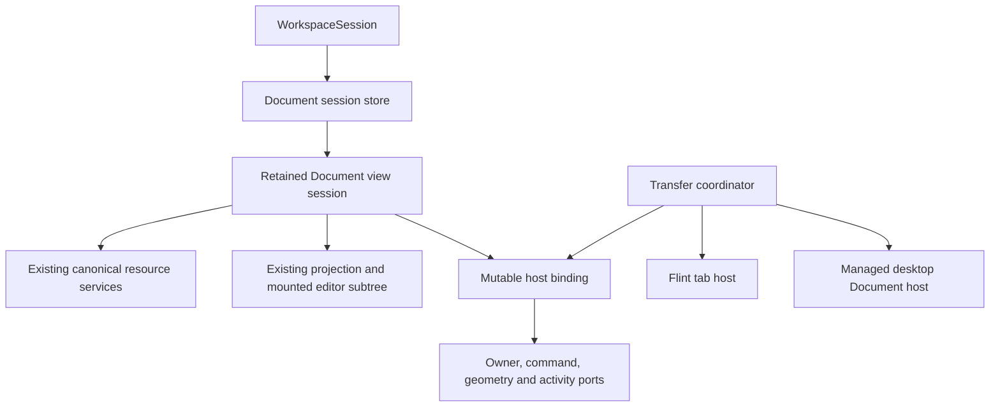

# Mutable Window Manager — E1 resource-view detachment and rehosting

**Status:** Proposed for architectural review. Implementation is not authorized.

**Prepared:** 20 October 2026. **Source baseline:** `819788a` (`Window Manager: D1 complete`).

A0, A1, B, D0, C and D1 are accepted by the user. This document narrows the broader Milestone E in the [approved architecture plan](MUTABLE_WINDOW_MANAGER_PLAN.md) to desktop Document view detachment. It does not implement E1, change application code, change persistence schemas, or change canonical resource ownership.

## 1. Recommendation and scope

Implement E1 around a retained, resource-specific view session with one transferable host lease. A detach operation must move the existing editor projection, SolidJS render owner and mounted editing DOM together. Opening another projection and restoring a bookmark is a different operation and does not satisfy detachment.

The first supported path should be a live Flint Document tab into a standalone managed desktop Document window, followed by return to its original Flint instance. Extend the same contract to eligible Ink Document occurrences after proving their projection and render-owner boundaries. Explicitly opening a second independent view is a separate capability, qualified after same-session transfer.

An independent window here means a window in the existing managed desktop, in the same browser `Document`, WorkspaceSession and canonical repository. It is not a new browser tab, popup, OS window, editor instance, workspace or Cavern.

### Included in the proposed E1 implementation

- An explicit **Detach Document view** action, an accessible menu equivalent, and **Return to Flint** where the original target remains eligible.
- A retained Document session boundary, host capabilities and a transactional transfer coordinator.
- Correct command routing, resource services, ownership of view-local surfaces, activity state and disposal.
- Distinct **Open another view** semantics, gated by adapter support; never implicit duplication.
- Integration with existing floating windows, shell tabs, layout operations and named arrangements without losing live sessions.
- Compatibility qualification against existing manual Save and restore contracts.

### Excluded

Canvas or Spatial rehosting; Acetate implementation; tool docking or promotion; transfer between workspaces, Caverns or browser documents; automatic resource imports; Thesis draft detachment; automatic crash recovery; new file extensions; a new persistence format introduced without review; drag-out tab gestures; changes to domain undo semantics.

The existing default-enabled `mutableWindowManager` flag and exclusive legacy path remain. Proposed implementation adds a subordinate default-enabled `resourceViewRehosting` flag, effective only when the Window Manager is enabled and the particular adapter passes its capability checks. Neither flag changes in this planning work. Disabled mode renders only the existing path. Runtime flag changes must not tear down a live session; use the established startup/reload boundary.

## 2. Current implementation evidence and obstacles

The findings below describe inspected source, not new browser qualification. Accepted B/C/D1 retention of application windows does not establish retention or transferability of every application-owned Document tab.

| Boundary | Current evidence | E1 consequence |
|---|---|---|
| Flint internal tabs | [document-application-capabilities.tsx](src/application/document-application-capabilities.tsx): `Instance`, `liveViews`, `Target`, and the active-tab `Show` mount only the selected Document target. | Switching an internal tab can dispose its Document projection. Introduce a retained session outside that conditional before enabling detach. |
| Transient Document lifetime | [transient-document-view.tsx](src/rendering/transient-document-view.tsx) creates a projection, owns its provider/layers and calls `editor.disposeView` on cleanup. Its bookmark records selections, but not scroll position. | Moving a tab descriptor or remounting this component is not session transfer. Separate creation/disposal from host attachment; retain scrollports and layers. |
| Ink and shared projection | [core-block-views.tsx](src/rendering/core-block-views.tsx), [block-outlet.tsx](src/rendering/block-outlet.tsx) and [workspace-presentation-view.tsx](src/application/workspace-presentation-view.tsx) render window/document descendants through the current projection. `ChildBlocks`, `Show` and presentation branches determine component lifetime. | Do not assume every Ink Document already has a private projection or independent Solid owner. Establish a stable Document island without changing its existing occurrence identities during transfer. |
| Occurrence identity | [projection.ts](src/block-tree/projection.ts) roots a projection at a placement and maintains route-specific occurrence keys. [editor.ts](src/reactive-editor/editor.ts) owns projections and destructive view cleanup. | Preserve the projection object, ViewId, root and existing NodeKeys. Reparenting canonical placements can alter routes and is not a host operation. Never call `disposeView` or `closeView` to detach. |
| Canonical ownership | [resource-registration.ts](src/block-tree/resource-registration.ts) explicitly distinguishes a canonical mount registration from semantic ownership. | Object-bank registration and presentation containment do not confer resource ownership. Preserve resource edges, registrations and domain authority exactly. |
| Window identity | [application/window-manager.ts](src/application/window-manager.ts) registers existing projected wrapper NodeKeys, reads their metadata and derives application instance IDs from them. | The manager cannot currently accept an arbitrary session host simply by substituting a new string ID. Add a narrow host adapter; keep shell identity separate from the Document session. |
| Solid context | [context.tsx](src/reactive-editor/context.tsx) supplies projection, coordinates and geometry; [window-manager.tsx](src/rendering/window-manager.tsx) supplies a window owner. | Physically moving DOM does not replace the context captured by existing components. Use stable context ports whose current host binding can change without recreating descendants. |
| Owned portals | `ApplicationSurfacePortal` resolves its owner with `untrack`, appends to a chosen group and registers a fixed surface lease. Modal boundaries also capture ownership. | DOM adoption alone leaves overlays, activity and input policies attached to the source. Qualified surface leases must be rebound transactionally; unsupported surfaces block transfer. |
| Flint service lifetime | `Instance` owns navigation, active-tab closures, tool state and cleanup. [shell.tsx](src/features/flint/shell.tsx) handles Save using `shell.contains(event.target)` and the active application Document. | A detached editor needs resource/session-scoped commands and service leases. It must not depend on the original Flint shell staying mounted or on whichever tab becomes active there. |
| Native persistence | [native-session.ts](src/persistence/native-session.ts) provides one native Document service per editor, with resource bindings, dirty flags and pending-operation state. | Reuse this service and its existing file binding. Do not instantiate another repository/native service or bypass pending-operation protections. |
| Undo and multiple views | [flint-transient-proof.test.ts](src/application/flint-transient-proof.test.ts) demonstrates separate occurrence keys over shared content and shared repository undo. | Independent views have independent view state, not independent canonical edit histories. Preserve the existing history authority rather than copying an undo stack. |
| Durable desktop | [managed-desktop.ts](src/persistence/managed-desktop.ts) versions 2–4 use `persistence: 'anchor'`, unique anchor identities and view/window restore records. [named-layouts.ts](src/application/named-layouts.ts) uses existing window placements. | There is no proven generic detached-session serialization contract. A valid window wrapper alone does not prove that its resource-specific view restores correctly. See the release gate in section 9. |
| Presentation switching | `WorkspacePresentationView` retains a provider/layer boundary but switches rendered Desktop/Canvas/Spatial roots. | E1 must not accidentally promise cross-presentation retention by adding a desktop session store. Transfers remain within Desktop; presentation changes require explicit handling while sessions are detached. |

These obstacles require changes to ownership boundaries in a future implementation, not merely a new launch action or a call to `appendChild`.

## 3. Identity and ownership contract

| Identity or authority | Move the existing view | Open another view |
|---|---|---|
| Document/resource identity and authority scope | Unchanged; resolve by exact identity and existing authority, never title or filename | Same resource, validated in the same authority |
| Canonical content, semantic ownership, resource registration | Unchanged | Unchanged; no clone, new owned edge or duplicate canonical registration |
| Editor/repository and resource Save binding | Same objects | Same objects |
| Runtime Document session ID | Same | New |
| Projection/ViewId and occurrence NodeKeys | Same objects and IDs | New projection/occurrences for an adapter that supports them |
| Solid render owner, editor DOM and local state | Same | New |
| Caret, selection, scroll and local UI | Retained | Independent; initialize explicitly, without sharing mutable selection objects |
| Domain undo/history | Existing authority and history retained | Existing shared authority; no promise of isolated per-view undo |
| Host lease | Same session, new host and generation | New session with its own lease |
| Runtime desktop window identity | New for a newly created window; source Flint window remains | New |
| Durable view/window restore identity | Never inferred from runtime or domain IDs; reuse or allocate only according to the approved persistence mapping | Distinct view/window restore identities where the format supports this |

The current desktop restore “view” often represents an entire application window. It must not be equated automatically with a newly introduced Document session inside Flint. Flint's application restore identity stays with Flint; detaching one tab cannot steal it.

Required invariants:

1. Each live Document session has exactly one authoritative primary host lease. A prepared destination reservation is not another lease.
2. There is one mounted editing subtree per session. Temporary transfer staging cannot create a second editor, projection or input gateway.
3. Session lifetime belongs to a WorkspaceSession-level store, not a Flint tab component or disposable window frame. A host release is not automatically session disposal.
4. Domain services and required subscriptions outlive host changes. Closing the source Flint window after a committed detach leaves the detached session usable.
5. Mounted, visible and active are distinct. Hidden sessions remain mounted; optional work can pause; canonical change delivery remains correct.
6. Host/layout changes do not mark Document content dirty, save a Document, clear dirty flags, create a domain edit or erase undo history. They update workspace presentation state only where supported.
7. Closing a view is distinct from deleting a resource. Last-view close and workspace disposal continue to use the existing domain unsaved-state guards.
8. No session silently degrades to “reopen and restore a bookmark” when transfer cannot preserve identity.

## 4. Proposed runtime architecture

Names below are proposed contracts, not existing APIs or persistence fields.

### Document session

A session owns:

- A runtime session ID, exact resource reference, existing editor and projection handle.
- A retained Solid render root, Document subtree, view-local layers and scrollports.
- View-local selection/bookmark state and the existing occurrence/mount registrations.
- Required resource-service leases and subscriptions; cancellable optional view work.
- A stable host-binding port and generation; one primary host lease.
- A disposal guard and an optional runtime return address.

The store holds a strong lifetime reference while the session is hosted or a transfer is reserved. A transfer never reaches a zero-reference interval. Disposal is explicit and idempotent after guarded final close or workspace teardown. Host cleanup cannot dispose a projection shared by other sessions.

### Host capability

Expose a narrow interface through the application capability layer, rather than giving the Flint feature unrestricted repository or manager access. A host supplies:

- Host ID, kind, workspace/authority identity and lifecycle generation.
- A slot reservation and connected container in the same browser document.
- Visibility/activity, geometry/coordinate and application-surface ownership ports.
- Supported session/embedded-content capabilities, readiness and abort signals.
- A staged membership update, reversible attachment, commit and reservation release.
- Command routing and activation hooks tied to the session and lease generation.

A new desktop host provides ordinary managed geometry, window list/menu, minimize/maximize, shell-tab participation and close guards. It does not clone the entire Flint shell. Resource operations such as Save remain available through a Document capability; Flint's library/search/sidebar remain with Flint.

### Stable rendering and context

Create a session-owned Solid root before its first editor mount. Host slots display the retained container; they do not instantiate the editor as conditional children. Keep the retained root under workspace disposal authority and pass only the service/context ports it needs.

The binding object must be stable, with reactive accessors for current owner, coordinates, geometry and activity. Audit consumers for destructured or cached host values: introducing an accessor at the provider does not fix consumers that captured the old window ID.

Moving the container must preserve element identity and component lifetime. Browser-native focus/selection may still need restoration after adoption. Capture those explicitly and qualify in real browsers; stable DOM alone is not proof of native selection or embedded-content continuity.

### Service and subscription ownership

Classify existing dependencies before enabling an adapter:

| Lifetime | Examples | Transfer policy |
|---|---|---|
| Resource/workspace | Canonical content, history, native binding, dirty state, required repository subscriptions | Retain unchanged; never release/reacquire merely because the host changes |
| View session | Projection subscriber, occurrence mounts, editor-local state, selection, view-local inspector state | Retain exactly; move qualified surfaces with the session |
| Host | Geometry observer, visibility observer, shell command registration, focus eligibility | Rebind with generations; remove obsolete handlers once commit succeeds |
| Source application | Flint library, active-tab navigation, app-wide Entity list and panel state | Remain with Flint; no silent promotion or reassignment |

Navigation into an existing session must resolve the current host from the session store. Commands may not retain `activeTab()` or source-shell DOM containment as their authority. Late results validate session/resource lifetime separately from host generation: a host change must not discard a valid resource result, and a stale source focus callback must not steal focus.

## 5. Ink and Flint paths

### Flint: detach and return

1. Establish retained sessions for opened Document tabs. Tab selection changes visibility/activity, not projection lifetime. Dispose a session only on its guarded close, not on deselection.
2. **Detach Document view** targets an explicit tab/session ID. If necessary, activate the tab through the existing lifecycle policy before preparing transfer.
3. Reserve a desktop Document host and a source return slot. After commit, remove the tab's hosting membership without invoking current `closeTab`/`disposeView` cleanup.
4. Keep only a lightweight runtime return address containing source app instance, tab identity/order and generation. It is not a second mount, a canonical owner or an unsaved-draft persistence mechanism.
5. Existing “open this Document” navigation should reveal/focus the already-detached session when it is the session being reused. It must not silently create another view. Ambiguous multiple sessions require a deterministic existing-view choice or an explicit view picker.
6. **Return to Flint** is a reverse transfer using the same session. It restores the original slot where still valid. A reused tab ID or replaced source instance fails generation validation.
7. If Flint has closed, the detached session remains independent. Disable the original return action with an explanation; an explicit **Move to Flint…** can select an eligible live target if included in the approved implementation. Do not silently recreate Flint or merge into another session of the same Document.

The source selects its next tab only after successful commit. Closing Flint during preparation must first cancel/roll back the transfer before running its ordinary close path. Closing Flint after commit releases only Flint-owned state.

### Ink: eligible occurrence to independent window

An Ink Document already in its own desktop window is already independently hosted. Moving that whole window between floating/tiled/shell-tab presentation is a C operation, not resource detachment.

For an embedded or otherwise hosted Ink Document, inventory the actual root, projection, render owner, inherited margins/style context and resource authority. Two supported implementation strategies need a proof decision:

- **Private retained Document projection from first mount:** suitable for new session-aware rendering paths. Existing views created this way can later move without changing their ViewId or NodeKeys.
- **Retained island within an existing shared projection:** preserve that projection and the original occurrence route, hold its required lifetime, and move only a session-owned DOM island. Session close must release the island, not the shared projection. Host lookup must prioritize the live lease over canonical ancestry.

Prefer a private session projection for newly initialized qualified views. Do not replace the projection of an already-live shared-projection view during detach and claim continuity. For such views, either prove the retained-island route or refuse the action with an explanation while leaving the editor usable. No automatic save/reload is an acceptable substitute.

This is a release gate for advertised Ink support. A successful Flint proof alone is not completion of the full Ink-and-Flint E1 scope.

### Open another view

Use a separately named action and capability. Resolve the exact existing resource, allocate a new session/projection and host, and retain independent view-local state. Closing either view leaves the other intact. Canonical edits, dirty status and existing history effects appear in both.

Do not copy the resource, invoke import/open-file admission again, generate a new Document ID, or duplicate resource ownership. Existing `openDocument` deduplication remains the normal navigation behavior; it is not the implementation of the explicit second-view action.

## 6. Transfer lifecycle

### State machine

| State | Work and authority | Cancellation/failure |
|---|---|---|
| `idle` | Source owns the sole primary lease. | No work to undo. |
| `preparing` | Reserve the session and destination slot; collect capabilities, lifecycle guards, source generation and relevant layout revisions. Source remains usable. | Release reservations; no source membership or resource changes. |
| `ready` | Destination shell/slot is connected, inert and not publicly active; service and surface adapters are ready. | Destroy only the provisional shell and reservations. |
| `validating` | Recheck identities, root availability, permissions, composition, modal/pending state and all reservation generations. Capture current selection/scroll/active intent. | Abort without input loss. Never rely solely on checks made before an awaited operation. |
| `attaching` | Briefly suspend input for this session; retain source slot and rollback data. Move the same container and qualified surfaces, bind staged host ports, verify attachment. Source remains the authoritative lease until publication. | Reverse attachment and bindings before releasing input; restore source presentation and eligible focus. |
| `committed` | Publish the lease generation, source/destination membership, owner mapping and layout change as one transaction; expose destination. | Subsequent Return/Move is a new transaction. Do not replay a stale pre-commit rollback. |
| `settled` | Release old host registrations/reservations; restore eligible focus once; resume optional work. | Cleanup is idempotent; stale completions cannot release the new lease. |
| `rolledBack` / `cancelled` | Source restored; provisional destination removed; reservations released exactly once. | Announce failure/cancellation; keep Document and workspace dirty acknowledgements unchanged. |

### Commit boundary and concurrency

Use one transaction token per session, source/destination generation checks and an AbortSignal. A second detach/return/close cannot race the first. Coordinate conflicting shell layout, named-arrangement selection and presentation switching through the existing lifecycle/layout coordinator.

Do asynchronous destination preparation before the final attach step. Keep the final DOM/port/membership publication synchronous and guarded: no network request, file write or resource load between source detachment and commit. Prevalidate the layout candidate using C's constraints; observers/input handlers must not see half-published ownership. Solid batching alone does not make imperative DOM and registry operations transactional.

Hold an explicit rollback record for source slot, host ports, surface leases, affected layout membership, focus request generation and scroll/selection. Revert only transaction-owned changes. Unrelated windows and resource edits must not be restored from a whole-workspace snapshot.

Typing may continue during preparation. Capture the latest selection at final validation, and use resource/root and operation generations rather than aborting for every unrelated repository revision. If the targeted resource is deleted or its authority changes, cancel; never recreate it to make rollback appear successful.

Conflicting source close/disposal is serialized until rollback or commit finishes. Workspace teardown cancels transfers and then disposes sessions normally; it must not resurrect a destroyed workspace. An unexpected lost source slot before commit is a controlled failure: retain the session in a workspace-owned inert recovery container and present an explicit recovery action. This is an exceptional containment path, not a successful rollback; record it as a qualification failure until the triggering race is addressed.

After commit, stale source cleanup can release only its own generation. Activation failure must not transfer the session back implicitly. Keep the committed destination accessible in the window list and report the focus failure.

### Cancellation and reversibility

Provide Cancel during asynchronous preparation and Escape where not consumed by an existing higher-priority modal. Cancellation is accepted only before commit. Revalidate cancellation immediately before publication.

After commit, **Return** or **Move view…** provides reversibility using a fresh transaction. Do not insert detach into Document undo. Preserve the existing workspace layout undo policy if a compatible presentation transaction exists; do not invent content-history entries for hosting changes.

## 7. Input, surfaces, tabs and safety restrictions

### Input and visual continuity

- Preserve caret direction, inline/native selection, cross-block endpoints, selection anchors and current occurrence keys. Snapshot only view interaction state; do not serialize the Document.
- Keep the scroll container when possible. Capture each relevant scroll offset and an occurrence-based viewport anchor for changed wrapping. At equal geometry, offsets should remain equal within browser rounding; after reflow, preserve the logical visible anchor.
- Rebind coordinate/geometry ports, invalidate affected shared geometry caches and refresh in read-before-write frame batches. Account for viewport resize, browser zoom, compact presentation and content-width changes. No unconditional cell sweep on typing.
- Restore focus through A1's activation mechanism, with transfer and activation generations. If the user activates another window during asynchronous preparation, completion must not steal focus. A successful explicitly active detach gets one eligible activation request.
- Route Save, undo/redo, find, clipboard and selection commands to the current session/resource. Exactly one handler owns a given command. Cmd/Ctrl-S must still save that Document to its existing opened filename through its existing Save path.
- Optional hidden-view work can pause; required canonical subscriptions cannot. Remounting, losing editor undo state, or silently resetting an embedded editor is a failed continuity check.

### Owned surfaces

View-local nonmodal surfaces may follow only when their adapter can preserve state, parent-surface relationships, anchor coordinates, close policy and request lifetimes. Update surface ownership and stacking together with the host lease.

Flint-wide tools remain owned by Flint. In particular, an app-owned Entity list or Linked Entity Reference interaction must not become an independent tool window merely because its source Document detaches. If an open tool has a live transaction anchored to that occurrence and cannot rebind safely, block transfer and explain what must be finished. Do not destroy the tool to make detachment succeed.

Menus opened solely to invoke Detach may dismiss normally before final validation. Stateful popovers, linking transactions and inspectors require explicit classification; they are not all disposable menus. Source callbacks and `ownerForNode` ancestry fallbacks must never override the committed session host.

### Flint tabs and shell tabs

| Action | Owner and outcome |
|---|---|
| Select Flint Document tab | Flint selects one retained Document session inside its application window. |
| Detach Flint Document tab | Transfer that session to a new managed window; leave the source Flint application and other tabs intact. |
| Put detached window in shell tab group | C changes that managed window's presentation. It does not turn the window back into a Flint tab. |
| Select shell tab | Window Manager activates the selected managed window; Flint's internal tab selection is unchanged. |
| Close shell tab/window | Run the managed window's session close guard; no canonical resource deletion. |
| Return to Flint | Reverse host transfer; remove only the detached window's shell membership after commit. |

Retain distinct ARIA tablists, labels and keyboard scopes. Detach is available through an ordinary button/menu reachable by keyboard and touch; do not introduce a browser-conflicting shortcut. Shell window cycling remains separate from Flint tab cycling. Initial E1 needs no pointer drag-out gesture.

### Eligibility policy

| Condition | Proposed E1 behavior |
|---|---|
| Dirty canonical Ink/Flint Document with a proven retained session | Allow same-session movement; retain dirty state and history. Do not require or perform Save. |
| Unsaved canonical Document with a stable admitted identity | Allow only if its resource and close guards already support in-memory lifetime independent of the source host. Otherwise explain the unsupported lifetime and leave it in place. |
| App-local draft without canonical identity or independently retained lifetime | Reject. In particular, do not transfer or duplicate unsaved Thesis drafts. |
| Pending Save, pending receipt, relocation, recovery, import/export or other mutating operation | Initially reject transfer of the affected session. Preserve the operation and receipt; do not cancel/reissue writes to make transfer possible. Relax only with an adapter-specific proof and separate review of that behavior. |
| Unrelated window has a pending operation | Permit unless a shared workspace/resource lock actually conflicts. |
| Window-owned or workspace modal; pending close guard | Reject the affected transfer before any mutation. Preserve the dialog and focus. |
| IME composition | Reject until composition has finished and its input commit has settled; never force blur or synthesize composition completion. Require a new user action. |
| Active drag, resize, text-selection gesture or capture | Finish or cancel through its owning controller before transfer; do not reparent under live pointer capture. |
| Unavailable, ambiguous, deleted or inaccessible resource | Reject; use existing explicit recovery outside the transfer transaction. No filename/title matching. |
| Unsupported iframe, media, embedded editor or other stateful descendant | Reject the containing view until its capability is qualified. Do not assume stable parent DOM prevents reload. |
| Wrong workspace, Cavern, browser document or presentation | Reject; E1 is same-desktop only. |

Dirty Documents and uncommitted application drafts are deliberately different categories. The original E-plan draft-rejection requirement must not become a blanket prohibition on moving ordinary unsaved Document edits.

## 8. Lifecycle after detachment

Minimization, hidden shell tabs and named-layout visibility preserve the exact session and its retained DOM. Active input belongs to the one visible eligible host. A hidden view can receive canonical edits from another view without rebuilding its editor.

Closing the detached window uses the existing unsaved-state protection and final-view policy; it does not silently return the session, delete the Document or save it. The return address is cleared when no longer valid. Reopening after a completed close may create a new session; that is not transfer continuity.

Closing the original Flint window after detach must not dispose the detached view's resource-service leases. Audit app-scoped factory disposers and selected-Vault leases explicitly. Conversely, detached-session disposal must not close source Flint tools or release workspace-wide native services.

Switching to Canvas/Spatial while an E1-only detached session is live must not destroy it. Recommended initial restriction: block the presentation switch with a clear explanation until that session is returned or closed, unless an already-qualified desktop retention boundary demonstrably keeps it intact. Do not perform a hidden Canvas transfer. This restriction is a proposed E1 limitation requiring review, not an existing behavior claim.

## 9. Persistence and named-layout compatibility gate

E1 must preserve D0/C/D1 guarantees. The current outer local/server JSON formats and Desktop versions 2/3/4 remain authoritative; no new extension, automatic upgrade or load-time rewrite is proposed.

The runtime session store, host leases, transfer journal, return addresses, selections, tools, pending operations and unsaved drafts stay outside durable persistence.

### Required design proof before releasing detachment

Determine whether the existing supported anchor/resource descriptor can faithfully represent:

1. The detached Document resource and its application view.
2. The remaining Flint window without restoring a duplicate copy of the moved session.
3. Stable durable identities for the standalone window and the original application.
4. Named arrangements captured before and after detach/return.
5. Local self-contained content versus server resource references.

A new empty `document-window-block` is not sufficient evidence. Nor is storing an arbitrary host field under an ignored extension property. Existing native-resource workspace Save restrictions in [native-bindings.ts](src/persistence/native-bindings.ts) remain in force.

**Recommended decision:** first prove an exact mapping using existing descriptors and presentation-only shell anchors. A shell anchor may describe presentation, but cannot become a new canonical owner or require reparenting the Document. Do not advertise durable detached-window restoration until both writers and loaders round-trip it correctly.

If that mapping cannot express the required semantics, produce a separate versioned persistence proposal for approval. Do not silently extend Desktop 4, overload a resource ID, persist a runtime session ID, or claim E1 complete with lossy Save behavior. An internal proof can explicitly reject unsupported Workspace Save before any write, keeping the workspace dirty; that is a temporary development guard, not an acceptable unreported release regression.

### Named arrangements and manual Save

Named layouts remain window arrangements, not commands to transfer Document sessions between Flint and standalone hosts. Selecting an older snapshot must not recreate the original internal tab and duplicate the moved session. A newly detached window absent from that snapshot follows D1's retained-but-hidden policy and remains revealable.

On return, remove or reconcile references to the retired standalone shell through a defined presentation transaction. Preserve valid historic arrangements without leaving invalid dangling tree members. Qualify selection, rename, deletion and Save after that change. If the current D1 rules cannot express this safely, include it in the persistence review gate rather than guessing.

Detachment changes workspace presentation revision only after commit. Cancellation/rollback does not acknowledge dirty state. Concurrent Workspace Save captures one committed state; if detachment commits later, the older Save receipt must not acknowledge it. A capture must not observe staged membership.

Document Save remains explicit and resource-scoped. Local workspace saves continue to embed supported content; server saves remain manifests and do not write Document content. Failed/cancelled saves preserve the original file and dirty acknowledgement, including the existing CAS/atomic-write limitations documented in D1.

## 10. Proposed implementation sequence and review gates

No batch below is authorized by this document.

| Batch | Work | Exit evidence |
|---|---|---|
| E1.0 — Boundary proofs | Inventory Flint/Ink render roots, projection routes, surface owners, services, pending operations and descendant capabilities. Prove session-owned Solid lifetime and existing persistence mapping. | Before/after object-identity probes; explicit Ink strategy; list of unsupported descendants; persistence decision ready for review. No broad UI enablement. |
| E1.1 — Retained sessions | Introduce session store, narrow host/command ports and retained Flint Document tabs. Establish eligible Ink islands. | Tab switching retains DOM/projection/editor state; exact cleanup counts; no duplicate subscriptions; bounded-work regression assertions. |
| E1.2 — Transaction coordinator | Reservations, generation checks, lifecycle serialization, staged attachment, rollback and surface rebinding. | Deterministic fault injection at every pre-commit boundary; exactly one lease; no resource or history mutation. |
| E1.3 — Detach/return UI | Managed Document host, keyboard/touch menus, active/MRU behavior, source tab reconciliation and reverse transfer. | Real Ink/Flint interactions; source closure independence; Save/undo routing; dirty content continuity. |
| E1.4 — Additional view and compatibility | Explicit second-view action for qualified resources; named-layout integration; approved persistence mapping if proven. | Independent view IDs/state over shared resource; local/server round trips; D0/C/D1 compatibility and flag fallback. |
| E1.5 — Qualification | Run targeted and accepted regression comparisons; record browser evidence and remaining restrictions. | Reviewable E1 qualification report with no concealed continuity or Save failures. |

Likely changes belong in the application session/capability layer, retained rendering boundary, Window Manager host/lifecycle adapter, and targeted tests. Feature UI should use [document-application.ts](src/feature-api/document-application.ts), not reach directly into the canonical repository.

Do not begin Canvas adapters, tool promotion or other E/F work while resolving an E1 obstacle. If preserving Ink identity or existing Save semantics requires a broader redesign, return that concrete design issue for review before expanding implementation.

## 11. Qualification plan

All tests below are proposed. No application tests, browser interactions, benchmarks or load tests were run for this planning document. The user's prohibition on load testing remains in force.

### Deterministic tests

- Identity matrix: same session/projection/NodeKeys/resource objects on move; distinct session/occurrences over shared content on another-view creation; ambiguous identity rejection.
- Lease state machine: double requests, cancellation at each awaited boundary, stale readiness, source/destination close, lost generation, workspace disposal, rollback after attachment/surface binding, and post-commit stale cleanup.
- Exact lifecycle accounting: editor mount/disposal counters, projection subscriptions, host observers, tool requests and service leases. A move produces no editor cleanup or resource-service interruption.
- Layout transactions: destination constraints, affected shell group collapse, pinned order, return, named snapshot membership and rollback without reverting unrelated window changes.
- Activity/input: hidden retention, one command owner, owner/modality checks, stale focus tokens and caret restoration.
- Persistence tests on local and server paths separately: old-version load, explicit upgrades only where approved, detached-view round trip, named layouts, malformed/unknown descriptors, cancellation, failed writes and dirty revisions during an in-flight Save.
- Finite bounded-work assertions: ordinary typing performs no repository snapshot, Document serialization, vault discovery, unrelated Explorer update, host inventory rebuild or named-layout capture. Transfer work is bounded by the affected view/surfaces, with necessary layout solving measured separately. No load or timing claims from these assertions.

### Real-browser interaction matrix

Use isolated fixtures and temporary storage, never production resources. Exercise actual Ink/Flint components with trusted pointer/key input; do not substitute a counter component for editing continuity.

| Scenario | Interaction | Required evidence |
|---|---|---|
| Dirty Flint Document | Type, create forward/backward and cross-block selections, scroll, detach, continue typing, undo/redo, return. | Same Document/session/ViewId/NodeKeys and editor DOM; no disposal; text/history/selection/scroll continuity; dirty remains set; no Save request. |
| Ink occurrence | Detach an eligible embedded Ink session; repeat for each approved projection strategy. | Same projection/occurrence identity and canonical ownership; unsupported shared-owner path refuses without mutation. |
| Inactive Flint tab | Edit A, select/edit B, return to A, then detach A. | A was retained across tab changes; B's state remains intact. This specifically tests the current transient-tab boundary. |
| Source closes | Detach A, close its source Flint, edit/Save/undo in A. | Detached service leases and command routing remain valid; source tools close only under their existing policy. |
| Additional view | Open another view of A; choose different carets and scroll offsets; edit in both; close either. | Two session/ViewIds, one canonical resource and Save binding; updates shared, selections independent; existing shared undo behavior documented. |
| Pending operation | Hold a Save receipt or import/relocation completion, attempt detach, then complete/fail the operation and retry. | Initial refusal leaves operation/receipt untouched; no duplicate write or incorrect dirty acknowledgement; later transfer succeeds when eligible. |
| Modal and tool ownership | Open a Document dialog, app-owned Entity linking interaction and qualified nonmodal view tool; attempt transfer. | Correct blocking or state-preserving surface transfer; no tool disposal, stale owner, orphan portal or focus escape. |
| Cancellation/failure | Cancel slow preparation; inject failure before attach, after DOM adoption and before commit; remove destination. | Original mounted source, focus/scroll and membership restored; no duplicate window/session, leaked lease or resource mutation. |
| Race with activation | Begin slow detach, activate unrelated window, finish preparation; queue stale source focus. | User's later activation wins; no focus theft. Repeat source-close and second-detach races. |
| IME | Use real OS composition, attempt detach during composition and immediately at composition end. | Refusal preserves composition; committed text appears exactly once; retry after settled input preserves session. Synthetic events alone do not qualify this. |
| Shell/Flint tab distinction | Detach A, shell-tab its window with Flint, cycle each tablist, return A. | Separate tab semantics and keyboard scopes; no remount; correct source selection and shell membership cleanup. |
| Geometry and zoom | Detach from maximized/compact hosts; resize viewport; test actual browser zoom at 80%, 100%, 125% and 150%; return at a different width. | Valid geometry, caret hit testing and anchored surfaces; same-width scroll continuity and logical-anchor retention after reflow. CSS zoom alone is insufficient. |
| Visibility | Minimize/restore, switch shell tabs, select a named arrangement that excludes the detached window, reveal it from the list. | Same mounted view, editing state and subscriptions; optional work pauses; eligible focus restores. |
| Save routing | After detaching A, select B in source Flint; press Cmd/Ctrl-S in A and then in B. | Exactly one correct resource Save per command, correct filenames, no background Save and no cross-tab dirty acknowledgement. |
| Persistence | Explicitly save/reopen compatible local and server fixtures before/after detach and return; cancel/fail Save. | Exact durable/resource identities, no duplicated canonical content or unintended session, valid named layouts, original bytes and dirty state protected on failure. |
| Unsupported descendants | Attempt move with an unqualified iframe/media/editor; later qualify any claimed supported descendant. | Clear refusal; supported cases prove no reload/reset, not merely unchanged outer DOM. |
| Flag fallback | Open supported legacy fixtures with Window Manager off and with only E1 off. | Exclusive existing tree/handlers; no transfer session leaks or new format interpretation. |

Capture browser/version/platform, fixture identity, test commands, screenshots or interaction traces where useful, object-identity and mount counters, network/file-write assertions and final cleanup results. Real OS IME, native file picker and cross-browser results must be labeled unqualified if not actually exercised.

The primary browser baseline is the existing Chrome qualification path. Qualify at least one additional supported engine before making cross-browser DOM-rehosting claims; record exact scope rather than assuming equivalence.

### Regression comparison and release criteria

Use `819788a` as the accepted source baseline and the exact suites/fixtures identified in the [D1 qualification report](MUTABLE_WINDOW_MANAGER_D1_QUALIFICATION.md). That report records 431 passes and 13 baseline failures in its selected 41-file run, plus separately reported follow-ups and a known drag/drop error; those numbers are historical evidence, not results of this planning turn.

Run targeted E1 tests, client/server typechecks, existing A1/B/C/D0/D1 browser fixtures and the accepted regression selection. Compare failure identities and behavior, not just totals. Do not reclassify a new failure as baseline because the count remains 13.

E1 is complete only when:

- Both advertised Ink and Flint paths satisfy same-session continuity, or a reduced scope has been separately accepted.
- All cancellation and failure paths retain usable editing state and leave canonical ownership unchanged.
- Source closure, Save routing, owned tools and IME restrictions are proven.
- Existing named layouts and manual Save behavior remain safe and compatible; the persistence gate is resolved.
- No new regression is hidden among accepted baseline failures.
- The qualification report states unsupported adapters, browser limits, deviations and cleanup evidence.

## 12. Longer-term integration boundaries

| Future area | Reusable E1 contract | Separate work and approval required |
|---|---|---|
| Canvas | Session store, one host lease, transactional attach, reactive coordinate/owner ports | Canvas placement identity and directory contract, camera transforms, clipping/hit testing, multiple occurrences, presentation-root retention and persistence mapping. Existing Canvas exclusions stay. |
| Acetate | Host and resource-view capabilities where applicable | A distinct application identity, lifecycle and product contract. Sharing Canvas infrastructure does not make Acetate a Canvas alias or authorize its implementation. |
| Spatial / other displays | Capability negotiation and cancellation model | Different rendering/input/coordinate lifetimes and possible browser-document boundaries. No generic DOM-transfer guarantee. |
| Application tool promotion | Surface ownership inventory and transfer transaction | Explicit dependent versus independent tool identity, domain authority, close policy, commands, docking and persistence. Entity linking, menus and autocomplete do not become independent tools by default. |
| Resource viewers | Exact resource reference, view identity and capability checks | Per-viewer continuity proofs for PDF, images, media, HTML/iframes and embedded editors; preserve playback/page/zoom without promising all DOM is movable. |
| Saved Thesis views | Potential future resource-specific adapter | Proposition identity, draft/source-backlink and Save-receipt lifecycle require separate qualification. E1 does not transfer Thesis sessions or persist drafts. |
| Cross-workspace/Cavern transfer | None beyond a possible future coordinator shape | Import/authority/security and canonical ownership decisions. A host move cannot implement resource migration. |

## 13. Architectural decisions requested at review

The recommended defaults are:

1. **Same-session continuity is mandatory.** Refuse unsupported views rather than silently reopening them.
2. **Dirty canonical Documents may move; pending writes and unqualified drafts may not.** No implicit Save or operation cancellation.
3. **Retain Flint tab sessions and establish Ink render boundaries before adding detach UI.**
4. **Use same-browser-document desktop hosts only.** Keep Canvas, Acetate, promotion and other resource families separate.
5. **Keep source application tools with their owner.** Move only qualified session-owned surfaces; block unresolved transactional dependencies.
6. **Resolve the D1 persistence/named-layout mapping before release.** Any required schema extension comes back as a separate explicit proposal.
7. **Gate unsupported presentation switching and descendant content visibly.** Do not sacrifice live state to preserve an apparently available menu action.

Approval of this plan should establish the E1 implementation scope and these gates. Until the user explicitly approves implementation, the repository change is this planning document only.
