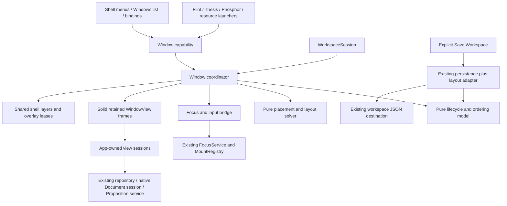
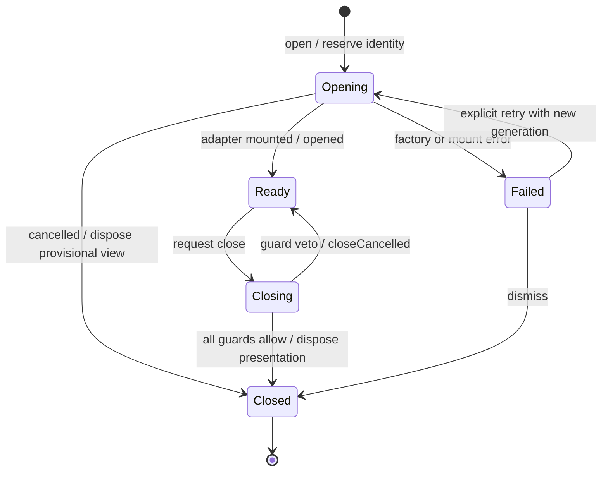
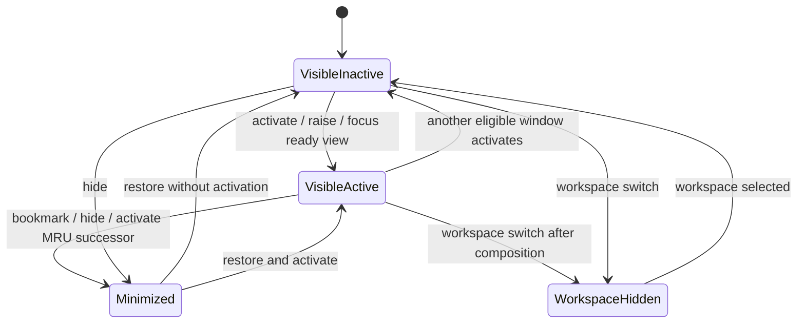

# Mutable Window Manager: architecture and implementation plan

**Status: A0, A1 and B accepted. Approved Milestone D0 is implemented and qualified, awaiting acceptance. C, D1 and later milestones remain unapproved.**

Executed D0 changes, the two-container format decision, anchor descriptor boundary and limitations are recorded in [Milestone D0 qualification](MUTABLE_WINDOW_MANAGER_D0_QUALIFICATION.md). See [Milestone B qualification](MUTABLE_WINDOW_MANAGER_B_QUALIFICATION.md) for accepted floating interactions and retained hosts. The longer-term contracts below remain proposals beyond that qualified scope.

See the [A1 qualification report](MUTABLE_WINDOW_MANAGER_A1_QUALIFICATION.md) for activation, lifecycle, Entity continuity and current limitations. The historical planning audit below remains the design reference. See the [A0 qualification report](MUTABLE_WINDOW_MANAGER_A0_QUALIFICATION.md) for implementation details, executed checks, baseline failures and scope limits.

Approval clarifications: retain a future common tool-chrome/positioning/docking capability boundary without adding those features in A0; distinguish mounted, visible and active views; Acetate is a distinct future application; preserve all existing JSON persistence formats and manual Save semantics. The A0 and A1 qualification reports supersede their planning estimates. The original planning-only audit below predates both implementations.

Prepared 20 October 2026 against repository commit `d0faa4c` and the current working tree. Revised to address both `MUTABLE_WINDOW_MANAGER_PLANNING_BRIEF.md` and `MUTABLE_WINDOW_MANAGER_PLANNING_ADDENDUM.md`. The companion [application-surface design](MUTABLE_WINDOW_MANAGER_APPLICATION_SURFACES.md) is part of this plan: it supplies the source inventory, scope contracts, Entity case study and qualification scenarios. Evidence comes from source inspection, existing test-source inspection, and the browser/platform references linked below. No application code, tests, schemas, dependencies, or generated artifacts were changed during this investigation. No tests, builds, benchmarks, load tests, migrations, or application sessions were run. Proposed tests and TypeScript below are specifications, not executed or installed code.

## 1. Recommendation and approval decisions

Introduce **one window authority for each live shell workspace session**, integrated into `WorkspaceSession`. Reuse the existing `WindowView`, `WindowGeometryHost`, `FocusService`, `MountRegistry`, command/binding registries, resource repository, and explicit workspace-save path. Applications receive a narrow window capability. They must not calculate stacking numbers or implement shell activation themselves.

Use a small **ManagedSurface** contract for shared ownership, focus, layering and lifecycle. Desktop windows are one specialization; application tools and ordinary overlay leases are others. A central metadata index arbitrates cross-app policy, while scoped app capabilities retain content, validation and local layout. Do not give every panel a WindowId. The actual **Link Entity Reference** tool is the first scope proof: keep its floating workflow, correct its ownership and modeless semantics, and defer docking and promotion.

Start with adoption of the existing desktop windows, shared ordering, and focus handoff. Treat desktop maximisation as geometry within the normal layer; it must not grant a higher layer. Remove the renderer's `101` floor and Thesis's compensating floor together when central ordering becomes authoritative. Do not resurrect the original Knockout/jQuery window manager.

Keep resource content in its current owner. A window is a presentation container, not a Document, SQLite Resource, or Proposition. Existing workspace `window-block` wrappers remain compatibility anchors initially. They are not a reason to invent another content repository.

Before implementing tiled/tabbed layouts, establish stable view lifetimes and an explicit persistence boundary. The proposed sequence is **A0 adoption/ordering → A1 focus/lifecycle → B floating interaction and stable hosts → D0 durable contract → C layouts → D1 restore/named layouts**. E and F remain separately approved future integrations. D0 moves earlier because tiled memberships and multiple views require durable identities that the current format cannot safely express.

Decisions requested with implementation approval:

| Decision | Preferred choice | Alternative and consequence |
|---|---|---|
| Manager lifetime | Owned by the canonical `WorkspaceSession`; injected into child editors and shell adapters | A global module singleton risks cross-workspace/Cavern references and conflicts with isolated demos |
| Initial scope | Existing canonical desktop windows plus minimal application-surface ownership/layer contracts in A0; Entity focus/lifecycle proof in A1 | Thesis-only management would leave tools able to obscure newly activated windows |
| Surface registry | One central metadata index with scoped registration capabilities; existing app/overlay owners retain content | Separate local ordering registries would require cross-app focus/modal reconciliation; making every widget a desktop window would overreach |
| Maximisation | Normal-layer geometry state | A privileged maximised layer recreates the reported bug |
| Window host lifetime | Preserve mounted frames during floating/tiled/tabbed desktop transitions | Rebuilding component trees requires every app to serialize all transient state, which is not supported today |
| Resource duplicates | Explicit reuse-window / new-view / new-window policy | Inferring policy from a resource GUID would conflate resource and view identities |
| Close | Close the presentation after guards; never delete the domain object | Domain deletion remains a separate app command |
| Persistence | Manual Save Workspace; versioned layout data and safe version rejection | Automatic session/crash persistence would add new write semantics; excluded initially |
| UI defaults | Existing chrome and menus; new MWM feature flag enabled by default once a milestone qualifies | A redesign or third-party docking framework increases migration risk and is unnecessary |
| Workspaces | Same live resource session may contain multiple arrangements; cross-Cavern moves rejected | Cross-Cavern transfer is a domain import, not window movement |
| Acetate | Distinct future application identity, potentially sharing Canvas infrastructure | Canvas remains the existing presentation infrastructure; it is not an alias for Acetate |

## 2. Current-state audit

### 2.1 Evidence inventory

Links are repository-relative. Function/component names identify the relevant call sites even if line numbers move. “Adapt” means a future milestone, not work authorised by this document.

| Area / surface | Evidence and present responsibility | Conflict / integration point | Disposition |
|---|---|---|---|
| Canonical shell | [workspace-demo.tsx](src/demo/workspace-demo.tsx), `CanonicalWorkspaceSession`; [workspace-session.ts](src/application/workspace-session.ts), constructor/dispose | Owns editor, projection, presentation and global input lifetime; best manager owner. Legacy split demo is a separate host | Adapt canonical shell; leave split demo isolated until explicitly qualified |
| App registration | [features.ts](src/application/features.ts), `registerApplicationViews`; [register-core-views.ts](src/rendering/register-core-views.ts) | Feature-scoped app registration and existing window capability; no uniform launch port | Reuse registration; add shell capability adapters |
| Desktop windows | [core-block-views.tsx](src/rendering/core-block-views.tsx), `WindowView`, approximately lines 482–734 | Shared chrome, drag, sizing and minimisation; z-index is metadata except maximised minimum 101; no common activation/MRU authority | Adapt renderer; replace its stacking policy |
| Document windows | Same `WindowView` for `document-window-block`; document style/status bars and margins | Window host and document data are presently linked through tree placements, but are distinct concepts | Reuse renderer and document controls; retain canonical resource ownership |
| Window geometry adapter | [window-geometry.ts](src/rendering/window-geometry.ts), `WindowGeometryHost`, `WindowResizePort` | Already distinguishes desktop metadata from externally hosted geometry; lacks lifecycle/layer policy | Extend or compose this port, rather than add a second geometry system |
| Resize | [floating-window-resize.tsx](src/rendering/floating-window-resize.tsx), `createFloatingWindowResize` | Pointer/keyboard previews, final commit, scale and viewport clamp; reads bounds during clamp; not a tiled solver | Reuse interaction mechanics; adapt work-area measurements and constraint policy |
| Maximise | [window-maximize.ts](src/rendering/window-maximize.ts), `createWindowMaximize` | Measures work area using `data-window-work-area`, resize/scroll observers; geometry separate from saved normal bounds | Reuse work-area intent; centralise shared cache and remove stacking side effect |
| Compact margins | [window-presentation.ts](src/rendering/window-presentation.ts); [runtime/window-presentation.ts](src/runtime/window-presentation.ts) | `WindowPresentation` is a single margin/chrome policy contribution, explicitly not a layout registry | Reuse; do not rename it into a manager or break compact-size conversion |
| Workspace open/reveal | [workspace-open.ts](src/application/workspace-open.ts), `geometry`, `insert`, `reveal`, `presentDocument` | Calculates maximum stored z; reveal forces state normal; opens resources into Flint, Phosphor or document windows; canvas/spatial have separate paths | Adapt all desktop branches to MWM; preserve resource resolution |
| Flint app | [document-application-capabilities.tsx](src/application/document-application-capabilities.tsx), `register`/`flint.open`, Instance/Target; [flint/index.tsx](src/features/flint/index.tsx) | Launcher inserts wrapper and calculates z independently; Instance retains navigation/bookmark maps; app hosts document tabs | Adapt launcher and lifetime hooks; do not merge its document tabs with shell tab groups |
| Ink editor views | [transient-document-view.tsx](src/rendering/transient-document-view.tsx), `TransientDocumentView` | Creates/disposes an occurrence projection sharing the repository; captures revision-checked selections. Remount does not preserve the same projection ID | Reuse selection and resource-sharing model; add persistent host/view identity where required |
| Thesis | [thesis.tsx](src/application/thesis.tsx), `open`, `openThesisSource`, `captureThesisDraft`; [view.tsx](src/features/thesis/view.tsx) | Opens a window with local 101 workaround; source reveal has its own z calculation. Draft is component state plus an isolated editor, with close guard and one active draft input router | First proof adapter. Preserve draft, receipts, selection provenance and manual Save; absorb only shell concerns |
| Phosphor | [phosphor.tsx](src/application/phosphor.tsx), `openPhosphor`, `phosphorWindowPresentation` | Creates/retains a canonical Document through object bank and reference placement, then independent wrapper/z. Application save owns its domain data | Adapt outer window; keep Phosphor editing, rendering and persistence |
| Sticky notes | [sticky-notes.ts](src/runtime/sticky-notes.ts); `WindowView` sticky branch; [sticky-note.tsx](src/rendering/sticky-note.tsx) | Floating sticky windows use a body Portal and stored z=10; transient draft panel is a different surface | Adopt durable floating window; coordinate draft overlay separately. Do not equate “sticky note” with user-pinned layer |
| Tabs/panes | [core-block-views.tsx](src/rendering/core-block-views.tsx), `TabRowView`, `TabPanelView`; Flint shell/context/Explorer panes | Authored tabs, application document tabs, and panes already exist; they are not workspace layout groups | Leave internal UI outside MWM; expose detachable views only via later app capability |
| Canvas | [workspace-presentation-view.tsx](src/application/workspace-presentation-view.tsx); [canvas/view.tsx](src/features/canvas/view.tsx); [canvas/interactions.ts](src/features/canvas/interactions.ts); [canvas-actions.ts](src/application/canvas-actions.ts) | Camera/placement sidecar, frame-batched gesture previews, static `WindowGeometryHost`; explicit qualification limits for embedded apps | Reuse independent host. Do not apply desktop pixel geometry or z policy to canvas world coordinates |
| Night Study / spatial | [spatial/model.ts](src/features/spatial/model.ts), `SpatialLayout`; [spatial/view.tsx](src/features/spatial/view.tsx); [spatial-actions.ts](src/application/spatial-actions.ts) | Implemented `night-study-v1` scene, metre-based placements, constrained live document handoff and bookmarks; some resources remain placeholders | Preserve implementation; future adapter boundary, not initial 3D development |
| Presentation switching | [workspace-session.ts](src/application/workspace-session.ts), `changePresentation`, `canvasRoots`; [workspace-presentation-view.tsx](src/application/workspace-presentation-view.tsx) | Composition deferral, selection capture and safeguards; only active roots mount. Opaque apps, drafts and dialogs may prevent switching | Retain safety gates; qualify each host adapter before relaxing them |
| Shared repository/occurrences | [types.ts](src/block-tree/types.ts); [editor.ts](src/reactive-editor/editor.ts), `createView`, `disposeView` | ContentKey, PlacementKey, NodeKey and ViewId have different meanings. A second projection need not duplicate content | Reuse; never persist runtime keys as durable window references |
| Focus and mounted elements | [focus.ts](src/runtime/focus.ts), `FocusService`; [mounts.ts](src/runtime/mounts.ts), `MountRegistry` | Tokenised pending focus, mount generation, native/inline selection. `FocusRequest.raiseWindow` exists but `applyPending` does not implement stacking | Add a shell focus bridge; retain editor focus service as caret authority |
| Keyboard/input | [gateway.ts](src/input/gateway.ts); [bindings.ts](src/input/bindings.ts); Thesis active draft router in `view.tsx` | Native Document listeners, event-path ownership, IME/opaque/modal fences; no window-wide router | Shell handles only window commands/activation; exactly one editor owner handles text input |
| Close/visibility | [editor.ts](src/reactive-editor/editor.ts), `viewCloseGuards`, `closeView`; [view-visibility.ts](src/reactive-editor/view-visibility.ts) | Close hides a placement without deleting content/history. Visibility uses stable IDs when available, serializes only on explicit save; guards currently synchronous | Adapt to lifecycle transactions with async guard support and compatibility wrapper |
| Context menus / entity panels / annotation monitors | [overlays.ts](src/runtime/overlays.ts); [contributed-panels.tsx](src/rendering/contributed-panels.tsx); [block-context-menu.tsx](src/rendering/block-context-menu.tsx); [annotation-monitor.tsx](src/rendering/annotation-monitor.tsx) | Session descriptors and focus-return bookmarks; body Portals and independent CSS layer numbers; not all `role=dialog` panels are modal | Reuse overlay registry; add owner/modal-layer coordination, not normal window entries |
| Other transient UI | [reactive-tree-view.tsx](src/rendering/reactive-tree-view.tsx), `ReactiveViewLayers`; document find, history, chord hint, compact toolbar, selection inspector, clipboard/interchange status | Layers are per projection; dialogs, inspectors and notices have different focus policies and arbitrary z values | Inventory into shared layer leases; preserve per-projection filtering and domain behaviour |
| True app dialogs | [document-dialog.tsx](src/demo/document-dialog.tsx); [block-history.tsx](src/rendering/block-history.tsx); collection/publication dialogs and Cavern startup | Portals, aria-modal, partial local focus trapping/return; role-based global checks are coarse | Adapt modal coordination and accessibility; do not rewrite unrelated forms |
| Shell menus / launchers | [codex-system-bar.tsx](src/demo/codex-system-bar.tsx); [workspace-demo.tsx](src/demo/workspace-demo.tsx); [workspace-open-controls.tsx](src/demo/workspace-open-controls.tsx) | Menu navigation and app launch buttons; minimised icons are in `WindowView`. No central reactive Dock/window list found | Reuse menus; add a modest Windows list when lifecycle exists, not a new Dock design |
| Resource viewers | [register-core-views.ts](src/rendering/register-core-views.ts); PDF, IIIF, web article, citation, academic, structured, source, iframe and media renderers | Mostly Block views, often opaque widgets; embedded editors/viewers are not automatically top-level windows | Adopt only containing window. Dedicated detached-view adapters later; iframe focus requires host cooperation |
| Persistence | [workspace-manifest.ts](src/reactive-editor/workspace-manifest.ts); [workspace-presentation.ts](src/reactive-editor/workspace-presentation.ts); [persistence.ts](src/reactive-editor/persistence.ts); [workspace-store.ts](server/workspace-store.ts) | Versioned manifest, layout sidecar, local capture and server bundle differ; no first-class durable view/window directory | Extend existing capture/restore boundary; no separate SQLite window schema |
| Legacy systems | [original window manager](src/library/original/parts/window-manager.js), [original Dock](src/library/original/parts/dock.js), [universe-block.ts](src/universe-block.ts), [window-block.ts](src/blocks/window-block.ts) | Older manager/layer/stack behaviour and `getHighestZIndex` are outside current reactive shell | Design references only; leave separate legacy path outside initial migration |

This inventory groups registered surface families; it does not claim that every third-party widget is detachable. Initial adapter qualification must enumerate instances through the live registrations, not assume every `opaque-widget` supports move or suspend.

### 2.2 Verified format and ownership facts

1. Server workspaces use `.json` names. `server/workspace-store.ts` validates JSON filenames; `workspace-browser.tsx` appends `.json`; `browser-json-file.ts` advertises JSON file types. There is no dedicated `.desktop`, `.canvas`, or `.world` workspace serializer in the inspected runtime paths. A legacy-import test deliberately excludes a `.desktop` file from Document discovery; that is not support for a desktop file format.
2. The server manifest is `kind: "speedy-workspace", schemaVersion: 1`, with `workspaceId`, a Document reference table, and a workspace Block root. Its parser rejects embedded Document content in a versioned manifest. Local save uses `captureWorkspace()` and an encoded workspace tree; it is not automatically the same artifact as the server manifest. The local loader explicitly rejects a server manifest. These two save routes must both be migrated and qualified. There is also a native-file integration boundary: client Document-source validation accepts `.json`/`.ink`, whereas the inspected server bundle source validator uses JSON filenames and rejects native destinations for bundled writes. A new layout codec must not bypass that protection; native resource resolution and Save remain separate.
3. `root.metadata.workspacePresentation` has envelope version 1. Desktop is `{version:1,kind:"legacy-tree"}`; Canvas has a camera and ordered object placements; Spatial is a separate supported entry decoded by its feature. Unknown fields are preserved; unsupported envelopes become opaque/read-only for presentation editing.
4. Workspace object targets currently support Block or Document identity. Canvas forbids multiple occurrences of the same object ID and rejects some overlapping render roots. Multi-view canvas is therefore a future format/ownership change, not an existing capability.
5. `workspaceViewVisibility` v1 records closed stable placement/Block identities separately from repository content. Ordinary close is not delete. Runtime identities without a stable saved form are excluded from its durable capture.
6. Flint's document views share a canonical repository. Selection belongs to occurrences, not just Document IDs. Thesis uses independent editable aggregate drafts and revision-checked SQL saves; two Thesis views must not be assumed to share one live mutable draft.
7. “Acetate” was not found as a named runtime component or command in the inspected source. The user clarified that it is a distinct future application concept, even if it shares Canvas infrastructure. Do not map or rename Canvas to Acetate. Night Study is already implemented as Spatial and must remain working throughout desktop changes.

### 2.3 Concrete defects and gaps that shape the design

- Stacking is independently computed in Thesis, Flint, Phosphor, workspace reveal/open, and sticky-note creation. A high z-index inside a lower ancestor stacking context cannot outrank another context.
- Maximisation currently changes effective stacking without changing stored z. The recent Thesis fix is a local workaround, not a shared policy.
- FocusService handles DOM/editor focus but does not coordinate window activation, rank or MRU. Clicking a window and raising a window have no single shared contract.
- `WindowView` changes geometry/state through repository metadata operations, while close visibility lives outside authored undo. MWM must explicitly preserve then migrate this mixed ownership, not silently create a second source of truth.
- Conditional rendering can unmount window contents on minimise and presentation switches. An unsaved component-local Thesis draft needs a retained lifetime before MWM can promise state-preserving minimise/rehost. Merely saving its text is insufficient: undo, pending operation receipt, selection and Entity panel state also matter.
- Global queries for `[role="dialog"]` conflate blocking dialogs with nonmodal tools. MWM needs explicit modal scope and ownership.
- Fixed z values range from ordinary windows to very high inspector/canvas layers. Fixing just app launch ranks does not guarantee modal precedence.
- The “resource” term in the domain model must not mean a new SQL Resource row. Propositions remain Entity + standalone Block aggregates.

## 3. Alternatives and selected architecture

| Approach | Advantages | Costs / reason not selected |
|---|---|---|
| Shared `nextZIndex()` utility only | Small immediate change | Does not resolve focus, lifecycle, nested stacking contexts, modal ownership or layouts |
| Reuse original WindowManager wholesale | Existing stacking and active-window concepts | Knockout/jQuery, old ownership and snapshot paths; would create a competing shell |
| External docking/window library | Prebuilt splits and tabs | Dependencies, styling, focus/DOM assumptions and resource lifetime migration; not warranted before adapter proof |
| New standalone shell and parallel window/content tree | Clear separation in a new application | Duplicates current repository/view ownership and makes incremental compatibility difficult |
| **Session-owned coordinator and adapters** | Central policy; reuses current services; incremental adoption | Requires a disciplined compatibility bridge and view-lifetime qualification; selected |

Do not begin with five independent manager classes. Implement a small pure transition model plus one session coordinator, a focus bridge, a pure layout solver, and a persistence adapter. Existing `WorkspaceSession` remains the workspace owner; existing `FocusService` remains editor-local. A separate multi-workspace directory is justified only when multiple live workspace arrangements are introduced.

Proposed modules (names illustrative):

| Module | Responsibility |
|---|---|
| `src/runtime/window-manager/model.ts` | Types, validated commands, state transitions, invariants; no DOM, fetch or Solid dependency |
| `src/runtime/window-manager/ordering.ts` | Normal/pinned order, MRU, owner relationships, effective eligibility |
| `src/runtime/window-manager/layout.ts` | Placement candidates, snap rectangles, split/tab constraints; pure arithmetic |
| `src/application/window-manager.ts` | Session coordinator, app factories, request cancellation, lifecycle guards, compatibility adoption |
| `src/application/window-focus.ts` | Active view routing, bookmarks, composition barrier, mount-ready focus generation |
| `src/rendering/window-shell.tsx` | Shared layer root and retained frames, existing chrome/geometry adapters, overlay leases |
| `src/feature-api/windows.ts` | Narrow app-facing capabilities, independent from repository internals |
| Application-surface contracts within the above model/capability modules | Owner app/window and occurrence bindings, scoped leases, placement and modal descriptors; no separate tool-window engine |
| `src/reactive-editor/window-layout-persistence.ts` | Versioned descriptors, old-format import, explicit snapshot/restore |

The declared toolchain in [package.json](package.json) is SolidJS (`^1.7.6`), Vite (`^4.3.9`), TypeScript (`^5.6.2`) and Vitest (`^2.1.9`), with Kobalte already available. These are dependency ranges, not a claim about every installed version. Use existing Solid stores/signals and native Pointer Events; no React abstraction, new docking dependency, or dependency upgrade is proposed. Fullscreen, file pickers, browser-owned shortcuts and cross-origin iframes remain browser capability boundaries, not features that a shell z-index can override.

No module is to be created before approval.



```mermaid
sequenceDiagram
  participant User
  participant App as Ink / Thesis command
  participant WM as Window coordinator
  participant View as App view session
  participant Mount as MountRegistry / FocusService
  User->>App: Create Proposition from selection
  App->>App: Capture exact text, annotations, source evidence and return bookmark
  App->>WM: open(viewFactory, placementHint, focusPolicy)
  WM->>WM: Validate policy; reserve ID; place above normal windows
  WM->>View: Construct unsaved draft session
  View->>Mount: Register mounted editor occurrence
  Mount-->>WM: Ready with matching generation
  WM->>Mount: Focus new draft if activation token is still current
  Note over App,View: No source mutation and no Proposition records until Save
```

## 4. Domain model and contract sketches

### 4.1 Identity and ownership rules

- **Resource reference:** durable identity plus authority scope. A Document reference resolves through the native/resource binding; a Proposition through Cavern/vault + Entity GUID; an authored Block through its owning Document/workspace + Block ID. URLs or filenames are locator hints, not authority.
- **View instance:** runtime app/session ID with a stable optional restore key. Owns selection, scroll, subscriptions and transient operations. May display one or several resources (Flint has multiple document tabs). A view references domain data; MWM never clones that data.
- **Window instance:** runtime shell ID hosting one view session. Has an optional durable window-entry key. It is not the app's resource GUID or a `NodeKey`.
- **Workspace:** live session/authority plus arrangements. A layout switch inside that session does not reopen a Cavern or duplicate its repository. Multiple simultaneously loaded Caverns are outside the initial implementation.
- **Layout group:** arrangement of window entries. Shell tabs group windows; Flint tabs remain internal views of Documents.
- **Host instance:** desktop/window, Canvas, embedded pane, or later spatial host. Each live view has exactly one primary host lease. Creating another view allocates a new session; moving a view transfers its lease.
- **Parent relation:** distinguish `owned` transient child from `related` independent window. Thesis extracted from Ink is related, not owned: closing the source does not close the Proposition draft.
- Runtime IDs never enter saved JSON. Restore keys are stable descriptor identities scoped to the saved workspace; restore allocates fresh runtime IDs and rebuilds maps. Reject duplicate keys, cycles and ambiguous targets rather than choose by title/path.

### 4.2 Illustrative TypeScript

These sketches define semantics; they are not repository-ready declarations. `JsonValue` means a validated JSON value; runtime ports and bookmarks are not serializable.

These are the desktop specialization. The companion [surface contracts](MUTABLE_WINDOW_MANAGER_APPLICATION_SURFACES.md#3-contract-sketches-and-invariants) define their common ownership/focus envelope. Existing desktop APIs remain convenient facades over one coordinator; they do not create a second registry.

```ts
type WindowId = string & { readonly windowRuntime: unique symbol };
type ViewInstanceId = string & { readonly viewRuntime: unique symbol };
type WorkspaceId = string; // stable saved workspace identity
// Separate key spaces in the serializer, never aliases for runtime IDs.
type ViewRestoreKey = string;
type WindowRestoreKey = string;
type LayoutId = string;
type LayoutNodeId = string;
type Layer = "normal" | "pinned";
type Rect = { x: number; y: number; width: number; height: number };

type ResourceRef =
  | { kind: "document"; cavernId: string; documentId: string }
  | { kind: "block"; owner: { kind: "document" | "workspace"; id: string };
      cavernId: string; blockId: string }
  | { kind: "proposition"; cavernId: string; vaultGuid: string; entityGuid: string };

interface ViewDescriptor {
  appId: string;                 // allowlisted app registration
  descriptorVersion: number;
  restoreKey?: ViewRestoreKey;   // omitted for non-restorable drafts
  resources: readonly ResourceRef[];
  initialState?: JsonValue;      // app-validated UI configuration, not resource content
  persistence: "none" | "descriptor";
}
interface WindowCapabilities {
  move: boolean; resize: boolean; minimize: boolean; maximize: boolean;
  close: boolean; pin: boolean; tile: boolean; tab: boolean;
  minSize: { width: number; height: number };
  maxSize?: { width: number; height: number };
  rehost: "unsupported" | "desktop-layouts" | "adapter";
}
interface WindowDescriptor {
  id: WindowId; viewId: ViewInstanceId; workspaceId: WorkspaceId;
  restoreKey?: WindowRestoreKey;
  title: string;                 // app title accessor updates independently
  layer: Layer;
  relationship?: { parent: WindowId; kind: "owned" | "related";
    onParentClose: "close" | "detach" | "veto" };
  capabilities: WindowCapabilities;
}
type DisplayMode = "floating" | "tiled" | "tabbed";
interface WindowState {
  lifecycle: "opening" | "ready" | "closing" | "failed";
  visibility: "visible" | "minimized" | "workspace-hidden";
  mode: DisplayMode;
  maximized: boolean;            // orthogonal; restore preserves mode/slot
  bounds: Rect;                 // effective CSS work-area coordinates
  normalBounds: Rect;           // remembered floating geometry
  returnSlot?: { layoutId: LayoutId; nodeId: LayoutNodeId };
  generation: number;
  // Active window and ordered lists are stored centrally, not duplicated here.
}
interface WindowPlacementRequest {
  policy: "near-source" | "beside-parent" | "cascade" | "center" |
          "remembered" | "tile-insert";
  preferredSize?: { width: number; height: number };
  // Snapshot supplied at the explicit launch action; never a live DOM Range in JSON.
  source?: { viewportRects: readonly Rect[]; workAreaGeneration: number };
  parent?: WindowId;
  targetLayout?: LayoutId;
}
type LayoutNode =
  | { id: LayoutNodeId; kind: "leaf"; entry: WindowRestoreKey }
  | { id: LayoutNodeId; kind: "split"; axis: "horizontal" | "vertical";
      ratio: number; first: LayoutNode; second: LayoutNode }
  | { id: LayoutNodeId; kind: "tabs"; entries: WindowRestoreKey[];
      active: WindowRestoreKey };
interface WorkspaceLayout {
  id: LayoutId; name: string;
  tree?: LayoutNode;
  floating: Array<{ entry: WindowRestoreKey; bounds: Rect }>;
  minimized: WindowRestoreKey[]; // retain slots, exclude from visible solve
  normalOrder: WindowRestoreKey[];
  pinnedOrder: WindowRestoreKey[];
  lastActive?: WindowRestoreKey;
}

type OpenPolicy =
  | { kind: "reuse-window"; reuseKey: string }
  | { kind: "new-view" } // new view session, normally a new shell window
  | { kind: "new-window"; viewId: ViewInstanceId }; // only an unhosted/detaching view
interface WindowManager {
  open(view: ViewDescriptor, options: {
    policy: OpenPolicy; placement: WindowPlacementRequest;
    focus: "activate" | "background"; signal?: AbortSignal;
  }): Promise<{ windowId: WindowId; viewId: ViewInstanceId; reused: boolean }>;
  activate(id: WindowId, reason: string): Promise<void>; // reveal + raise + focus
  focus(id: WindowId, bookmark?: unknown): Promise<void>; // no implicit raise
  raise(id: WindowId): void; // within authorised layer; no focus change
  close(id: WindowId, reason: string): Promise<"closed" | "cancelled">;
  minimize(id: WindowId): Promise<void>;
  restore(id: WindowId, options?: { activate: boolean }): Promise<void>;
  maximize(id: WindowId): Promise<void>;
  unmaximize(id: WindowId): Promise<void>;
  setBounds(id: WindowId, bounds: Rect, phase: "preview" | "commit"): void;
  moveToWorkspace(id: WindowId, workspace: WorkspaceId): Promise<void>;
  tile(id: WindowId, target: { layout: LayoutId; beside?: LayoutNodeId;
    edge: "left" | "right" | "top" | "bottom" | "tab" }): Promise<void>;
  untile(id: WindowId): Promise<void>;
  setPinned(id: WindowId, pinned: boolean): void;
  cycle(direction: 1 | -1): Promise<void>;
}
interface ViewSessionPort {
  readonly id: ViewInstanceId;
  ready(signal: AbortSignal): Promise<void>;
  composing(): boolean;
  captureFocus(): unknown; // typed per editor adapter, bounded to this view
  restoreFocus(bookmark: unknown, signal: AbortSignal): Promise<void>;
  prepareClose(reason: string): Promise<"allow" | "cancel">;
  serializeDescriptor(): ViewDescriptor | undefined;
  setVisible(visible: boolean): void; // suspends optional services, not ownership
  dispose(): void;
}
interface WindowLifecycleEvent {
  type: "opening" | "opened" | "activated" | "deactivated" | "minimized" |
        "restored" | "boundsCommitted" | "layoutChanged" | "closeRequested" |
        "closeCancelled" | "closed" | "failed";
  windowId: WindowId; transactionId: string; generation: number;
  reason: string;
}
```

The `LayoutNode` sketch is the durable representation. The runtime solver uses the same structure with runtime window references; the persistence adapter maps only eligible entries to `WindowRestoreKey`. Unsaved drafts can participate in live layouts without becoming restorable resources. On explicit workspace capture, omit non-restorable draft entries and collapse their empty saved slots in the detached snapshot only; leave the live layout and draft untouched, and disclose that the draft will not return after restart.

`new-window` must reject an already-hosted view unless an explicit transfer operation is supplied. It must not accidentally mount the same occurrence twice. Applications define reuse keys: a Cavern-scoped Proposition ID plus app mode is reasonable for a saved Thesis editor; a selection draft must always get a new session. MRU breaks ties when several existing windows qualify. No title-based matching.

Two separately editable saved Proposition views use their existing aggregate revision checks. They may conflict on Save; MWM must not merge or overwrite either draft. Document views sharing a repository do observe the same authored edits while retaining separate selection/scroll state.

## 5. Lifecycle, activation and focus

### 5.1 State machines

Three independent view facts must be explicit: **mounted** means the editing view exists; **visible** means it is exposed by its owner/presentation; **active** means native focus currently belongs to that owner. A retained hidden view can be mounted but neither visible nor active. A minimized icon may be mounted chrome while its editing view is unmounted. A0 records these facts and leaves existing mount/minimize behaviour intact; later qualified adapters may use visibility to suspend optional work without destroying editing state. These are not three names for one boolean. A0 observes focus without introducing A1 activation arbitration, MRU or focus restoration.





Maximised, floating, tiled and tabbed states are orthogonal to this focus machine. A blocking modal temporarily owns focus while its parent window remains the logical active owner. Browser focus leaving the tab does not choose a new active app.

### 5.2 Required event order

| Operation | Ordered steps and cancellation rules |
|---|---|
| Launch | App captures source/return context before focus changes → validate authority/reuse policy → allocate provisional IDs and generation → emit opening → create/attach session → calculate placement → register frame/owner/input mapping → publish visible rank → wait for mounted readiness → if activation token still current, activate and focus → emit opened/activated. Failure disposes only provisional presentation resources |
| Activate existing | Validate eligibility/modal scope → restore if minimised and select appropriate workspace/tab group → finish or defer composition → bookmark current view → raise within layer → update active/MRU → focus ready view → emit deactivated/activated. Clicking inside an editor must preserve the browser's clicked caret, not restore an old bookmark over it |
| Raise | Change only layer-local order; do not select text or steal focus. Programmatic background opens use this independently |
| Minimise | Capture focus/restore mode → dismiss ephemeral menus without stale focus returns; suspend retained tools and modal leases → release drag capture → retain view session but hide/inert its frame → choose eligible MRU successor → focus successor or shell fallback → emit minimized. Do not unmount an unsaved Thesis editor |
| Restore | Restore prior mode, slot and maximisation intent; validate current work area → show frame → optionally activate → restore bookmark only when occurrence/version/generation is valid → emit restored |
| Close | Emit closeRequested → gather owned descendants → obtain all guards, child-first → if any veto, change no host/layout memberships and emit closeCancelled → cancel scoped async work/input/overlays → update memberships/order/active successor atomically → dispose sessions whose final host lease is released → emit closed once → restore focus if its token still current |
| Layout/host change | Validate destination capability and constraints → wait for composition completion → cancel/finish owned gesture according to user action → capture occurrence bookmark → commit membership/geometry atomically → keep mounted desktop frame → restore only if rehosting required and bookmark valid → emit layoutChanged |

Opening tasks must not steal focus after the user activates something else. Use request tokens tied to window/view generation, not bare `queueMicrotask` callbacks. Closing while a factory is loading aborts it; late completion is disposed and cannot recreate the window.

### 5.3 Focus bridge and keyboard ownership

The manager records the active window and its last focus bookmark. The existing editor service remains responsible for actual caret placement. Bookmarks include editor/view identity, occurrence or stable placement locator, content revision, mount generation, inline/native selection and relevant scroll position. Rebase through existing editor range mapping where supported; if a bookmark cannot be verified, focus a safe current editor position and disclose stale selection when navigation semantics require it. Do not serialize DOM Ranges.

Capture a window root/owned portal mapping on mount. `pointerdown` and `focusin` resolve that mapping through the event path or a WeakMap; they must not enumerate Documents, cells, open files, or the repository. A pointer into an already-active window is an early no-op for window state. Ordinary typing does not run MWM work.

Shell commands are dispatched only for the active eligible window. Native input continues through the existing gateway and active child editor. Thesis's isolated gateway needs an ownership adapter, not another shell-wide keyboard listener. An `opaque-widget` remains opaque for editor commands while still belonging to an activatable window. Iframe content cannot expose its internal selection across origins; its frame is the shell focus target unless a supported adapter supplies more.

Expose `window.next`, `window.previous`, `window.minimize`, `window.restore`, `window.close`, `window.move` and `window.resize` through the existing command registry and accessible window menu. Choose configurable default accelerators only after browser/OS conflict qualification; do not claim Alt+Tab, Cmd+Tab, Ctrl+Tab, Cmd+W or browser reserved shortcuts. Keep the accepted Thesis Cmd/Ctrl+Shift+P binding unchanged in this project.

### 5.4 Parent/child and dirty state

Owned dialogs/tools close with their owner after their guards. Independent windows linked to a source do not. Parent minimise hides owned nonmodal tools and restores their prior visibility; related windows stay visible. Cyclic ownership is rejected. An owned blocking child redirects parent activation to the child.

A close guard is app-owned. MWM cannot infer “safe to discard” from a window's title or the presence of a Resource. Documents remain manually saved; Thesis retains its dirty draft and pending receipt semantics. Guard dialogs may perform explicitly requested Save operations; a later guard cancellation cannot undo a completed Save, but must leave all windows open. Workspace switching hides and retains sessions by default; opening a different Cavern uses the existing coordinated close/unload boundary.

## 6. Layering and rendering specification

### 6.1 Layer policy

| Order | Layer | Rules |
|---|---|---|
| 0 | Desktop/background | Wallpaper and non-window background surfaces |
| 1 | Normal | Ordinary windows, including maximised windows; newest activated normal window is above other normal windows |
| 2 | Pinned/floating | Explicitly pinned windows; never granted to Thesis merely because it was just created |
| 3 | System chrome | Menus, launcher/Windows list, work-area boundaries; normal windows cannot cover these |
| 4 | Shell-owned transient overlays only | Short-lived shell menus; require shell-issued leases. App tools and app menus remain in their owner's window group, below later normal groups and pinned windows |
| 5 | Workspace-modal scopes | Backdrop and dialog; lower scopes are inert and cannot receive activation. Owner-local modals stay in their window groups |
| 6 | Active workspace modal's transient overlays | Its own menu/picker/tooltips; another window cannot acquire this layer |

Layer numbers above are conceptual ordering, not constants applications may write. Browser-owned dialogs and top-layer elements are outside ordinary CSS ordering.

Use one untransformed shell layer root in the active browser document. Desktop frames should have a stable shared parent. Normal and pinned ranks can be dense ordered bands within its window plane; parent system/overlay/modal planes isolate them. For example normal ranks occupy `1..N`, pinned ranks `N+1..N+P`, with the whole window plane below system chrome. Reindex only on explicit registry/order changes. No unbounded `max(z)+1` accumulation, no per-keystroke scans and no absolute app-supplied z value.

Each desktop rank is an **owner group**: frame/content → floating tools → app transient overlays → owner-scoped modal/backdrop → that modal's descendants. A portal can escape clipping without escaping its group rank. Activating Thesis raises its whole normal group above inactive Ink and Ink's tools. Pinned ownership is inherited; a tool cannot independently pin itself. Workspace modals occupy layer 5 above all normal/pinned groups, while owner-scoped modals remain in their group. See the companion for physical host and focus-boundary rules.

Keeping normal/pinned frames in the same parent allows pinning and desktop layout changes without moving their editor DOM. Shell layer containers have explicit positioning/isolation. Transformed Canvas/Spatial content remains in its own host, while its overlays acquire shell leases with viewport coordinates. Preserve theme and Solid provider context when moving outer window rendering to the shell root; selectors depending on old background ancestry must be audited.

A CSS transform or isolation can establish a stacking context; a descendant's z-index is compared inside that context. Therefore raising a nested child's number is not sufficient. [MDN stacking-context reference](https://developer.mozilla.org/en-US/docs/Web/CSS/Guides/Positioned_layout/Stacking_context)

Solid's Portal preserves component context and events follow the component hierarchy even when DOM placement differs. Native Document capture listeners still need correct physical event-path ownership. A Portal is a rendering mechanism, not evidence that changing its mount preserves every app's DOM/session state. [Solid Portal reference](https://docs.solidjs.com/reference/components/portal)

### 6.2 Modal and transient coordination

Keep the existing overlay registry as the content/session owner; add an adapter to central surface metadata with `ownerAppInstanceId`, `ownerWindowId`, `parentSurfaceId`, explicit modality, layer lease and close policy. Context menus do not get WindowIds or appear in the Windows list. Annotation/Entity panels remain modeless unless their own interaction contract says otherwise. Do not make every `role="dialog"` blocking. Entity's current conditional `aria-modal` is not evidence of a working modal contract.

A workspace modal blocks all lower window activation; an owner-modal blocks its declared window or application family but permits unrelated windows through explicit shell activation. A0 establishes these distinctions; A1 qualifies focus enforcement and an owner-modal proof. Choose scope from the actual operation: a shell workspace dialog may block the workspace, whereas Flint storage belongs to Flint. Do not broaden every app dialog into workspace modality. Nested modals form a stack within their blocking scope; only the top scope accepts input there. Close restores the exact permitted invoker or the next eligible owner/shell fallback. For owner-local blocking that permits unrelated app interaction, use named dialog semantics without claiming whole-page `aria-modal=true`; qualify assistive-technology behaviour before release.

For custom modals, implement inert background, reliable initial focus, contained Tab/Shift-Tab, Escape according to the app's cancel policy, accessible naming and focus return. A nonmodal window must not trap Tab or claim `aria-modal`. [WAI dialog pattern](https://www.w3.org/WAI/ARIA/apg/patterns/dialog-modal/)

`showModal()`, fullscreen and popovers can occupy the browser top layer, which ordinary z-index cannot overtake. Existing custom portal dialogs should be adapted first; converting them all to native dialogs is outside A. If a later modal uses the native top layer, mount its owned overlays within that dialog or coordinate top-layer order explicitly. Browser native file pickers/confirm dialogs remain external blocking interactions. [MDN top layer](https://developer.mozilla.org/en-US/docs/Glossary/Top_layer)

## 7. Placement, floating interactions and layout algorithms

### 7.1 Placement

All desktop bounds are CSS pixels relative to the shell work area, not device pixels or Canvas metres. Capture source geometry once at explicit launch through the existing measurement adapter. Use cached caret geometry when valid; a selected range may require one bounded range-rectangle read. Do not sweep source cells or take a full Document snapshot to place a window.

For `near-source`, generate candidates right, left, below and above the source rectangle with a modest gap. Score them deterministically by offscreen area (hardest penalty), overlap with source selection, distance to the source, and overlap with other visible windows. Tie-break by candidate order. Clamp to reachable bounds; respect app minimum dimensions where feasible. If none fits beside the source, use the largest usable region/centred placement and keep a clearly accessible source-return action. Non-overlap cannot be guaranteed on a small screen.

For remembered bounds, validate finiteness and current viewport before use. For cascade, use a bounded offset and wrap within the work area, not an offset proportional to a monotonically growing z-index. Beside-parent uses the parent's effective rectangle. A maximised source still allows a normal Thesis window over it; do not restore or shrink Flint as a side effect.

Maintain one work-area cache invalidated by visual viewport changes, relevant scrolling, shell chrome size and zoom/scale changes. Read layout before DOM writes; retain previous geometry to avoid unchanged output. A host transform change invalidates its viewport conversion and the affected editor's geometry, not every open Document.

### 7.2 Floating window rules

Reuse existing chrome and compact-margin conversion. Drag/resize uses pointer capture, live preview and one committed transition per gesture; Escape, lost capture, disposal and window blur cancel safely. A titlebar drag must not start text selection, and focusing a content editor must not unexpectedly move its caret. Keyboard move/resize operates from a discoverable window-menu action with arrow keys, fine/coarse steps, Enter commit and Escape cancel. Touch gets usable handles without disabling document scrolling everywhere.

Min/max sizes include chrome. On a viewport smaller than an app's minimum, keep the titlebar and close/restore controls reachable and provide internal scrolling; do not silently shrink the editor below a declared hard minimum. Distinguish a preferred minimum from a hard input-usable minimum in the final app capability if existing apps need both. Validate compact-margin sizing against the existing `WindowResizePort`.

Maximise stores normal bounds and previous layout membership, then uses work-area bounds. Restore clamps the remembered normal rectangle. Minimise retains prior maximisation intent. Browser fullscreen is a separate, user-activated capability; MWM maximise never invokes it. Viewport zoom and device pixel ratio do not multiply persisted CSS bounds.

### 7.3 Snapping, split trees and tabs

Use a binary split tree and tab-group leaves, alongside a floating list. Do not model tiling by changing Document child placements. A window entry occurs at most once in a named layout; a new view of the same resource has a different entry.

- Halves and quarters are deterministic split presets. Snap zones are calculated from the shared work area; show a preview and commit on release. Touch/keyboard users can choose the same preset from a menu.
- Bottom-up constraint propagation: horizontal split minimum width is `left.minWidth + gutter + right.minWidth`, height is the maximum child minimum; vertical uses the dual formula. Tabs use the maximum member minimum plus tab chrome. Maxima propagate where meaningful.
- Top-down allocation: derive available axis length minus gutter, clamp the requested ratio to child feasible ranges, and allocate the rounding remainder deterministically so no gaps or negative bounds appear. Return explicit `unsatisfiable` diagnostics instead of producing invalid dimensions.
- Cache constraints by layout-node and capability revision. A divider updates its ancestors and affected subtree; it does not traverse unrelated Documents. Only changed rectangles notify frames. Solver cost follows layout windows, not text volume.
- A new tile request that cannot fit is rejected with an alternative “add as tab” action; do not silently rewrite the layout. If an existing layout becomes too small after viewport shrink, render an explicitly signalled temporary tabbed presentation of the affected subtree, retaining its saved split structure so expanding the viewport restores it.
- Close removes the leaf/tab member and collapses empty or single-child splits. Choose an adjacent surviving tab, otherwise MRU. Minimise retains its return slot but excludes it from visible constraint solving; if siblings later close, restore uses the nearest surviving slot or floating fallback.
- Maximise a tiled window temporarily covers the desktop work area at its existing layer, retaining its slot. Unmaximise restores the tree. Pinning a tiled window detaches it to floating with a retained return slot; unpin returns it where feasible.
- Floating → tiled → tabbed → floating changes frame geometry, visibility and group membership, not app session identity. Stable desktop frames remain mounted; inactive tabs are hidden/inert and removed from navigation, not destroyed. The last floating rectangle is retained independently.
- Closing/moving one tab from a group cannot dispose the other views. A layout switch that would omit a dirty view retains it in an unplaced/recovery list or asks the app guard; it never discards it implicitly.

## 8. Persistence and workspace restoration

### 8.1 Runtime versus durable state

Runtime only: WindowId/ViewInstanceId, NodeKey, projection objects, DOM references, active pointer capture, modal stack, pending requests/operation tokens, live caret ranges, transport capabilities and file handles. Unsaved Thesis draft contents and receipts remain app session state; MWM must not turn them into hidden document saves.

Application SurfaceIds, scope IDs, anchor leases, Entity linking targets, candidate selections and uncertain Entity-write attempts are also runtime-only. Do not restore Link Entity Reference after a crash or replay a creation request from layout data. Later explicit workspace saves may contain app-validated inspector layout preferences or independent resource-browser descriptors; app-local dock settings are not desktop tile nodes.

Durable on explicit Save Workspace: stable view/window restore keys, app descriptor version, scoped resource references, normal bounds, layer, minimised/maximised intent, layout tree, selected shell tab, relative order, named arrangement and optional validated app UI preferences. Scroll/caret bookmarks are optional app descriptors, only when they can be expressed with durable identities/version evidence and restored safely. Never persist a DOM selector as the identity of a resource.

Keep dirty clocks separate: workspace layout changes affect workspace-layout dirty state; Document edits affect the existing per-document dirty state. Activation/MRU alone need not mark the workspace dirty, although the current last-active preference may be captured on explicit save. No layout serialization, Document snapshot, vault discovery or indexing during typing. No autosave or Markdown sidecars.

### 8.2 Version strategy and example

**Preferred D0 decision:** retain `.json` and the existing workspace save infrastructure, but introduce a supported manifest schema version 2 and a managed desktop entry version 2. Preserve the surrounding `workspacePresentation` v1 envelope and unchanged Canvas/Spatial entries. The validator must explicitly accept the new desktop kind; it currently rejects it. Do not write the new structure into v1 files while relying on old readers to understand it.

A new outer manifest version makes older builds reject a managed workspace rather than silently overwrite unsupported layouts. Local workspace-tree saves have no equivalent outer manifest today. **Preferred: share the managed-desktop payload codec while preserving two honest storage containers.** Server uses `speedy-workspace` schemaVersion 2 with external Document references. Local uses a new `speedy-local-workspace` schemaVersion 2 wrapper around the existing self-contained workspace tree, with `workspaceId` and `root`; it does not fabricate server paths or move content into a server reference table. The old local loader requires a top-level `type: "workspace-block"`, so it will reject the new wrapper rather than accidentally editing it. New loaders retain explicit support for old raw trees.

The alternative is one unified v2 resource-package format with embedded/external source variants. That is more general but expands this window-management project into resource packaging. Prefer the two-container adapter above. Confirm this versioning decision at D0 review; no codec change is authorised here.

Illustrative fragment inside a v2 **server** manifest; resource table/root children and Canvas/Spatial data are abbreviated by omission, not intended as a complete loadable fixture:

```json
{
  "kind": "speedy-workspace",
  "schemaVersion": 2,
  "workspaceId": "workspace-research",
  "documents": {
    "doc-17": {
      "documentId": "doc-17",
      "source": { "kind": "document-store", "folder": "notes", "filename": "Research.json" }
    }
  },
  "root": {
    "type": "workspace-block",
    "id": "workspace-root",
    "metadata": {
      "workspacePresentation": {
        "version": 1,
        "active": "desktop",
        "objects": [],
        "presentations": {
          "desktop": {
            "version": 2,
            "kind": "managed-windows",
            "views": [
              {
                "restoreKey": "view-flint-a",
                "appId": "flint",
                "descriptorVersion": 1,
                "resources": [{ "kind": "document", "cavernId": "cavern-a", "documentId": "doc-17" }],
                "initialState": { "activeDocumentId": "doc-17" },
                "persistence": "descriptor"
              },
              {
                "restoreKey": "view-thesis-a",
                "appId": "thesis",
                "descriptorVersion": 1,
                "resources": [{ "kind": "proposition", "cavernId": "cavern-a", "vaultGuid": "vault-a", "entityGuid": "proposition-42" }],
                "persistence": "descriptor"
              }
            ],
            "windows": [
              { "restoreKey": "window-flint-a", "view": "view-flint-a", "layer": "normal", "maximized": false },
              { "restoreKey": "window-thesis-a", "view": "view-thesis-a", "layer": "normal", "maximized": false }
            ],
            "activeLayout": "layout-reading",
            "layouts": [{
              "id": "layout-reading",
              "name": "Reading and propositions",
              "tree": {
                "id": "split-main", "kind": "split", "axis": "horizontal", "ratio": 0.6,
                "first": { "id": "left", "kind": "leaf", "entry": "window-flint-a" },
                "second": { "id": "right", "kind": "leaf", "entry": "window-thesis-a" }
              },
              "floating": [],
              "minimized": [],
              "normalOrder": ["window-flint-a", "window-thesis-a"],
              "pinnedOrder": [],
              "lastActive": "window-thesis-a"
            }],
            "floatingBounds": {
              "window-flint-a": { "x": 24, "y": 24, "width": 900, "height": 650 },
              "window-thesis-a": { "x": 70, "y": 70, "width": 740, "height": 680 }
            }
          }
        }
      }
    }
  }
}
```

Values such as app UI state and short IDs are illustrative. Production validators retain actual domain ID constraints. The Proposition does not enter the Document table and does not acquire a fake file or Resource row. Existing canonical wrapper trees can remain compatibility anchors, referenced by durable IDs, but managed geometry/order is authoritative once present. No duplicated app resource payload is introduced.

### 8.3 Import, save, restore and failures

1. **A/B compatibility:** import legacy wrapper state at session attach. Central ordering owns runtime ranks. Until D, explicit workspace capture projects the current effective ordering/geometry into a detached legacy snapshot through one adapter. No automatic file rewrite. Existing geometry undo remains supported through a tagged bridge: repository undo changes are imported once; manager-origin writes are not reimported recursively.
2. **D migration:** parse known versions in memory, validate first, build stable descriptor maps from authored Block/placement IDs, and preserve raw unknown fields. Missing durable wrapper IDs are assigned only during an explicit format-upgrade/save operation. Existing files remain unchanged until Save or Save As. Prefer a new named file for first upgrade; support the existing overwrite choice with version checks.
3. **One authority:** if managed layout exists, do not independently apply legacy `metadata.zIndex`, `state`, visibility and new layout at startup. Define a single precedence rule: managed desktop for shell state; domain/app data remains in existing owners. Retain legacy values only as uninterpreted compatibility data or an explicitly generated export, never another live writer.
4. **Restore:** validate container → resolve resource authorities without inventing targets → instantiate descriptor placeholders and layouts → create fresh runtime sessions in bounded batches → mount only eligible views → apply geometry → activate the saved eligible window once. Restore must not let every app's `onMount` steal focus.
5. **Missing/changed targets:** preserve a placeholder with label, original reference, Retry, Locate/Relink and Remove from layout. Relink requires explicit identity validation; never substitute another Document with the same filename or Proposition label. Archived Propositions remain resolvable. Unknown app/descriptor versions are placeholders and round-trip unchanged.
6. **Corruption:** duplicate keys, ownership cycles, repeated layout entries, invalid ratios/bounds and ambiguous references fail validation. Keep original data for review; offer a safe fallback view/repair copy rather than silently rewriting. Unsupported future versions are read-only or refused.
7. **Partial restore:** one app failure does not destroy other sessions. Failed opening has a cancellable retry generation; saved ordering and placeholder identity remain stable. Resource deletion while open triggers the domain adapter's unavailable state, not implicit resource recreation.
8. **Save consistency:** capture a layout revision token and app descriptors outside typing; acknowledge only the captured revision after successful I/O. A layout changed during save remains dirty. Restore/save must reuse existing path confinement and native-resource protections. Layout-only Save must not call Document/Proposition Save implicitly; legacy explicit bundle-save behaviour must be documented separately and preserved until a reviewed change.
9. **Crash:** initial guarantee is restoration of the last explicitly saved workspace and domain files. No promise to recover unsaved drafts or the last activation. Crash journals/autosession writes require a separate approved design. Beforeunload warnings remain best effort.
10. **Workspace switching:** hide/inert inactive frames and pause optional drawing/media services where adapters support it. Do not evict dirty or nonserializable sessions. Memory-pressure eviction is future work. Moving between arrangements within the same resource session preserves view identity; moving across unrelated repository/Cavern sessions is rejected initially.

## 9. Mutable integration and migration matrix

| Integration | A/B adaptation | C/D requirements | E/F boundary |
|---|---|---|---|
| Ink | Associate mounted occurrence with containing shell; delegate actual caret to existing services | Keep projection/view session stable across shell layouts; revision-safe bookmarks | New view may create another projection over the same resource; detach must preserve registration ownership |
| Flint | Route launch/reveal through manager; outer frame adoption | Retain internal tab/bookmark/navigation state; shell tabs contain whole Flint views | Detach a Document tab only through a Flint view-session adapter; never move canonical Document ownership by DOM action |
| Thesis | Replace local stacking and source-reveal calculations; launch normal/frontmost; preserve source bookmark | Retain draft/undo/receipt state through minimise/tab switch; saved aggregate descriptor restoration | Separate reuse-window/new-view policies; independent drafts retain SQL concurrency checks |
| Canvas infrastructure | Keep current host and restrictions; desktop manager does not commandeer canvas gestures | Preserve sidecar; do not confuse shell tiling with Canvas arrangement | Explicit transfer adapter with local-coordinate conversion; additional occurrences require reviewed directory changes |
| Phosphor | Adopt outer window, keep object-bank/resource references | Keep live editor state; workspace save never substitutes for manual native Save | Qualify detach/new view according to its model; retain explicit minimum dimensions |
| Resource viewers | Manage containing shell; opaque input remains app-owned | Size/visibility notification, playback and observer cleanup; no reset on desktop layout changes | Capability-based rehost; iframe/video/PDF may reject live rehost until state continuity is demonstrated |
| Sticky notes | Adopt portal window and close semantics | Preserve draft overlay separation; pin only by explicit policy | Canvas/spatial eligibility stays gated |
| Shell menus / Windows list | Open/reveal/activate use one API; registry-derived list | Accessible cycle, minimise/restore, group navigation | Overview is future; original Dock is not pulled into the reactive build |
| Workspaces | Manager lifetime and legacy adoption in `WorkspaceSession` | Manual versioned capture, named arrangements, placeholders and rollback | Multiple browser documents/native hosts are separate shell adapters |
| Night Study | Preserve current live document handoff and safety gates | Existing spatial bytes remain unchanged by desktop layout edits | `HostLease` adapter; no initial 3D stacking/tiling implementation |

Future host contract:

```ts
interface ViewHost {
  readonly kind: "desktop" | "canvas" | "embedded" | "spatial";
  accepts(view: ViewDescriptor): { allowed: boolean; reason?: string };
  prepareAttach(viewId: ViewInstanceId, signal: AbortSignal): Promise<HostLease>;
}
interface HostLease {
  commit(): void;
  rollback(): void;
  release(): void;
}
// moveView transfers one existing session/lease; createView creates another session.
// Neither operation copies resource bytes, changes SQL ownership, or saves a Document.
```

For desktop floating/tiled/tabbed layouts, keep frames under the same parent and change rectangles. For cross-host transfers, prepare destination, wait for composition, retain source lease until destination readiness, then commit atomically. On failure restore the original host and focus. Do not assume DOM reparenting preserves iframe/media state; adapters may refuse. A second view gets independent transient state over shared content only where the domain adapter supports it.

## 10. Milestones, dependencies and review gates

Effort labels are relative: **S** is one constrained integration; **M** crosses a few existing services; **L** changes a shared lifecycle/format; **XL** spans several adapters with broad interaction qualification. Review-batch ranges are planning estimates, not deadlines or throughput promises. They assume one implementation stream, no new dependencies, current app ownership retained, and no unresolved resource-format redesign. Every milestone needs its own approval and acceptance evidence; approving A0 does not authorise B–F.

### A0 — Adopt desktop windows and establish application-surface ownership/layers (M–L; approximately 3–4 review batches)

**Dependencies:** approved manager owner, normal/pinned policy and scope; clean baseline verification. Add default-enabled `mutableWindowManager` flag under project conventions, with an exclusive legacy path when disabled. Set the mode at session creation; do not hot-toggle two managers over live windows.

**Affected modules:** proposed model/ordering/coordinator; `WorkspaceSession`, `WindowView`, configuration; launch/reveal adapters in Thesis, Flint, Phosphor, workspace-open and sticky notes. Keep app feature registrations and existing commands.

**Contracts:** identity adoption, runtime rank, window registration/disposal, raise/open capability; legacy wrapper remains content anchor. Existing mounts register once; structural changes are handled incrementally. No repository scan on every focus event.

**Sequence:** (1) inventory live wrappers and initialise ordered registry with deterministic tie-breaking; (2) connect shared renderer and shell window plane; (3) make all managed desktop launchers/reveal paths use the manager; (4) remove app maximum-z calculations and renderer floor together; (5) introduce app/window/occurrence ownership and idempotent surface leases, and adapt existing overlay/panel hosts into owner groups; (6) prove Entity versus Thesis stacking and workspace-modal precedence. Stage partial branches behind the flag until the whole policy is coherent. A0 adds no docking UI or generic application layout system.

**Acceptance:** Thesis from maximised Flint appears above every normal window and below pinned/system/modal layers; consecutive opens stack predictably; normal/maximised states share order; Ink's modeless tools cannot stay globally above Thesis; portal ownership survives physical DOM separation; disposal releases only the correct generation's lease; unrelated typing produces zero registry updates/scans. Legacy-disabled path remains functional and no format is rewritten.

**Qualification:** unit ordering/identity cases; real rendered hit-testing with maximised Flint, normal Thesis and modal; high historical z imported without elevating above system layer; repeated register/unregister and stale disposal; existing Thesis/window-icon/compact-window workflows. The Entity ordering fixture must keep a real tool mounted through the overlap assertion, for example its existing created-but-not-linked recovery state. A disappearing tool is not a stacking success. Ordinary lookup continuity across Thesis launch belongs to A1 because current repository-wide invalidation can close it. Avoid tests that only check a new magic z constant.

**Risks/exclusions:** portal ancestry/styles and old persisted state; no tiling, new Dock, schema migration, broad focus rewrite, cross-host transfer or crash journal. A0 is not a claim that all focus/lifecycle behaviour is complete.

### A1 — Activation, focus and lifecycle (L; approximately 2–4 batches)

**Depends on:** A0's scope and owner-group contracts; app-owned readiness/close hooks identified. A1 may block destructive owner transitions until B proves retained hosts; it must not claim state preservation by unmounting and recreating tools.

**Affected modules:** window-focus/coordinator; existing FocusService/MountRegistry integration points, gateway command dispatch, `closeView` compatibility bridge, Thesis draft router and source return; modal/overlay adapters.

**Contracts:** active/MRU, generation-tagged ready/focus, owned/related windows, asynchronous close guards, input owner, modal leases. Source selection remains an occurrence bookmark, not a Document-level singleton. Qualify Link Entity Reference as an owner-scoped modeless tool: one session per owner occurrence, explicit dismissal, source validity and no late focus/write after close.

**Sequence:** consume A0 ownership map → route activate/focus/raise separately → adapt current guards → centralise focus return and overlay dismissal → qualify nested editor/iframe and composition deferral → prove Entity launch/return/owner close and a dialog opened from a tool. Narrow Entity's repository-wide invalidation to relevant domain changes using existing change records, with no new typing scan; if the current revision contract cannot support this safely, block completion of that acceptance case rather than weaken stale-target checks.

**Acceptance:** minimise active window chooses correct successor; close cannot discard blocked draft; late factory cannot steal focus; clicking editor preserves clicked caret; parent close handles owned tools while related Thesis remains; modal scope cannot be bypassed by launcher or shortcut.

**Qualification:** launch/minimise/restore/close event order and cancellation; stale async generations; IME end timing; inline/native/cross-Block selections; multiple occurrences; keyboard-only and screen-reader checks; no additional text-router fan-out as windows increase.

**Risks/exclusions:** existing synchronous guards and per-app mount focus; no auto-save, resource deletion or default OS-reserved window shortcuts. Existing confirm dialogs can remain app-owned initially while central modal coordination is qualified.

### B — Floating interactions and retained desktop hosts (L; approximately 3–5 batches)

**Depends on:** A1. Retained-host proof is required before advertising state-preserving minimisation or shell tabs.

**Affected modules:** WindowView, floating resize, maximise/work-area cache, WindowGeometryHost, retained frame host, compact margins, shell window menu/Windows list. App adapters expose visibility and lifetime without serializing resource contents.

**Contracts:** preview/commit geometry; minimums; restore bounds/mode; stable ViewInstanceId and mounted desktop frame. Add a reusable, invalidation-aware anchor port and owner-local floating tool coordinates; keep current Entity floating mode as default. Docking needs a separate app adapter proof, not desktop tiling. Compatibility geometry bridge retains current save/undo behaviour until D's reviewed transition.

**Sequence:** centralise work-area conversion → retain app bodies while hidden → route geometry/minimise/maximise through coordinator → add accessible keyboard move/resize/cycling and registry-derived window list → validate all existing outer windows.

**Acceptance:** resize/drag commits once, cancels cleanly; restore remembers geometry; desktop frame/draft/undo survives minimise; zoom/touch/undersized viewport leaves controls reachable; no app theme redesign.

**Qualification:** pointer cancellation/blur, keyboard gestures, browser zoom and visual viewport, compact margin sizing; retain Entity tool state and Thesis pending Save receipt; document typing during unrelated window movement does not scan repository. Use actual browser DOM/focus checks, not headless frame timing as latency proof.

**Risks/exclusions:** retaining mounted views consumes memory; pause optional work through explicit visibility hooks. No generic eviction, canvas rehost, multi-monitor or Document undo-policy change hidden inside geometry work.

### D0 — Durable identity and format contract (M–L; approximately 2–3 batches)

**Depends on:** B's stable view identity; may be designed/reviewed during A but implemented only after approval.

**Affected modules:** manifest/presentation/visibility codecs, persistence capture hooks, server workspace validation/store, browser JSON save route and app descriptor adapters.

**Contracts:** versioned managed desktop schema, stable view/window keys, local versus server container decision, opaque data handling, snapshot revision acknowledgement and no implicit domain Save. Define optional app inspector-layout preferences separately from desktop membership; explicitly exclude ephemeral tools, anchors, linking targets and modal stacks.

**Sequence:** approve the two-container versioning contract → validators/read-only fixtures → pure legacy importer and capture adapter → explicit upgrade/Save As flow. Do not change historical source files or migrate user workspaces at startup.

**Acceptance:** old supported workspaces open unchanged; unknown future schemas are preserved/refused safely; runtime IDs never leak; local and server save routes each have round-trip specifications; native Document protections stay active.

**Qualification:** malformed/duplicate/cyclic layout references; missing/ambiguous resources; version rejection; unknown field round-trip; save failure and changes during save. No production migrations during qualification.

**Risks/exclusions:** the two-container versioning boundary requires explicit review; preserve self-contained local contents and native external-resource authority before enabling writes. No new `.desktop/.canvas/.world` suffixes, SQLite tables or automatic journaling.

### C — Snap, tile and shell tab layouts (L–XL; approximately 3–6 batches)

**Depends on:** B and approved D0 contracts. Initial implementation can be session-only while D1 restore is unfinished, but must not silently save lossy layout data.

**Affected modules:** pure layout solver/model, shell divider/tab controls, geometry host, window menu and layout state adapter.

**Contracts:** LayoutNode invariants, constraints, temporary undersized presentation, membership transactions and retained floating rectangles.

**Sequence:** halves/quarters → binary split solve → divider preview/commit → tab groups → reversible layout switching → minimise/close/move rules and explicit unsatisfiable handling.

**Acceptance:** floating→tiled→tabbed→floating preserves app session/DOM identity and unsaved text, selection, scroll and undo; duplicate entries/cycles rejected; window minima respected or temporary fallback clearly signalled; shell tab operations do not alter Flint's authored/internal tabs. Owned tools follow owner visibility and coordinates without becoming tile members; app docking is independent and optional.

**Qualification:** deterministic solver cases, property-based invariants using existing tooling or small generated cases without load testing, divider cancellation, single-child collapse, inactive tabs inert, responsive fallback restoring original tree; real-browser input continuity.

**Risks/exclusions:** stable app instances are a prerequisite, not an assumption. No graph layout, Canvas tiling, arbitrary nested app redesign or external docking dependency.

### D1 — Named layouts and reliable restoration (L; approximately 2–4 batches)

**Depends on:** D0 and C's final state semantics; minimal floating restore can be reviewed earlier after D0.

**Affected modules:** persistence adapter and existing save/load orchestration; layout picker/menu; app descriptor restoration/placeholder UI.

**Contracts:** restore graph, partial failures, cancellation, authority-scoped resolution, saved layout revisions and descriptor schema versions.

**Sequence:** explicit capture → fixture round-trip → mixed-app restoration with one final focus decision → named layout switching → missing/deleted resources and interrupted save → old-version/flag-disabled fallback.

**Acceptance:** mixed Flint/Thesis/Phosphor/viewer workspace restores last saved layout; deleted resource is a placeholder; independent views remain independent; unknown data survives; failure never overwrites original; native content is not saved by merely moving/restoring windows.

**Qualification:** local/server flows separately, browser file-picker cancellation, storage/permission failures, crash before/after existing atomic write boundary, saved layout changed during in-flight Save, restore while app feature disabled, all windows missing, stale last-active reference.

**Risks/exclusions:** no guarantee for unsaved draft crash recovery; no automatic session checkpoint or cross-Cavern move.

### E — Resource detach/rehost and Canvas integration (XL; 4–8 batches, re-estimate per adapter)

**Depends on:** B stable sessions, D contracts and proven domain-specific adapters. Separate approval per resource family.

**Affected modules:** narrow view host capability, TransientDocumentView lifetime, Flint detach actions, Canvas root/placement resolver and validation, appropriate resource viewers.

**Contracts:** move existing view versus create another; one host lease; transactional destination readiness; multiple occurrences without canonical duplication. Eligible tool promotion uses the same transaction, with explicit dependent versus independent ownership and reversible docking. Entity linking, menus and autocomplete are not independently promotable by default.

**Sequence:** one native Document detach/return proof → shared-resource second view → one Canvas transfer → extend eligible resource/viewer adapters. Review Canvas directory schema if multiple occurrences require new object identities.

**Acceptance:** same resource data, same view identity on move, independent view identity on duplication; source remains usable after failed transfer; no implicit save/deletion; current Canvas safeguards retained for unqualified apps.

**Qualification:** edit/undo before and after move, two views receiving shared changes with independent carets, dirty draft transfer rejection, destination removal/cancellation, canvas zoom transforms, embedded media reload detection, active modal and IME blocks.

**Exclusions:** automatic duplication of Thesis drafts, generic iframe reparent guarantees, cross-Cavern import, 3D host implementation.

### F — Overview, multi-display and spatial adapters (XL; scope separately estimated)

**Depends on:** E and separate feature briefs. Preserve current Night Study throughout A–E.

Potential work: registry-derived overview; explicit view-session adapter for Night Study's existing document slot; optional multi-display browser/native bridge. Each needs independent acceptance, accessibility, failure and capability-denial tests. No 3D drag/resize/tiling or OS-level windows is included in the initial window manager.

Browser in-page windows cannot escape their tab viewport. Multi-screen placement APIs are permission-controlled and not universally available; a future adapter must feature-detect and preserve a single-viewport fallback. [MDN Window Management API](https://developer.mozilla.org/en-US/docs/Web/API/Window_Management_API)

## 11. Qualification strategy and mandatory scenarios

This is a future test plan. **Do not run load tests, stress tests, soak tests or typing benchmarks under the current authorisation.** Functional bounded-work counters are appropriate when implementation is later approved. If a later performance question requires the repository's real Flint benchmark, first reconcile that requirement with the user's explicit no-load-testing constraint; do not launch it by inference.

### 11.1 Test layers

| Level | What must be established |
|---|---|
| Pure unit | Ordering/layers/MRU, transitions and event order, ownership-cycle rejection, deterministic placement, constraint solving, layout normalization and serialization validity |
| Adapter integration | Existing commands route to one owner; app readiness/guard failures; disposal exactly once; resource identity preserved; no canonical data operations from window-only actions |
| Browser interaction | Actual overlap hit-testing, focus target, caret/selection, IME, keyboard, drag capture, zoom, portal ancestry, minimisation and modal precedence. Computed z alone is insufficient |
| Accessibility | Keyboard-only launch/cycle/move/resize/close, named regions, focus order, modal containment/return, hidden tabs inert, screen-reader announcements, reduced motion, touch target usability |
| Regression | Existing window-icon/resize/compact-document suites; workspace-session/presentation/open/local/manifest/visibility suites; Flint lifecycle/transient/recents tests; Thesis tests; Phosphor integration; Canvas and Spatial handoff/arrangement tests; resource viewer fixtures |
| Failure | Cancellation, late ready callbacks, duplicate registration, missing resource, stale bookmark, invalid format, unsupported app, failed explicit write, absent portal owner, detached iframe, permission denial |
| Bounded work | Zero MWM scans/snapshots/serialization/network on ordinary text edits; no registry-wide reaction to active caret movement; geometry reads coalesced to invalidated hosts; only affected frame styles updated; listener count independent of inactive windows |

Use the test runner commands that match the touched modules at implementation time. Builds/test runners can create generated state, so none were run for this planning task. No new test dependencies are assumed. Manual platform evidence must identify actual browser/OS and input method; a headless test is not physical shortcut or latency verification.

### 11.2 Mandatory scenario traceability

| Required scenario | Design mechanism | Milestone / eventual evidence |
|---|---|---|
| Select Ink text → Thesis visibly on top with backlink | App captures provenance before activation; MWM places/raises in normal layer; generation-checked draft focus; source return bookmark | A0/A1: maximised Flint + normal/pinned/modal browser fixture, source unchanged and backlink retained |
| Open one Proposition twice under both policies | Explicit reuse key vs new view session; no duplicated Entity/Block; independent drafts use revision conflict checks | A1/D1: one-window reuse and two-window independent editor cases, database IDs stable |
| Floating → tiled → tabbed → floating | Stable frame/view session, pure layout membership, retained floating bounds | B/C: same view and mounted editor, unchanged undo/selection/scroll and dirty state |
| Minimise active window | Bookmark, retain hidden view, MRU eligible successor, shell fallback | A1/B: exact focus assertion, ephemeral overlays dismissed and stateful tools suspended, no focus in hidden subtree |
| Pinned above normal, workspace dialogs above both | Central layer authority and modal lease/inert scope; owner-local dialogs stay within owner groups | A0/A1: hit-testing and keyboard/pointer activation cannot cross the declared modal boundary |
| Tiled drag/resize under small viewport | Constraint solver, clamped divider ratio, explicit temporary tab fallback | C: boundary values and touch/keyboard/browser resize; saved split restores when space returns |
| Close parent with child | Owned/related distinction; guard collection before membership changes | A1: veto leaves all open, owned tool cleans up, related Thesis remains |
| Restore mixed apps with deleted resource | Stable descriptors, resolver status, retained placeholder | D1: partial restore, no filename-based rebinding and no data recreation |
| Context menu over window | Overlay lease with owner; no WindowId/normal registry entry | A1: registry unchanged, menu focus returns to same occurrence |
| Move view window ↔ Canvas | One host lease and transactional attach; resource owner unchanged | E: same view/session and resource IDs, failure rollback, no duplicate mounted occurrence |
| Flint/Ink/Canvas/Phosphor/viewer workflows unchanged | Existing services retained and adapter-specific regression gates | Each milestone: relevant existing suites plus targeted interaction; unqualified adapters retain current gates |

Additional release conditions: managed flag disabled uses exactly one old path; enabling does not rewrite files; old/future schema handling is explicit; workspace changes during save remain dirty; source/caret restore does not override newer user focus; normal launch does not de-maximise Flint; restore order does not elevate ordinary windows above a modal; no disposed session receives events.

The nine addendum scenarios and their phase gates are specified in the companion [qualification matrix](MUTABLE_WINDOW_MANAGER_APPLICATION_SURFACES.md#8-migration-and-qualification). They include source selection, Entity/Thesis overlap, anchor invalidation, owner lifecycle, nested modality, dock/undock state, future promotion, lightweight overlays and nested keyboard/accessibility behaviour. They are designed checks, not executed results.

## 12. Risk register and unresolved questions

| Risk / open decision | Evidence / impact | Preferred treatment / alternative |
|---|---|---|
| Two concurrent authorities | Several launchers and renderer floor currently manage z | Adopt all existing desktop windows; exclusive flag; remove old live writers in the same integration boundary |
| Stacking-context escape | Window transforms, sticky Portals, very high Canvas/overlay CSS | One shell layer policy with owner leases; test hit target across contexts, not numbers alone |
| Unsaved component state lost | Thesis draft inside component; minimise/render switches can unmount | Retain sessions/desktop bodies; no serialization-as-autosave workaround |
| Focus/caret regression | Multiple projections and independent Thesis editor; stale queued restores | Window ownership map + existing mount generations/revision-aware bookmarks; no generic DOM focus sweep |
| Unexpected view remount | `Show` branches and `TransientDocumentView` disposal | Stable desktop frame identity before C; cross-host continuity separately qualified |
| Partial modal coverage | Body portals and coarse role queries | Explicit scope/owner lease; inventory every current blocking surface before A1 complete |
| Resource deletion by window cleanup | Existing wrapper/Document/reference relationships | Only release view/host lease; domain adapters own resources and deletion commands |
| Legacy persistence split | Local tree saves versus server reference manifests | D0 format gate: shared desktop payload, separate v2 local wrapper/server manifest adapters; no implicit path fabrication |
| Old writers damage new layouts | v1 validators know only legacy-tree Desktop | New managed container version; refuse old writes, preserve unknown fields, explicit Save As migration |
| Geometry undo compatibility | Drag/resize uses repository commands, visibility does not | A/B tagged bridge preserves current behaviour; any move to layout-only undo is a separately reviewed D decision |
| Text-input overhead | Broad state subscriptions are easy to introduce | Registry subscribes only to structural window changes; active no-op fast path; bounded-work assertions |
| Retained hidden view memory | Keeping all sessions mounted avoids lost edits | Pause optional work; do not evict dirty sessions. Memory policy later, without current load testing |
| App minima exceed mobile viewport | Large Flint/Phosphor frames and compact margins | Reachable chrome + scrolling or temporary tabs; explicit unsupported tiling result |
| Browser event conflicts | Thesis history already exposed browser shortcut collision | Preserve accepted binding; qualify future window accelerators physically; commands/menu fallback |
| Unsupported rehost | iframe/media reload, opaque widgets, current Canvas restrictions | Capability refusal until adapter proof; no promise that arbitrary DOM moves preserve state |
| Acetate / Canvas conflation | Shared infrastructure could conceal distinct app ownership | Keep Acetate a distinct future app identity; Canvas remains infrastructure and its existing presentation |
| Multiple live workspaces | Current UI replaces a loaded session; no general multi-workspace window directory | Start with named arrangements in one authority scope; live workspace pooling later with explicit lease rules |
| Async close outcome | App Save may finish before another guard cancels close | Preserve saved result, cancel structural close; do not pretend saves are rollbackable |
| Layer privilege abuse | Apps might request modal/pinned/system priority to stay visible | Default normal only; pinned explicit; modal/system leases shell-issued and owner-scoped |
| Test confidence | Inspection only in this task | All acceptance claims are future criteria; no implementation or test-pass claim in this report |

## 13. A0 approval and later-milestone boundary

**Original A0 approval (completed and accepted): revised Milestone A0 only.** Establish the session-owned ordering/adoption model and minimal application-surface ownership/layers, connect the shared window renderer and existing panel hosts, migrate current desktop launch/reveal rank decisions, and qualify maximised-Flint → Thesis plus owner-relative Entity tool stacking with modal/pinned precedence. The subsequently approved A1 Entity focus/lifecycle proof is documented in its qualification report. No app docking, promotion or full generic panel registry is included in A0.

A0 must remain behind a default-enabled feature flag with exclusive fallback, retain existing data formats and manual Save semantics, and avoid tiling, rehosting, crash persistence, new visual themes, or domain changes. A0 was reviewed and accepted; A1 was then explicitly approved and implemented.

**Approval boundary:** the user accepted A0 and A1 and explicitly approved B: floating interactions and retained desktop hosts. B is implemented under the same default-enabled flag and documented in its qualification report. Existing JSON persistence and manual Save semantics remain unchanged. D0, C and later milestones still require separate approval; tool promotion, docking, tiling, shell tab groups, cross-host transfers and new persistence formats are not implemented.
